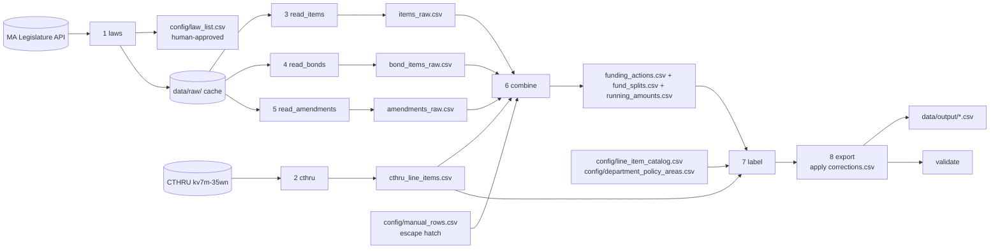

# Massachusetts Appropriations Dataset — Design Document

| | |
|---|---|
| **Status** | Draft v0.2 — CTHRU-first redesign; file formats not yet frozen (M0) |
| **Created** | 2026-10-21 (v0.1); revised 2026-10-28 (v0.2, see §20) |
| **Audience** | All 5 group members and any Claude session working in this repo |
| **Source of truth for** | Scope, architecture, file formats, allowed values, ownership, open questions |

> **How to use this document.** Read §1–§5 before touching code. Before changing a file format (§7) or allowed values (§9), propose the change, get group agreement, and log it in the Decision Log (§20). When a milestone or open question changes state, update the Status Board (§21) and Open Questions (§19) in the same commit. If code and this doc disagree, the doc wins until someone updates it deliberately. For a plain-language summary and the high-level tracker, see [`OVERVIEW.md`](OVERVIEW.md).

---

## Table of contents
1. [Purpose, scope, non-goals](#1-purpose-scope-non-goals)
2. [Glossary](#2-glossary)
3. [Sources](#3-sources)
4. [Seed law list](#4-seed-law-list)
5. [Core data model: the funding actions table](#5-core-data-model-the-funding-actions-table)
6. [Pipeline architecture](#6-pipeline-architecture)
7. [File formats](#7-file-formats)
8. [Mapping to the `exampledata.csv` columns](#8-mapping-to-the-exampledatacsv-columns)
9. [Allowed values](#9-allowed-values)
10. [Counting rules: net new appropriation authority](#10-counting-rules-net-new-appropriation-authority)
11. [Parsing details and known patterns](#11-parsing-details-and-known-patterns)
12. [Policy-area classification](#12-policy-area-classification)
13. [Validation suite](#13-validation-suite)
14. [Human review workflow](#14-human-review-workflow)
15. [Repo layout and engineering conventions](#15-repo-layout-and-engineering-conventions)
16. [Workstreams and ownership](#16-workstreams-and-ownership)
17. [Milestones and acceptance criteria](#17-milestones-and-acceptance-criteria)
18. [Risks and mitigations](#18-risks-and-mitigations)
19. [Open questions](#19-open-questions)
20. [Decision log](#20-decision-log)
21. [Status board](#21-status-board)

---

## 1. Purpose, scope, non-goals

### Goal
Produce a complete, auditable, line-item dataset of **every Massachusetts state appropriation enacted in calendar years 2021–2025**, in the column format of [`exampledata.csv`](../exampledata.csv), with each row classified into one policy area from [`policyareas.csv`](../policyareas.csv).

Just as important, build **a program that future cohorts can re-run each year** to add the next year's laws: one command, followed by a short and predictable review checklist ([`RUNBOOK.md`](RUNBOOK.md), to be written by workstream A). The 2021–2025 dataset is the first release, not the end product.

### Design principles (v0.2)
1. **Structured data first.** Take everything the Comptroller's CTHRU data provides. Read law text only for what CTHRU lacks (§3.4): which law made each supplemental change, bond laws, outside-section amendments, and item descriptions.
2. **Automate, don't hand-annotate.** Every routine kind of law is read by code. `config/manual_rows.csv` is an escape hatch for true one-offs, and validation counts its rows (target: zero).
3. **Carry human judgment forward.** Labels are recorded per line item (`config/line_item_catalog.csv`), not per row, so a decision made once applies in every later year.
4. **Nothing hard-coded to 2021–2025.** The scope window is a setting in `config/settings.toml`. A held-out test on 2026 laws (§17, M6) checks that the readers generalize.
5. **Simple over clever.** There is no LLM in the pipeline, few stages, and few files. Yearly human work is limited to genuine judgment calls: approving new laws, labeling new line items, and explaining CTHRU mismatches.

### In scope
- **Enactment window:** laws whose governor approval date (API field `ApprovedDate`) is **2021-01-01 through 2025-12-31**. Filter on approval date, **not** the Acts volume year. Two 2020-volume chapters (2020 ch. 358 and ch. 383) were approved in January 2021 and are in scope.
- **Law types:** General Appropriations Acts (GAAs), supplemental budgets, state-surplus spending acts, capital bond authorization acts, and interim ("1/12th") budgets. Appropriations in outside sections of other acts are included where found (e.g., an item rewritten inside a policy act).
- **Granularity:** one row per line item per legal action. Earmarks ("not less than $X shall be expended for…") stay inside the parent item's text and are not separate rows.
- **Federal money:** captured, but **flagged** at the source-fund level and excluded from the main totals (decided by the partner, Q1; Decision Log 2026-11-02). Only money from federal sources is flagged; state surplus counts as state money.
- **Appropriations only, not spending (decided, Q10).** The dataset records legal authority (appropriations), not what the state actually spent. Our partner set this scope at the proposal stage (Decision Log, 2026-11-01).

### Reference-only data (ingested, not exported)
Laws outside the window that are needed for computation:
- **FY2021 GAA** (2020 ch. 227, approved 2020-12-11). Used to compute "Previously funded?" for FY2022 items.
- **Same-fiscal-year laws outside the window.** CTHRU reports totals per fiscal year, so FY2021 supplementals enacted in 2020 and FY2026 supplementals enacted in 2026 must be loaded for reconciliation.
- **Target acts of amendments.** For example, 2019 ch. 5 is amended by 2021 ch. 35.

### Non-goals
- Earmark-level extraction.
- Actual spending or expenditures (appropriations only; Q10, decided).
- Governor's mid-year "9C" cuts and other executive actions that aren't laws.
- Budgets of municipalities, authorities (MBTA, Massport), or quasi-public agencies, except where a state appropriation funds them.
- Laws enacted outside 2021–2025, except as reference data.

---

## 2. Glossary

Use these terms consistently in code, comments, commit messages, and conversations.

| Term | Meaning |
|---|---|
| **GAA** | General Appropriations Act: the annual state budget for one fiscal year. Example: 2023 Acts ch. 28 is the FY2024 GAA. |
| **Fiscal year (FY)** | July 1 – June 30, named for the ending year. FY2024 = 2023-07-01 → 2024-06-30. |
| **Calendar year** | In this project, the year the law was approved, which defines scope. |
| **Session law / chapter** | An enacted law, cited as "{year} Acts, ch. {n}". |
| **Section 2 / 2A / 2B / 2D / 2E / 2F** | Appropriation sections of an act. In GAAs: **2** = appropriations; **2B** = Intragovernmental Service Fund (ISF) chargebacks; **2D** = General Federal Grants Fund; **2E** = transfers from the General Fund to named trust funds; **2F** = Education and Transportation Fund (Fair Share surtax, FY2024+). In supplementals: **2** usually supplements existing items, **2A** makes new items for unanticipated obligations. Bond acts use 2–2I for capital items. |
| **Line item / item** | An 8-digit account ID in `NNNN-NNNN` form (e.g., `0930-0100`). The first 4 digits roughly identify the department. CTHRU writes it without the dash (`09300100`). |
| **Outside section** | Any section other than the appropriation sections (e.g., SECTION 178). It may amend earlier acts, including changing item amounts. |
| **Supplemental budget** | An act adding to, cutting, or creating items for a fiscal year already under way. |
| **Closeout supplemental** | The final supplemental for a fiscal year, usually enacted months after June 30 (e.g., 2023 ch. 77 for FY2023, approved 2023-12-04). |
| **Interim ("1/12th") budget** | A stopgap lump-sum appropriation before the GAA passes. By law, spending under it "shall apply against" the GAA, so it isn't additional money. |
| **Fund split** | Lines under an item giving the share paid by each fund (e.g., `General Fund … 52.63%`). |
| **Retained revenue (RR) item** | An item allowing an agency to spend revenue it collects, up to a ceiling stated in the text ("may expend … not more than $X"). |
| **ISF chargeback** | One agency paying another for services. The same money is already in the buying agency's Section 2 item, so counting it again double counts. |
| **Prior appropriation continued (PAC)** | Unspent authority carried into a later fiscal year. Not new money. |
| **Reauthorization** | An amendment extending the availability date of existing authority. Not new money. |
| **Alteration of purpose** | An amendment changing what existing money may be spent on, without new money. |
| **Bond authorization** | Capital authority to borrow and spend over several years (bond bills). Not an annual operating appropriation. |
| **Veto / reduction / override** | The governor may veto or reduce individual items. The Legislature may override, restoring the amount. Overrides can happen weeks or months after signing. |
| **Earmark** | A minimum amount inside an item's text for a named purpose or recipient. Not a separate row. |
| **Law key** | Our internal law identifier: `{year}-{chapter}`, e.g. `2023-77`. |
| **Record ID** | A stable identifier for an export row (see §9.6). |

---

## 3. Sources

### 3.1 MA Legislature public API (primary source)
- **Swagger spec:** `https://malegislature.gov/api/swagger/v1/swagger.json`
- **`GET /api/SessionLaws/{year}`** returns **every chapter in a year** as JSON, with `Year`, `ChapterNumber`, `Type` (`Acts`/`Resolves`), `ApprovalType`, `Title`, `Status`, `ApprovedDate` (e.g., `"Feb 28 2025"`), `ChapterText` (full HTML), and `OriginBill` (`BillNumber`, `GeneralCourtNumber`, and a `Details` URL).
  - Discovery is cheap: there are about 1,160 Acts in 2021–2025. Pulling one call per year gives the whole corpus.
  - **Quirk:** in the year list, each record's `Year` is the **approval** year, not the Acts volume, and its type varies (string or int). For example, 2020 ch. 358 appears in `/SessionLaws/2020` with `Year: 2021`. Always take the volume year from the year requested.
- **`GET /api/SessionLaws/{year}/{chapter}`** returns one chapter.
- **`GET /api/GeneralCourts/{court}/Documents/{bill}`** returns bill metadata.
- **`.../Documents/{bill}/DocumentHistoryActions`** returns the bill's action history, including veto overrides.
- `ApprovalType` values seen for 2021–2025 Acts: `Executive approval (signed)` (1,142), `Passed over veto` (12), `State election` (4), `Reoganization plan approved` (1, sic), and null (2). Discovery must record this field. A whole act passed over veto has a different effective enactment date (see §19).
- **The bill search in `URLs.csv` is not needed.** The SessionLaws endpoint lists only enacted laws, which is exactly the set we need.

### 3.2 Session-law web pages
- `https://malegislature.gov/Laws/SessionLaws/Acts/{year}/Chapter{n}` is the human-readable page, with the same HTML as `ChapterText`. **This URL goes in the `Source URL` column.**
- `https://malegislature.gov/Budget/FY{yyyy}/FinalBudget` shows the final GAA for each fiscal year and links to the session law. It is useful for spot-checking vetoes and overrides.

### 3.3 Governor veto messages and override history
**Not used in v0.2.** Vetoes are found by comparing the law's printed amount with CTHRU (§11.4).
- Veto annotations in the act text reference the governor's message (e.g. "for message see House, No. 4055"). The pipeline reads the inline markup as a hint and doesn't fetch the messages.
- Override votes appear in the bill's `DocumentHistoryActions`. They aren't needed: vetoes and overrides are netted into each item's final amount (Q4, decided).

### 3.4 Comptroller CTHRU (primary source for annual budgets; check for everything else)
- Socrata dataset **`kv7m-35wn`** ("Budget_Actual_With_Other_Spending_Authorizationv3_Gen2", the production data behind CTHRU Budgets): `https://cthru.data.socrata.com/resource/kv7m-35wn.json`
- Useful fields: `fiscal_year` (e.g., `"2024.0"`), `appropriation_account_number` (8 digits, no dash), `appropriation_account_name`, `department_name`, `department_code`, `cabinet_secretariat_name`, `fund_number`, `fund_name`, `original_enacted_budget`, `supplemental_budget_appropriations`, `authorized_retained_revenue_ceiling`, `total_enacted_budget_appropriation`, `planned_saving_9c_cuts`.
- Spending-side fields, **not used** because the project covers appropriations only (Q10, decided): `total_expenses`, `unexpended_reverted`, `balance_forward_prior_appropriation_continued`, `transfer_in`, `transfer_out`, `retained_revenue_collected`. Related datasets: `uaqe-2tpk` (Non-Budgeted Special Revenue and Trusts) and `pegc-naaa` (Comptroller spending).
- **Quirks:**
  - There are **many rows per account per FY**, mostly zero rows under other departments. **Always aggregate** by FY × account and take the department with non-zero amounts.
  - Totals are **per fiscal year, not per law**.
  - The dataset has been re-versioned before ("v3_Gen2"). Save a dated snapshot on every pull, and keep all CTHRU-specific code in `cthru.py`, so a format change is a one-file fix.
- Example query:
  ```
  https://cthru.data.socrata.com/resource/kv7m-35wn.json?$select=fiscal_year,appropriation_account_number,sum(original_enacted_budget),sum(supplemental_budget_appropriations)&$group=fiscal_year,appropriation_account_number&$where=fiscal_year>='2022'
  ```

**What CTHRU covers (design probe, 2026-10-28, 8 requests):**

| Question | Finding | Consequence |
|---|---|---|
| Does `original_enacted_budget` reflect vetoes and overrides? | **Yes, in 4 of 5 FY2024 vetoed items checked.** 4000-0700 reduced and sustained: $3,601,016,357. 7061-0012 reduced: $498,972,361. 3000-1042 overridden: $35,000,000. 3000-5000: $17,500,000. **Exception:** 1231-1000 is printed at $10,000,000 after an override, but CTHRU shows $1,500,000. | GAA amounts come from CTHRU. Printed vs. CTHRU gives `veto_status`. Mismatches go to E's review (1231-1000 is the first). |
| Which GAA sections are present? | §2 and §2F (Education and Transportation Fund, $1.0B in FY2024) are present. **§2B ISF accounts appear with $0.** **§2D federal grants are absent.** | ISF is excluded from totals anyway. §2D needs law text if Q1 brings federal grants in. |
| Is supplemental money broken down by law? | **No.** No CTHRU budget dataset has a law or chapter column. | Supplementals are read from law text. CTHRU checks the per-FY sum. |
| Is there a capital (bond) dataset? | **No**, among 52 datasets. | Bond laws are read from law text. |
| History and freshness | FY2005 onward. FY2027 is already present. Updated daily. | "Previously funded?" is a lookup. New years appear automatically. |

Also verified: for FY2024, `23300100` shows original 9,310,231 + supplemental 350,000; `09300100` shows original 6,077,671. FY2024's total `original_enacted_budget` is $55,303,686,185.

### 3.5 Secondary cross-checks (manual use only)
- **MassBudget Budget Browser:** line-item history across years. Useful when items are renumbered and for "previously funded?" sanity checks.
- **Governor signing letters, House/Senate Ways and Means summaries, and A&F fact sheets:** law-level totals.

### 3.6 Politeness and terms
- Identify the scraper in its User-Agent (project name plus a contact email in config).
- Make at most about 1 request per second to malegislature.gov.
- Cache everything in `data/raw/` and never re-fetch unchanged content (see §15).

---

## 4. Seed law list

This is the candidate list produced during design research (2026-10-21) by scanning every 2020–2025 Act approved 2021-01-01 → 2025-12-31 for:
- appropriation-style titles,
- "hereby appropriated" language,
- line-item paragraphs ending in a dollar amount, and
- bond-issuance language.

**It is a seed, not the final law list.** Workstream A must re-run discovery as a full-text scan (§6, stage 1) and record an include/exclude decision with a reason for every candidate. The `items≈` column counts paragraphs starting with an item ID and ending in `$amount`. It is a rough lower bound: retained-revenue items and odd formats are missed.

| Law key | Approved | Proposed type | items≈ | Notes |
|---|---|---|---:|---|
| 2020-316 | 2021-01-11 | other | 1 | Hampshire Council of Governments. Likely a reference to an item, not an appropriation. **Probably exclude** after review. *(Decided 2026-11-04, Q7: in scope, as a supplemental.)* |
| 2020-358 | 2021-01-14 | bond | 27 | Economic development bond ("Enabling Partnerships for Growth"). 2020 volume, 2021 approval. |
| 2020-383 | 2021-01-15 | bond | 31 | Transportation bond (~$16.2B in items). 2020 volume, 2021 approval. |
| 2021-9 | 2021-04-01 | bond? | 1 | UI Trust Fund financing (special obligation bonds). **Decide include/exclude.** *(Decided 2026-11-04, Q7: in scope, as a bond law.)* |
| 2021-15 | 2021-05-25 | bond | 2 | Holyoke Soldiers' Home reconstruction ($600M). |
| 2021-23 | 2021-06-28 | interim | 0 | FY2022 interim. |
| 2021-24 | 2021-07-16 | gaa | 1,178 | **FY2022 GAA.** |
| 2021-25 | 2021-07-19 | bond | 1 | Chapter 90 municipal roads. |
| 2021-29 | 2021-07-29 | supplemental | 28 | FY2021 supplemental. |
| 2021-35 | 2021-08-03 | other | 1 | Policy act that **rewrites item 8100-1014 of 2019 ch. 5**. The delta needs the running amounts table. |
| 2021-76 | 2021-10-20 | supplemental | 100 | FY2021 closeout. Creates the Transitional Escrow Fund. |
| 2021-102 | 2021-12-13 | surplus (+federal) | 59 | ARPA (Federal COVID-19 Response Fund) **and** state surplus. Mixed funds; federal flag. |
| 2022-22 | 2022-02-12 | supplemental | 3 | FY2022. |
| 2022-42 | 2022-04-01 | supplemental | 28 | FY2022. |
| 2022-89 | 2022-06-17 | bond | 1 | Chapter 90. |
| 2022-98 | 2022-06-27 | interim | 0 | FY2023 interim. |
| 2022-103 | 2022-07-11 | supplemental | 1 | FY2022. |
| 2022-126 | 2022-07-28 | gaa | 1,224 | **FY2023 GAA.** |
| 2022-140 | 2022-08-04 | bond | 21 | General governmental infrastructure (~$5.2B). |
| 2022-175 | 2022-08-10 | bond | 3 | Judiciary IT. |
| 2022-176 | 2022-08-10 | bond | 19 | Transportation and climate (~$11.4B). |
| 2022-268 | 2022-11-10 | surplus (+federal) | 52 | Economic growth and relief: FY2022 closeout, surplus, and ARPA. Mixed funds. |
| 2023-2 | 2023-03-29 | supplemental | 22 | FY2023. |
| 2023-15 | 2023-06-26 | interim | 0 | FY2024 interim, $6,660,000,000. |
| 2023-24 | 2023-07-31 | interim | 0 | FY2024 second interim. |
| 2023-26 | 2023-07-31 | supplemental | 2 | FY2023. |
| 2023-27 | 2023-08-03 | bond | 2 | Chapter 90. |
| 2023-28 | 2023-08-09 | gaa | 1,412 | **FY2024 GAA.** Source of EX-001…EX-003. |
| 2023-77 | 2023-12-04 | supplemental | 83 | FY2023 closeout. **EX-004 is §178.** |
| 2024-88 | 2024-04-30 | supplemental | 2 | FY2024. |
| 2024-89 | 2024-05-03 | bond | 1 | Chapter 90. |
| 2024-122 | 2024-06-28 | interim | 0 | FY2025 interim, $6,925,000,000. |
| 2024-139 | 2024-07-29 | bond | 12 | IT bond (~$1.66B). |
| 2024-140 | 2024-07-29 | gaa | 1,167 | **FY2025 GAA.** Veto markup nearly absent (see §11.4). |
| 2024-150 | 2024-08-06 | bond | 16 | Affordable Homes Act (~$5.0B). |
| 2024-206 | 2024-09-16 | supplemental | 2 | FY2024. |
| 2024-238 | 2024-11-20 | bond | 35 | Mass Leads economic development (~$4.0B). |
| 2024-248 | 2024-12-04 | supplemental | 67 | FY2024 closeout. |
| 2025-1 | 2025-02-28 | supplemental | 1 | FY2025, Transitional Escrow Fund ($425M shelter item). |
| 2025-3 | 2025-05-15 | supplemental | 1 | FY2025. Short item title, amount ends with a period. |
| 2025-4 | 2025-05-29 | supplemental | 2 | FY2025. Same format as 2025-3. |
| 2025-7 | 2025-06-24 | supplemental | 28 | FY2025. |
| 2025-8 | 2025-06-30 | interim | 0 | FY2026 interim. |
| 2025-9 | 2025-07-04 | gaa | 1,340 | **FY2026 GAA.** |
| 2025-14 | 2025-08-05 | supplemental | 17 | FY2025. |
| 2025-17 | 2025-08-08 | bond | 4 | Chapter 90 (~$1.19B). |
| 2025-33 | 2025-09-22 | supplemental | 2 | FY2025. |
| 2025-73 | 2025-11-25 | supplemental | 56 | FY2025 closeout. |

**Reference-only seeds:**
- 2020-227 (FY2021 GAA).
- FY2021 supplementals approved in 2020. A title scan at M0 found none (2020 ch. 201 is the FY2020 closeout; ch. 101, 131 and 198 are FY2021 interims). Discover's full-text scan should confirm this.
- FY2026 supplementals approved in 2026: 2026-55 and 2026-101.
- Any act named as an amendment target, such as 2019-5.

---

## 5. Core data model: the funding actions table

### 5.1 Why one row per funding action
A law doesn't just create items. It also raises, cuts, re-purposes, extends, transfers, vetoes, and restores them, sometimes in other laws and sometimes in a later calendar year. Storing **one row per legal action (event)** handles all of these the same way:

- Every event has its own law, section, date, fiscal year, and signed amount.
- The `exampledata.csv` export is a **view** over the funding actions table, filtered to in-window events.
- Totals are sums over events flagged `counts_toward_total = true`.

### 5.2 Event types (`funding_action`)
The values (full list in §9.2) are: original appropriation, new supplemental item, supplemental increase, supplemental reduction, veto reduction, override restoration, reauthorization, alteration of purpose, transfer, interim appropriation, capital authorization, and prior appropriation continued. Under the Q4 decision, vetoes and overrides are netted into the item's amount (§5.7), so `VETO` and `OVR` are reserved and not emitted.

### 5.3 `amount_kind` and `counts_toward_total`
Each event carries:
- **`amount_kind`**: what the dollar figure means. One of `appropriation`, `retained_revenue_ceiling`, `bond_authorization`, `transfer`, `delta`, `prior_appropriation_continued`, `interim`, or `none` (e.g., a purpose change).
- **`counts_toward_total`** (true/false): whether it counts toward net new appropriation authority. Rules are in §10. Without this flag, totals will double count.

### 5.4 Fiscal year belongs to the event, not the law
- Take the FY from the appropriating section's text ("for the fiscal year ending June 30, 2024").
- **For amendments, take the FY of the act being amended.** EX-004 is in a law named "FY2023 Supplemental" but amends the FY2024 GAA, so its FY is **2024**.
- Multi-year items ("made available until June 30, 2027", "for the fiscal year in which the sums are disbursed") and bond items use the **FY containing the approval date**, set `fy_rule = enactment_fy`, and record `available_through`.

### 5.5 Running amounts
Keep the **current amount** of every `(target law, section, item)` after each event, in date order. This makes it possible to:
- compute deltas when an act replaces a whole item (2021 ch. 35) or inserts a new figure, and
- run the **struck-figure self-check**: when an amendment says it is "striking out the figure '$9,310,231'", the item's running amount must equal $9,310,231 (§13).

### 5.6 Fund attribution
Each event has zero or more fund splits (`fund_splits.csv`). The default fund is the one named in the section header (e.g., General Fund for GAA §2, General Federal Grants Fund for §2D, Education and Transportation Fund for §2F, Transitional Escrow Fund for 2025 ch. 1 §2A). Explicit split lines override the default. An item's own text can also name its fund. **The federal flag is computed from funds** (see §9.5).

### 5.7 Where amounts come from, and vetoes
- **GAA original appropriations** (`ORIG` in a GAA): the amount is CTHRU `original_enacted_budget` for that FY × item, which already reflects vetoes and overrides. These rows have `amount_source = cthru`. The law's printed amount goes in `amount_printed` (from `read_items`).
- **Everything else** (supplementals, amendments, bonds, interim) has `amount_source = law_text`. Escape-hatch rows have `manual`.
- **Vetoes are netted** (Q4, decided 2026-11-01). There's one row per item with its final amount. `veto_status` (§9.9) records `none`, `vetoed`, `reduced`, `partial_override`, `overridden`, `wording_vetoed` or `unknown`, and appears in the main export as "Veto status" (Q14, decided 2026-11-06). It's set by comparing `amount_printed` with CTHRU, with the inline veto markup as a hint. Unexplained differences are flagged `cthru_mismatch` and go to the review queue.
- Vetoes in bond laws (not in CTHRU) rely on inline markup only and are flagged `veto_unverified` when markup is present.

## 6. Pipeline architecture

Each stage reads and writes **versioned files**. Stages never call each other's internals, so people can work in parallel against samples. The one shared piece of code is `paragraphs.py`, which turns law HTML into paragraphs. Its output format (§7.2) is a contract, because three readers use it.



| # | Stage | Reads | Writes | Owner |
|---|---|---|---|---|
| 1 | `laws` | API year lists, law list | `config/law_list.csv` (new candidates as `tbd`), `data/raw/sessionlaws/{year}/{ch}.json`, `data/raw/manifest.csv` | A |
| 2 | `cthru` | CTHRU | `data/raw/cthru/{date}/…` (snapshot), `data/interim/cthru_line_items.csv` | E |
| 3 | `read_items` | raw supplemental and GAA laws | `data/interim/items_raw.csv`, `reports/unread_paragraphs.csv` | B |
| 4 | `read_bonds` | raw bond laws (incl. Chapter 90) | `data/interim/bond_items_raw.csv`, `reports/unread_paragraphs_bonds.csv` | A |
| 5 | `read_amendments` | raw laws | `data/interim/amendments_raw.csv`, `reports/unread_sections.csv` | C |
| 6 | `combine` | everything above, law list, `manual_rows.csv` | `data/interim/funding_actions.csv`, `fund_splits.csv`, `running_amounts.csv` | everyone (E coordinates; C owns the running amounts table; E owns the CTHRU comparison) |
| 7 | `label` | funding actions, `cthru_line_items.csv`, catalog, department table | `data/interim/labels.csv` | D |
| 8 | `export` | funding actions, labels, `review/corrections.csv` | `data/output/ma_appropriations_cy2021_2025.csv`, `…_extended.csv`, `data/output/ma_capital_authorizations_cy2021_2025.csv` (bond laws, Q5), `data_dictionary.md`, `review/review_queue.csv` | everyone (E coordinates) |
| — | `validate` | everything | `reports/validation/*.csv`, `reports/law_status.csv` | E |

### Stage notes
1. **laws.** Pull `/SessionLaws/{year}` for the configured years (`[scope] discover_years`) and **scan full text, not just titles**. Flag an Act not yet on the law list as a candidate if it has any of (tightened 2026-11-07, see the Decision Log):
   - a line-item paragraph (an item ID at the start, a dollar amount at the end),
   - "hereby appropriated",
   - an amendment of a line item ("item NNNN-NNNN … is hereby amended", in either order),
   - borrowing language ("issue and sell … bonds" or "notes"),
   - an appropriation-style title ("making appropriations", "appropriations for", "supplementing", "financing the …").

   Laws approved outside the window are flagged too, with a note, because they may be needed as reference-only laws.

   New candidates are appended with `role = tbd`, and existing human decisions are never overwritten. The stage also adds reference-only laws: same-FY laws outside the window, and amendment targets found by `read_amendments`. It then downloads each listed law's JSON and stores the SHA-256 and fetch time in `manifest.csv`, skipping unchanged files and throttling requests. **This stage is what a future cohort runs first each year.**
2. **cthru.** One aggregated query per FY (FY2005 onward for history), saved as a dated snapshot. It writes one row per FY × account (§7.5). This is the source of every GAA original appropriation and of agency names.
3. **read_items.** Uses the item state machine (§11.2).
   - **Supplementals:** full items with amounts, fund splits and headers.
   - **GAAs:** item text, printed amount, struck amount and inline veto markup only. A missed GAA item costs only a blank description (the amount comes from CTHRU) and is reported.
4. **read_bonds.** The same state machine, applied to capital sections (§2–§2I) of bond laws and Chapter 90 bills. It shares `items_raw` columns.
5. **read_amendments.** Grammar for outside sections (§11.3), including **direct appropriations**. Interim budgets are read here, not typed by hand.
6. **combine.** Builds GAA `ORIG` rows from `cthru_line_items.csv` (each FY has exactly one GAA in the law list). It adds rows from the readers, assigns Record IDs (§9.6), computes `counts_toward_total`, fiscal year and fund splits, maintains the running amounts table, and sets `veto_status` from the CTHRU comparison.
7. **label.** Agency/office from CTHRU, Program/purpose by rule, policy area from the catalog or department table (§12), and the three yes/no-style columns (§8).
8. **export.** Applies human corrections (§14) and writes the exact `exampledata.csv` columns and order, plus an extended file, a data dictionary, and the review queue.

## 7. File formats

> **Draft v0.2. Freeze these at Milestone M0 (§17).** After freezing, change them only through the Decision Log. All CSVs are UTF-8 with a header row, comma-delimited, and quoted per RFC 4180. Money is an **integer number of dollars** (no commas, no `$`) in interim files. Dates are ISO `YYYY-MM-DD` in interim files; the export reformats them to match `exampledata.csv`. Booleans are `true`/`false`, lists are `;`-separated, and an empty cell is null. The code copy of these formats is `src/ma_approps/schemas.py`.

### 7.1 `config/law_list.csv` (human-curated)
| column | type | notes |
|---|---|---|
| `law_key` | str | `2023-77` |
| `acts_year` | int | volume year (2020 for 2020-383) |
| `chapter` | str | |
| `approved_date` | date | from `ApprovedDate` |
| `approval_type` | str | from API |
| `api_title` | str | full formal title |
| `law_name` | str | **curated** short name, e.g. `FY2024 General Appropriations Act`, `FY2023 Supplemental Appropriations Act (December 2023)` |
| `law_type` | enum | §9.1 |
| `role` | enum | `in_scope`, `reference_only`, `excluded`, `tbd` (a discovered candidate awaiting a human decision) |
| `include_reason` | str | why it is included, excluded, or reference-only |
| `primary_fy` | int | FY stated in the title or appropriation section, if any |
| `origin_bill` | str | `{court}/{bill}`, e.g. `194/H58`, matching the API path `/GeneralCourts/{court}/Documents/{bill}` |
| `parse_strategy` | enum | `auto`, `manual`, `auto+manual` (`manual` is the escape hatch) |
| `notes` | str | |

### 7.2 `paragraphs.paragraphs()` output (in memory; optionally `data/interim/paragraphs/{law_key}.jsonl`)
One object per paragraph: `law_key`, `para_idx`, `text` (normalized), `raw_html`, `classes` (list), `struck` (list of struck substrings), `bold` (list), `links` (list of hrefs). Owned by B; used by B, A and C.

### 7.3 `data/interim/items_raw.csv` and `bond_items_raw.csv`
The same columns for both. `read_items` (B) writes `items_raw.csv` for supplementals and GAAs; `read_bonds` (A) writes `bond_items_raw.csv`.
| column | notes |
|---|---|
| `law_key`, `section` | e.g. `2023-28`, `2` |
| `section_fund_default` | fund named in the section preamble |
| `fy_stated` | FY from the section preamble |
| `para_start`, `para_end` | paragraph span |
| `line_item` | `NNNN-NNNN` |
| `secretariat_header_raw`, `agency_header_raw` | nearest headers as printed |
| `item_text` | full description, including provisos; final wording only, struck words left out (§11.2) |
| `amount` | final printed amount (int). Null for RR items with no trailing amount. For GAAs this becomes the funding action's `amount_printed`. |
| `amount_struck` | struck-through original amount, if any |
| `retained_revenue_ceiling` | retained-revenue ceiling parsed from the text, if any |
| `fund_splits_raw` | e.g. `General Fund:52.63;High-Quality Early Education & Care Affordability Fund:47.37` |
| `veto_annotation_raw` | annotation text as printed (a hint for `veto_status`) |
| `veto_kind_inline` | `none`, `disapproved`, `reduced`, `reduced_and_wording`, `overridden` |
| `reader_version` | semver of the reader |
| `confidence` | `high`, `medium`, `low` |

### 7.4 `data/interim/amendments_raw.csv`
| column | notes |
|---|---|
| `law_key`, `section` | the amending law and outside section (e.g. `2023-77`, `178`) |
| `action_type` | `figure_change`, `item_insert`, `item_strike`, `item_replace`, `text_insert`, `text_strike`, `date_extend`, `purpose_change`, `transfer`, `direct_appropriation` |
| `target_law_key`, `target_section`, `target_item` | e.g. `2023-28`, `2`, `2330-0100`. "Said …" references resolved. |
| `old_figure`, `new_figure` | ints, where applicable |
| `old_date`, `new_date` | for `date_extend` |
| `amount` | for `direct_appropriation` (including interim budgets) or `transfer` |
| `from_item`, `to_item` | for `transfer` |
| `fund_raw` | fund named, if any |
| `source_text` | verbatim section text |
| `reader_version`, `confidence` | |

### 7.5 `data/interim/cthru_line_items.csv`
One row per fiscal year × account, aggregated across CTHRU's per-department rows: `fiscal_year`, `line_item` (`NNNN-NNNN`), `account_name`, `department_code`, `department_name`, `secretariat`, `fund_numbers` (`;`-separated), `original_enacted`, `supplemental`, `retained_revenue_ceiling`, `total_enacted` (ints). Owned by E.

### 7.6 `config/manual_rows.csv` (escape hatch)
The same columns as `funding_actions.csv` (§7.7), except `record_id`, which combine generates. Adds `source_quote` (verbatim text), `entered_by`, `entered_on`. **Use only for a true one-off law no reader handles.** Validation reports the count (target zero), and the runbook asks whether a reader should be extended instead.

### 7.7 `data/interim/funding_actions.csv` (canonical)
| column | notes |
|---|---|
| `record_id` | §9.6 |
| `law_key`, `section`, `line_item` | `line_item` may be empty for lump sums |
| `target_law_key` | the law whose item is affected (equals `law_key` for original items) |
| `event_date` | approval date |
| `calendar_year` | year of `event_date` |
| `fiscal_year`, `fy_rule` | `stated`, `target_act`, `enactment_fy` |
| `available_through` | date or empty |
| `section_type` | §9.4 |
| `funding_action` | §9.2 |
| `amount_kind` | §9.3 |
| `amount` | signed int (reductions negative) |
| `amount_source` | `cthru`, `law_text`, `manual` (§5.7) |
| `amount_printed` | for GAA rows: the law's printed amount, for comparison |
| `veto_status` | §9.9 |
| `counts_toward_total` | bool (§10) |
| `fund_primary` | fund with the largest share |
| `federal_share` | 0–1, computed from fund splits |
| `flags` | `;`-separated (§9.5) |
| `agency_header_raw` | |
| `item_text` | |
| `source_url` | |
| `source_para_start` | for traceability |
| `reader_version` | |

### 7.8 Side tables
- **`fund_splits.csv`**: `record_id`, `fund_name`, `fund_number` (if known), `share`, `is_federal`.
- **`running_amounts.csv`**: `target_law_key`, `section`, `line_item`, `as_of_event` (`record_id`), `amount_after`. Owned by C.

### 7.9 `data/interim/labels.csv`
`record_id`, `agency_office`, `program_purpose`, `program_purpose_method` (`rule`, `human`), `policy_area`, `policy_area_method` (`catalog`, `department`, `human`), `previously_funded` (`Yes`, `No`, `Unknown`), `one_time_or_recurring`, `new_or_reapprop`. An empty `policy_area` means the row is waiting in the review queue.

### 7.10 Label tables (human-curated, committed; owned by D)
- **`config/line_item_catalog.csv`**: `line_item`, `policy_area` (§9.8), `label_every_year` (bool; `true` for catch-all items such as 1599-xxxx reserves, which always go to review), `decided_by`, `decided_on`, `note`. There's one row per line item, and it carries over between years. Rows generated from the department table have `decided_by = department list (automatic)`; a person who checks one replaces it with their name.
- **`config/department_policy_areas.csv`**: `department_code`, `department_name`, `policy_area` (empty when mixed), `mixed` (bool), `decided_by`, `decided_on`, `note`. The rule for items not yet in the catalog.

### 7.11 `review/corrections.csv` (human-edited, committed)
`record_id`, `field` (an export or description column name), `new_value`, `expected_old_value`, `reviewer`, `review_date`, `note`. Use it for one-row fixes only. Labels that should apply in every year go in the catalog (§7.10).

### 7.12 `review/review_queue.csv` (generated; do not edit)
`record_id`, `reason` (e.g. `new_line_item`, `mixed_department`, `label_every_year`, `cthru_mismatch`, `catalog_drift`, `unread_neighbor`, `federal_mixed`), `priority`, and context columns.

### 7.13 Export
`data/output/ma_appropriations_cy2021_2025.csv` uses the 19 columns of `exampledata.csv`, in the same order, plus **"Veto status"** right after "Appropriation/change ($)" (§8; Q14, decided 2026-11-06). The amount before a veto (`amount_printed`) stays in the extended file only. `…_extended.csv` adds every funding-actions column.

**Bond laws go in a separate capital file, not the main export (Q5, decided).** Rows with `funding_action = CAP` are written to `data/output/ma_capital_authorizations_cy2021_2025.csv`. **Its columns (Q16, decided 2026-11-06)** are the main export's columns plus 11 more (`schemas.CAPITAL_EXPORT_COLUMNS`), each repeating the details of the borrowing limit that covers the item (§7.16): Borrowing limit section; Borrowing limit ($); Total of items under this limit ($); Identified federal share ($); Federal split; Limit difference note; Bond name; Maximum term (years); Final payable date; Fund paying the bonds; Spending authority through. The item's own amount (its full project amount) is "Appropriation/change ($)". Pocket-vetoed items are left out (vetoes are netted). Every item covered by a limit with a difference gets a Limit difference note naming the limit and the gap, e.g. "covered by §4: items exceed the borrowing limit by $400,000,000" (Q11).

### 7.14 `config/funds.csv` (human-curated)
`fund_name`, `fund_number`, `is_federal` (bool), `notes`. Drives the federal flag (§9.5).

### 7.15 `data/raw/manifest.csv` (written by `laws`)
One row per cached file, sorted by `path`: `path` (relative to `data/raw/`, `/`-separated), `source_url`, `sha256`, `bytes` (int), `fetched_at` (UTC, `YYYY-MM-DDTHH:MM:SSZ`). A row changes only when its file's content changes. Cached law files:
- `sessionlaws/_lists/{acts_year}.json`: the whole `/SessionLaws/{year}` response (also what discovery will scan)
- `sessionlaws/{acts_year}/{chapter}.json`: one Acts chapter split out of it (Resolves are numbered separately and skipped)

JSON is written with sorted keys and a one-space indent, the same as `tests/samples/`. The cache comes first: an existing file is never re-downloaded; delete it to refresh.

### 7.16 `data/interim/bond_authorizations_raw.csv` (written by `read_bonds`)
One row per borrowing-limit section (Q11, Q12, Q17, decided 2026-11-06). Numbered 7.16 because PR #3 adds §7.15.

| column | notes |
|---|---|
| `law_key`, `section` | the borrowing-limit section, e.g. `2024-139`, `4` |
| `covers_sections` | `;`-separated capital sections it pays for, e.g. `2A;2B` |
| `covers_items` | `;`-separated line items, only when the limit names items rather than whole sections (2021-15 §6: `4000-2026`) |
| `authorized` | the borrowing limit ($) |
| `items_total` | total of the items it covers ($): the full project amount |
| `federal_share` | identified federal share ($), when `federal_split = identified` |
| `federal_split` | `identified` (the law says the items depend on federal funds, so the limit is the state share: `federal_share` = `items_total` − `authorized`); `unknown` (the items exceed the limit but the law doesn't support calling the limit the state share); `none` (items equal the limit) |
| `bond_name` | as printed on the bonds |
| `max_term_years` | maximum term |
| `payable_by` | final payable date |
| `paying_fund` | the fund that pays interest and principal (the General Fund, or a special obligation bond's fund) |
| `available_through` | how long spending authority lasts (from §1, e.g. "made available through December 31, 2030"), or empty |
| `reader_version`, `confidence` | as in §7.3 |

Only what the laws say is collected: no bond sale data (actual maturities, interest rates) and no spending (Q17; Q10 stands).

## 8. Mapping to the `exampledata.csv` columns

| # | Column | Derivation | Stage |
|---|---|---|---|
| 1 | Record ID | `record_id` (§9.6). The example uses `EX-001`; our IDs are stable keys. | combine |
| 2 | Law citation | `"{acts_year} Acts, ch. {chapter}"`, e.g. `2023 Acts, ch. 28` | combine |
| 3 | Law name | law list `law_name` (curated) | law list |
| 4 | Enactment date | `event_date` as `MM/DD/YYYY` (e.g. `08/09/2023`) | export |
| 5 | Calendar year | year of `event_date` | combine |
| 6 | Fiscal year | `fiscal_year` (§5.4) | combine |
| 7 | Section | section of the **enacting** law: `2`, `2A`, `178` | extract |
| 8 | Line item | `NNNN-NNNN`; blank for lump sums | extract |
| 9 | Agency / office | **The most specific administering office**, taken from CTHRU for that FY (so reorganizations are handled automatically). Order: CTHRU account name or item text naming a division (e.g., "division of marine fisheries"), then the CTHRU department. The printed header is the fallback for items not in CTHRU (bonds). *Example:* item 2330-0100 sits under the header "Department of Fish and Game." but the example expects **"Division of Marine Fisheries"**. Check this against CTHRU's account name early. | label |
| 10 | Program / purpose | Short summary of the item's purpose. **Rule only:** the first clause of the item text with boilerplate removed ("For the operation of…"); CTHRU account name when no text was read. Humans may override individual rows. | label |
| 11 | Policy area | one value from `policyareas.csv`, from the catalog or department table (§12) | label |
| 12 | Funding action | display label of `funding_action` (§9.2) | combine |
| 13 | Appropriation/change ($) | `amount`, formatted with thousands separators (e.g. `6,077,671`). Negative for reductions. | export |
| 13a | Veto status | `veto_status` (§9.9). Not in `exampledata.csv`; added after the amount (Q14, decided 2026-11-06). | combine |
| 14 | Previously funded? | **Prior fiscal year only** (Q3, partner, 2026-11-01): `Yes` if the same line item has non-zero enacted authority in the **immediately preceding fiscal year** (FY−1) in CTHRU or the funding actions table; `No` if it had none in FY−1, even if it was funded in some earlier year. `Unknown` only when the fact can't be established, e.g. the item number is new but the text suggests a renumbered program (Q3, partner, 2026-11-06). **EX-001:** its item 0930-0100 was funded in FY2023, the year before (CTHRU shows $4,400,000), so the answer is `Yes`; the example's `Unknown` was a placeholder (Q3, 2026-11-06). | label |
| 15 | One-time or recurring funding | **Recurring = funded in at least 2 consecutive budgets** (Q3, partner, 2026-11-02): `Recurring` if the line item has non-zero enacted GAA authority in the row's fiscal year **and** in the year before **or** the year after; otherwise `One-time`. So a program's first year is recurring when the next budget funds it again. The newest year's labels can change when the next GAA passes, so a re-run updates them. **Still interim** (Q3 open): supplemental, surplus and bond events → `One-time`. | label |
| 16 | New funding appropriation or re-appropriation of existing funding? | From `amount_kind`/`funding_action`: appropriation, delta, or bond → `New`; PAC or reauthorization → `Re-appropriation`; transfer or alteration of purpose → `Transfer of existing authority`. Default `Pending` until validated. | label |
| 17 | Human review status | `Human reviewed` if a correction exists for the record or its policy area came from a human decision (a catalog row decided by a person, not one marked `department list (automatic)`, or the `human` method); otherwise `Not human reviewed` (§9.7) | export |
| 18 | Source URL | `https://malegislature.gov/Laws/SessionLaws/Acts/{acts_year}/Chapter{chapter}` | combine |
| 19 | Source or calculation for total | **Law-level** validation note from `reports/law_status.csv`, repeated on each row of the law. Example: `Total checked: 1,412 items, net new $X; matches CTHRU FY2024 original_enacted within $0. Excludes ISF (2B), interim, reauthorizations; federal flagged.` Until validated: the example's text, beginning `Total not yet checked.` | validate → export |

**Placeholder answers** (partner, 2026-11-06): `Unknown` means the fact has not been established; `Not classified` means a category has not been assigned; `Pending` means a review or counting decision remains open. Use them only when there truly isn't enough information or a decision is still open. Columns 15 and 16 keep their interim defaults while the rest of Q3 is open.

---

## 9. Allowed values

### 9.1 `law_type`
`gaa`, `supplemental`, `surplus`, `bond`, `interim`, `other`. If a law is mixed (e.g., 2022-268), use its dominant type and set per-row flags.

### 9.2 `funding_action` (code → export label)
| code | export label | typical amount_kind | counts toward total? |
|---|---|---|---|
| `ORIG` | Original appropriation | appropriation / retained_revenue_ceiling | yes (§10 caveats) |
| `NEW` | Supplemental appropriation | appropriation | yes |
| `INC` | Supplemental increase | delta (+) | yes |
| `RED` | Supplemental reduction | delta (−) | yes (negative) |
| `VETO` | Veto reduction | delta (−) | yes (negative). *Reserved: not emitted, because vetoes are netted (Q4, §5.7).* |
| `OVR` | Veto override restoration | delta (+) | yes. *Reserved, as above.* |
| `INT` | Interim appropriation | interim | **no** |
| `CAP` | Capital authorization | bond_authorization | **no** (separate capital total and separate capital file, Q5) |
| `REAUTH` | Reauthorization | none / prior_appropriation_continued | **no** |
| `PAC` | Prior appropriation continued | prior_appropriation_continued | **no** |
| `PURP` | Alteration of purpose | none | **no** |
| `XFER` | Transfer | transfer | **no** (see §10) |

The labels `Original appropriation` and `Supplemental increase` match the examples. The other labels need partner sign-off (§19).

### 9.3 `amount_kind`
`appropriation`, `retained_revenue_ceiling`, `bond_authorization`, `transfer`, `delta`, `prior_appropriation_continued`, `interim`, `none`.

### 9.4 `section_type`
`approp_main` (GAA §2, supplemental §2), `approp_new` (supplemental §2A), `isf` (§2B), `federal_grants` (§2D), `trust_transfer` (§2E), `surtax` (§2F), `capital` (bond §2–§2I), `outside` (outside section), `interim`.

### 9.5 `flags` (`;`-separated)
`federal` (federal_share > 0), `federal_mixed` (0 < share < 1), `isf_chargeback`, `trust_transfer`, `fund_transfer_chain` (money moved into a fund that another event spends from), `arpa_reallocation`, `multi_year`, `retained_revenue`, `veto_unverified`, `cthru_mismatch`, `manual_row`, `low_confidence_parse`.

**Federal funds** (`is_federal = true` in `config/funds.csv`, curated): General Federal Grants Fund, Federal COVID-19 Response Fund (ARPA), Coronavirus Relief Fund, and trust funds filled with ARPA money (Broadband Innovation Fund, Behavioral Health Trust Fund). State surplus funds such as the Transitional Escrow Fund are **not** federal. General Fund items that are later federally reimbursed (e.g., MassHealth) are **not** federal under this rule (Q1, decided 2026-11-02).

### 9.6 Record ID
Format: `{acts_year}-{chapter:03d}-S{section}-{line_item|NOITEM}-{funding_action}-{ordinal}`

Examples:
- `2023-028-S2-0930-0100-ORIG-1`
- `2023-077-S178-2330-0100-INC-1`
- `2023-015-S1-NOITEM-INT-1`

The ordinal counts duplicates of the same prefix in source order. IDs must be deterministic: re-running on the same raw inputs gives the same IDs.

### 9.7 Human review status
`Not human reviewed` (default), `Human reviewed`. (v0.1's `Review stale` was dropped in v0.2: enacted laws don't change text, and labels live in the catalog.)

### 9.8 Policy areas
Exactly the 18 values in `policyareas.csv`:
1. Education
2. Health and public health
3. Children and families
4. Human services and income support
5. Housing and homelessness
6. Economic development and workforce
7. Transportation
8. Environment and natural resources
9. Public safety and corrections
10. Courts and legal services
11. Veterans’ services
12. Arts, culture, and recreation
13. Government administration and oversight
14. General local aid
15. Public employee pensions and benefits
16. Debt service, reserves, and statewide finance
17. Multiple
18. Unclassified/other

Note: `Veterans’ services` uses a typographic apostrophe in the file. Match it exactly.

### 9.9 `veto_status` and `amount_source`
- `veto_status`: `none`, `vetoed`, `reduced`, `partial_override` (the governor reduced the item and the Legislature restored only part of the cut; Q13), `overridden`, `wording_vetoed` (wording struck, amount unchanged), `unknown` (§5.7; the two new values decided 2026-11-06).
- `amount_source`: `cthru`, `law_text`, `manual`.

---

## 10. Counting rules: net new appropriation authority

The **operating total** for a law (or fiscal year) is the sum of `amount` over events with `counts_toward_total = true`, excluding `federal`-flagged shares by default.

| Event / section | Counted? | Why |
|---|---|---|
| GAA §2, §2F items; supplemental §2/§2A new items and increases | yes | new authority |
| Reductions, veto reductions (negative), override restorations | yes | net effect |
| Retained-revenue ceilings (fee-based items) | yes, flagged `retained_revenue` (Q2, decided) | CTHRU tracks these separately; reconcile against `authorized_retained_revenue_ceiling` |
| §2B ISF chargebacks | **no** | duplicates §2 spending |
| §2D federal grants and federal fund shares | **no by default**, kept and flagged | pending the State Auditor decision |
| §2E transfers to trust funds | **no** for the transfer in, flagged `trust_transfer`; count the **appropriation out** of the trust instead (Q2, decided) | the same money would otherwise be counted twice. For trusts that spend without a further appropriation, see Q15 |
| Transfers into reserve or escrow funds (e.g., Transitional Escrow Fund) that later acts appropriate from | count the **appropriation out**, not the transfer in, flagged `fund_transfer_chain` (Q2, decided) | avoids double counting surplus money |
| Interim budgets | **no** | by statute they apply against the GAA |
| PAC, reauthorizations, alteration of purpose, item-to-item transfers, ARPA reallocations | **no** | not new money |
| Bond authorizations | **separate capital total**, never summed with operating; exported in the separate capital file (§7.13, Q5). The capital total is the items' total **minus any identified federal share**, which is kept and flagged; where the split is `unknown`, the full amount stays in, flagged (2026-11-06, amends Q11). A later law that restates an earlier bond item counts **only a change in amount** (2024-150 §60 restates 1993 item 4000-8200 at the same $50,000,000: $0). Pocket-vetoed items count $0 and are left out of the capital file | multi-year borrowing authority |

---

## 11. Parsing details and known patterns

### 11.1 Normalization (`paragraphs.py`, shared)
- Unicode NFKC. Convert `&nbsp;`/U+00A0 to a space, U+2011/U+2010/en dash inside item IDs to `-`, and smart quotes to plain quotes **only in matching keys** (keep the original text for display).
- Join text split across `<span>`s before matching. IDs and `$` amounts are sometimes split.
- Keep **strike-through** (`style="text-decoration: line-through;"`) and **bold** spans as attributes. They carry veto meaning.
- Treat `</p>` and `<br>` as paragraph boundaries. Keep the original HTML for debugging.
- Don't rely on CSS classes. `HWMLineItem`, `HWMAgency`, and `HWMSecretariat` exist in the FY2021 HTML but not reliably in later years.

### 11.2 Item extraction state machine (`read_items`, `read_bonds`)
One state machine, used in three modes: **supplementals** (full items), **GAAs** (description, printed amount and veto markup only; amounts come from CTHRU) and **bonds** (capital sections §2–§2I and Chapter 90 bills; `amount_kind = bond_authorization`). Bond formatting was checked on the two bond samples on 2026-10-29 (see **Bond laws** below).

States: `PREAMBLE → SECTION_HEADER → (SECRETARIAT_HEADER | AGENCY_HEADER | ITEM | FUND_SPLIT | VETO_NOTE)* → next SECTION`.

- **Section start:** a paragraph matching `^SECTION\s+(2[A-Z]{0,4}(\.[IVX]+)?)\.` (2, 2A, 2CI, "2C.I"), or a paragraph that is **only** the heading, in any case and with or without the period ("Section 2" in 2021-24, "SECTION 2" in 2024-140; issue #12). The section is recorded without inner periods (`2CI`). The **first outside section** (§3 or higher) ends the budget part, so statute text quoted later ("Section 2PPP.") is ignored. Capture the preamble's fund and fiscal year; a section without its own takes §1's, except §2C sections (prior appropriations continued), whose default fund is left blank. A section with no items (e.g. 2021-35's policy "SECTION 2.") is ignored.
- **Headers:** short paragraphs (120 characters or fewer, 150 for ALL CAPS) that don't start with an item ID or contain `$`. ALL-CAPS headers are usually secretariats or independent offices; Title-case ones are usually agencies. Keep both raw: they are the **nearest headers as printed**, and the laws aren't consistent (FY2024 prints "Judiciary." and "State ethics commission.", and independent offices sit among a secretariat's agencies), so agency names come from CTHRU (§12).
- **Item start:** an item ID **at the start of a paragraph**, optionally preceded by a veto note in the same paragraph. IDs inside provisos ("from item 1599-0026") are **not** item starts. No space is required after the ID (2024-140 prints `4125-0122vFor`). IDs with a missing digit (`911-1003` in 2024-140, `340-1000` in 2020-227, `4190-010` in 2025-9) are left for the unread report.
- **Item end:** the paragraph whose text ends with the **trailing amount after a dotted leader**: `\.{2,}\s*(?:\$[\d,]+\s*)?\$([\d,]+)\.?\s*$` (`paragraphs.TRAILING_AMOUNT_RE`, shared with `read_amendments`). The amount may be several paragraphs after the start. Earmark amounts earlier in the text must be ignored, so always take the trailing one. A trailing period (`$240,000,000.`, 2025 ch. 3) is allowed. Also accepted: no dotted leader (the normal layout of the FY2021 and FY2022 GAAs), and, at `confidence = medium`, printed typos: `$186.409,929`, `3,369,875`, `.$4,100,000`, `$$515,000`, `$ 2,629`, `$4,371,777.42`. A replacement amount printed on its own line under a struck amount belongs to the item above (2025-9, 1595-6368).
- **Struck amounts:** if the trailing region contains a struck amount followed by a plain amount (`<s>$49,279,108</s> $48,420,108`), set `amount_struck` = the first and `amount` = the second.
- **Struck wording:** where the governor struck wording and substituted new wording (2210-0106 in FY2024), `item_text` keeps **only the final wording**. `veto_kind_inline = reduced_and_wording` records that the wording changed (group decision 2026-11-01). Wording struck with the amount unchanged is `wording_vetoed` (2026-11-06).
- **Retained revenue:** if the text contains `may expend … not more than $X` and there is no trailing amount, set `retained_revenue_ceiling` and leave `amount` null. `amount_kind` = `retained_revenue_ceiling`.
- **Fund splits:** paragraphs like `General Fund…… 52.63%`, possibly several per paragraph separated by `<br>`. Attach them to the preceding item. Variants seen: no dotted leader (`Marijuana Regulation Fund 100%`), a fund name wrapped onto two lines, a split on the same line as the amount, and a missing `%` (`General Fund …… 80.32`, 2024-140). In all 31 law-list GAAs and supplementals, every item's splits add up to 100%.
- **Unread:** any paragraph in an appropriation section that isn't consumed goes to `reports/unread_paragraphs.csv` (or `…_bonds.csv`). This file must be empty, or explained, before a law can be marked done.

**Bond laws** (checked 2026-10-29 on samples 2024-139 and 2025-17, using `paragraphs.py` from PR #6). Expected output is in `tests/samples/expected/bond_items.csv` and `bond_authorizations.csv`.
- **The state machine works unchanged for the items.** Every item is one paragraph that starts with its ID and ends with a dotted leader and amount. Headers follow the ALL-CAPS secretariat / Title-case agency pattern. Earmarks inside the text ("not less than $300,000 …") are skipped by the trailing-amount rule. Spacing before the `$` varies, which the end pattern already allows. The samples have no fund splits, veto markup or retained revenue. All 16 items in the two samples are found, and no capital-section paragraph is left unread.
- **Capital sections may start at §2A.** 2024-139 has no §2. They end at the first `SECTION 3.` or higher.
- **No preamble per section.** `SECTION 1` introduces all the capital sections at once. It names no fund and no fiscal year, so `section_fund_default` and `fy_stated` stay empty and the fiscal year comes from the enactment date (§5.4, `fy_rule = enactment_fy`). It may give an availability date ("made available through December 31, 2030", 2024-139), which becomes `available_through`.
- **Borrowing limits come after the items**, one section each: "the state treasurer shall … issue and sell bonds … not exceeding, in the aggregate, $X". Each names the capital sections it covers, which may be more than one (2024-139 §4 covers §2A and §2B). It also gives the bond's name, its maximum term, its final payment date and the fund that pays it. `read_bonds` writes them to `bond_authorizations_raw.csv` (§7.16; Q11, Q12, Q17, decided 2026-11-06).
- **Items don't always add up to the borrowing limit.** In 2024-139, the §2A and §2B items total $1,455,000,000, but §4 allows borrowing of only $1,055,000,000. The item text doesn't explain the $400,000,000 gap, but §3 does (see the survey below). Check 7 must still report differences for review rather than treat them as reader errors. **Decided (Q11, partner, 2026-11-01):** a law's capital total is the sum of its items, any difference from its borrowing limits is flagged, and the borrowing limits are recorded too.

**Survey of every law with capital sections** (2026-11-04: the 15 bond laws plus supplemental 2023-2; 191 capital items). Findings marked ✓ were hand-checked by Emma against the official text.
- **Every item is one paragraph** that starts with its line item number and ends with its amount, so the item rules above still apply, with two adjustments:
  - **The amount may have no dotted leader** ("…applies $4,400,000,000"; 2020-383, 2022-176, 2023-2, 2024-150). ✓ (2024-150 item 7004-0074.)
  - **The line item number may be followed by dots or a space** ("6121-2114.. For" or "6121-2617 For"), sometimes both in one law.
- **Capital sections can sit inside a supplemental budget,** numbered §3 and up: 2023-2 §3–§3B (10 items, $740,300,000), with borrowing limits in §§77–79 that match exactly. ✓ (found by Emma.) **Decided (Q25, 2026-11-06):** these are capital authorizations (unusual ones: mostly matching grants), go in the capital file, and are read by `read_bonds` (A), which therefore also reads capital sections in non-bond laws.
- **Read capital sections only from the first capital heading to the first section after them.** A later amendment can contain its own "Section 2." heading as part of the new text it inserts. For example, 2024-238 §183 replaces section 2 of General Laws chapter 61A ("Section 2. Land shall be considered to be in horticultural use…"). That's part of §183, not a capital section. ✓
- **Borrowing limits:**
  - may cover **several sections** (2022-140 §7 covers §2, §2A and §2B);
  - may cover **a single line item** rather than a section: 2021-15 §6 is for item 4000-2026 ($400,000,000) and §7 for item 4000-2027 ($200,000,000), both in §2 ✓;
  - use varying wording ("in the aggregate" or "in an aggregate principal amount", 2021-9 §23 ✓);
  - may be **special obligation bonds** paid from a named fund (2020-383 §36, 2021-9, 2022-176 §44).
- **Vetoes appear in bond laws** and are read from the inline markup (CTHRU has no capital data, so these rows are flagged `veto_unverified`, §5.7):
  - **A reduction** shows the old amount crossed out before the new one. 2020-383 item 6621-2117: $400,000,000 → $370,000,000. The capital total uses **$370,000,000**. ✓
  - **A pocket-vetoed item** is entirely crossed out under "Governor pocket vetoed the following item". 2020-383 items 6720-2127 ($250,000,000) and 6921-2110 ($25,000,000) **never became law and are left out of the capital total.** ✓
  - Wording vetoes and section vetoes (2020-383, 2022-176) don't change amounts.
- **Federal-aid items exceed their borrowing limits because the limit is the state's share.** These items may only be committed "based upon a prior or anticipated future commitment of federal funds and the availability of corresponding state funding", so the borrowing limit covers only the state's part. ✓ Cases:
  - 2020-383 item 6121-2114: $4,400,000,000 of items against a §32 limit of $880,000,000;
  - 2022-176 §2 against §41's $611,800,000;
  - 2022-176 item 6720-2215 ($3,500,000,000) against §47's $1,750,000,000;
  - 2022-176 item 6622-2214 ($25,501,000) against §48's $8,300,000. This item lacks that sentence, but allows spending on projects in the federal Infrastructure Investment and Jobs Act of 2021.

  Under the Q11 decision, these laws' capital totals therefore **include federally funded amounts**, which bears on Q1. **2024-139 §4** (items $1,455,000,000 against a limit of $1,055,000,000) is explained the same way. §3 creates a fund (new G.L. c. 29 §2EEEEEE) that is also credited with "federal financial participation revenues" claimed for eligible expenditures, and with interest. Amounts credited "shall be expended without further appropriation", so part of the items can be paid without borrowing. The law gives no dollar figure for those other sources. ✓ (found by Emma.) **So every gap between items and borrowing limits in the 16 laws is now explained** by vetoes, federal shares or other fund sources.
- **Amendments to earlier bond laws** go to `read_amendments` (§11.3, "bond-on-bond amendment"). 2024-150 §60 replaces item 4000-8200 of 1993 ch. 52. ✓ That law would normally be listed as reference-only, but it predates the Legislature's API (the 1993 year list returns HTTP 400) and website, so its details and the item's original amount need another source. **Pending: Emma is raising it with the group.**

### 11.3 Outside-section grammar (`read_amendments`)
Resolve "said item … of said section 2 of said chapter 28" by carrying the last explicitly named law, section, and item forward through consecutive sections. Patterns to support, each with a sample:

| Pattern | Example | Action |
|---|---|---|
| Figure change | 2023-77 §178: *Said Item 2330-0100 of said section 2 of said chapter 28 is hereby further amended by striking out the figure "$9,310,231" and inserting in place thereof the following figure:- $9,660,231.* | `figure_change` → `INC` +350,000, FY of the target (2024) |
| Figure decrease | the same with a smaller new figure | `RED` (negative) |
| Several items in one section | "items 1234-5678 and 2345-6789 … are hereby amended" | one action per item |
| Date extension | 2023-77 §41: *Item 7008-1117 of section 2A of chapter 142 of the acts of 2019 is hereby amended by striking out the figure "2023" … inserting … 2024* | `date_extend` → `REAUTH` |
| Whole-item replacement | 2021-35 §1: *Section 2A of chapter 5 of the acts of 2019 is hereby amended by striking out item 8100-1014 … and inserting in place thereof the following item:-* | `item_replace`; delta = new − running amount of the target |
| Item insertion | "…is hereby amended by inserting after item X the following item:-" | `item_insert` → `NEW` |
| Item strike | "…by striking out item X" | `item_strike` → `RED` by the running amount |
| Text-only change | 2023-77 §179: inserting proviso words | `text_insert` → `PURP` with no amount, or ignore if trivial |
| Transfer | "the comptroller shall transfer $X from item A to item B" | `transfer` → `XFER` |
| Direct appropriation | "the sum of $X is hereby appropriated…" in an outside section or policy act | `direct_appropriation` → `NEW` |
| Interim lump sum | 2023-15 §1: *the amount of $6,660,000,000 is hereby appropriated for the fiscal year ending June 30, 2024…* | `direct_appropriation` in an interim law → `INT` (read by code, not typed) |
| Bond-on-bond amendment | a bond act amending an earlier bond act's item | `figure_change` on `CAP` |

Anything in an outside section mentioning `$` and an item or appropriation that isn't matched goes to `reports/unread_sections.csv`.

### 11.4 Veto markup variants (inline)
| Year (GAA) | Markup |
|---|---|
| FY2021 (2020-227) | `The Governor disapproved the following item [for message, see House, No. 5190]` + `The Legislature overrode the Governor's veto.` (142 items, all overridden) |
| FY2022 (2021-24) | strike-through present (~100 spans); a few "disapproved/overrode" notes |
| FY2024 (2023-28) | `Governor reduced the following item, for message see House, No. 4055` with a struck old amount and a new amount; `Legislature overrode Governor's disapproval`; `…and disapproved of certain wording and added wording in place thereof` |
| FY2025 (2024-140) | **Only one** annotated reduction (`1108-5200`: struck $2,169,893,912 → $2,163,893,912). The governor vetoed more than that, so **the text is incomplete**. |

**Rule (v0.2):** treat inline markup as a hint, not truth. For every GAA item, the dataset amount is CTHRU `original_enacted_budget`. Compare it with the printed amount to set `veto_status` (§5.7):
- They're equal: `none`, or `overridden` if the markup says so.
- CTHRU is lower: `reduced`, or `vetoed` if CTHRU is 0.
- Anything inconsistent, such as 1231-1000 in FY2024: `unknown` plus a `cthru_mismatch` flag for E's review.

Bill history and veto messages are not fetched (§3.3).

---

## 12. Policy-area classification

Rules and humans only, with no LLM (Decision Log 2026-10-28). Each row records `policy_area_method`. Labels are kept **per line item** so they carry over between years.

1. **Catalog lookup** (`config/line_item_catalog.csv`). If the item is in the catalog and `label_every_year = false`, use its policy area. After the first year this covers nearly every row.
2. **Department default** (`config/department_policy_areas.csv`). About 150 CTHRU departments, each mapped once to its usual area. A new item in a non-mixed department gets that area automatically, and is queued as `new_line_item` so a human can add it to the catalog. Examples:
   - Division of Marine Fisheries → *Environment and natural resources*
   - Office of the Child Advocate → *Children and families*
   - Department of Veterans' Services → *Veterans’ services*
   - State Retiree Benefits Trust / GIC → *Public employee pensions and benefits*
   - Courts and CPCS → *Courts and legal services*
   - DOT → *Transportation*
   - DHCD/EOHLC → *Housing and homelessness*
   - DESE, EEC, higher-ed campuses → *Education*
   - DPH, DMH, MassHealth → *Health and public health*
   - DTA, DDS, Elder Affairs → *Human services and income support*
   - DOC, sheriffs, State Police → *Public safety and corrections*
   - Legislature, A&F, DOR, elections → *Government administration and oversight*
   - Unrestricted local aid (7061-0008, 0611-xxxx lottery aid) → *General local aid*
   - Debt service and stabilization transfers → *Debt service, reserves, and statewide finance*
3. **Mixed departments, `label_every_year` items, and items with no CTHRU department** (e.g., bond items) go to the review queue with an empty policy area. Mixed departments include the EOHHS umbrella, A&F reserves (1599-xxxx), and DCR (parks vs. water).
4. **Human decisions** are written into the catalog (one row per item), not into `corrections.csv`, so they apply in every later year. **Unclassified/other** requires a written reason in `review/research_log.md`, as `policyareas.csv` requires.
5. **Seeding (D, week 1):** pull CTHRU's account and department list, fill `department_policy_areas.csv`, then generate catalog rows for every account in a non-mixed department. Humans review the mixed-department items plus a random 5% spot-check of the generated rows.
6. **Catalog drift:** if CTHRU's account name or department for a catalog item changes from one year to the next, validation queues it as `catalog_drift` so a human can confirm the label still fits.

## 13. Validation suite

`python -m ma_approps validate` writes `reports/validation/*.csv` and `reports/law_status.csv`. Checks:

1. **File formats and allowed values:** every file matches §7 and every value is allowed by §9. Record IDs are unique.
2. **Example-rows test:** reproduces the reader- and combine-derived fields of EX-001…EX-004 (§17, M1).
3. **Struck-figure self-check:** for every `figure_change`, `old_figure` equals the running amount for the target. A mismatch means a missed amendment, a veto, or a parse error.
4. **CTHRU comparison** per FY × line item (owned by E):
   - GAA: printed amount vs. `original_enacted` sets `veto_status` (§11.4). Unexplained differences go to `reports/validation/cthru_mismatches.csv`.
   - Supplementals: `Σ NEW + INC + RED` (for that FY, with reference-only laws loaded) vs. `supplemental`. Where several laws touch one item, a difference can't be attributed and is flagged.
   - RR items vs. `retained_revenue_ceiling`.
   - Report dollar and percent differences. Known non-law differences (9C cuts) are annotated.
5. **Internal consistency:** fund splits sum to 100% (±0.01); the item-ID prefix is consistent with the CTHRU department; no item appears twice in one section without a reason.
6. **Coverage:** `unread_*` reports are empty or every row is explained; every law-list `in_scope` law has at least one funding-action row; every GAA item in CTHRU has a description or is listed as missing.
7. **Bond totals:** for each borrowing limit (§7.16), the total of the `CAP` items it covers is compared with the limit. A difference is not a reader error: it is reported, sent to the review queue, and flagged on every item row the limit covers, with a note naming the limit and the gap (Q11, decided 2026-11-06). The capital total excludes identified federal shares (§10).
8. **Law status:** each law gets `checked` / `partially_checked` / `not_checked` plus a sentence. This text becomes the `Source or calculation for total` column.
9. **Orphaned corrections:** corrections whose record ID no longer exists are listed in `reports/correction_problems.csv`.
10. **Manual rows:** the number of `manual_rows.csv` rows per law (target zero), for the runbook.
11. **Catalog drift:** see §12 step 6.

## 14. Human review workflow

Each workstream owner works the review items for their own area (§16).

1. Run the pipeline. Open `review/review_queue.csv` (sorted by priority).
2. Record each decision in the right place:
   - **A policy area for a line item** goes in `config/line_item_catalog.csv` (it applies in every year).
   - **A one-row fix** (e.g., one supplemental row's purpose text) goes in `review/corrections.csv` with `record_id`, `field`, `new_value`, `expected_old_value`, your name, and the date.
   - Never edit generated CSVs.
3. Write any reasoning longer than one line in `review/research_log.md` under a heading with the record ID or line item.
4. Re-run `label` and `export`. Commit the changed config and review files together with a message such as `review: policy areas for 12 new FY2024 items`.

## 15. Repo layout and engineering conventions

```
capstone-fall26/
├── CLAUDE.md                     # pointer + rules for Claude sessions
├── README.md                     # quickstart
├── docs/                         # OVERVIEW, WORKFLOW, DESIGN (this file), RUNBOOK (to write)
├── exampledata.csv  policyareas.csv  URLs.csv   # reference inputs (keep at root)
├── pyproject.toml                # deps, ruff, pytest config
├── config/
│   ├── settings.toml             # user agent, rate limit, scope dates
│   ├── law_list.csv         # A
│   ├── line_item_catalog.csv     # D
│   ├── department_policy_areas.csv     # D
│   ├── funds.csv                 # fund → is_federal
│   └── manual_rows.csv           # escape hatch only
├── src/ma_approps/
│   ├── cli.py                    # python -m ma_approps run --stage X --law 2023-28
│   ├── laws.py  cthru.py  read_items.py  read_bonds.py  read_amendments.py
│   ├── combine.py  label.py  export.py  validate.py
│   ├── paragraphs.py             # shared HTML → paragraphs helper (B)
│   └── schemas.py                # column lists + enums from §7/§9 (single source in code)
├── data/
│   ├── raw/                      # gitignored cache (law JSON, CTHRU snapshots)
│   ├── interim/                  # gitignored except small samples
│   └── output/                   # committed at milestones
├── review/{corrections.csv, review_queue.csv, research_log.md}
├── reports/                      # generated validation reports (committed at milestones)
└── tests/
    ├── samples/                  # raw law JSON, a CTHRU snapshot, expected rows
    └── test_*.py
```

**Conventions**
- **Python 3.11+.** Dependencies: `requests`, `lxml` and/or `beautifulsoup4`, `pandas`, `pytest`, `ruff`. Pin versions in `pyproject.toml`. No LLM or API key is needed to run the pipeline.
- **`schemas.py` is the only place column lists and enums live in code.** It must match §7 and §9.
- **Determinism:** the same raw inputs (including the CTHRU snapshot), config, and corrections must produce byte-identical outputs. Sort outputs by `record_id`.
- **Samples** (commit them; they let everyone work offline and in CI):
  - `2023-28` (FY2024 GAA; EX-001…003 descriptions; veto variants; fund splits; retained revenue)
  - `2023-77` (EX-004; figure changes; date extensions; text-only changes)
  - `2024-140` (FY2025; missing veto markup)
  - `2025-3` (short title, trailing period)
  - `2021-35` (whole-item replacement)
  - `2023-15` (interim)
  - `2024-139` (IT bond; capital sections start at §2A; one borrowing section covers two item sections)
  - `2025-17` (Chapter 90; §2 municipal roads and §2A MassDOT programs, each with its own borrowing section)
  - **to add:** a small CTHRU snapshot for FY2023–FY2024 covering the example-row and veto items (E).
- **CLI:** `python -m ma_approps run --stage {laws…validate|all} [--law 2023-28] [--offline]`.
- **Git:** branch per task (`a/bond-sample`, `b/paragraphs`, …), PRs reviewed by one other person where possible, CI runs `ruff` and `pytest` (example rows plus samples). Never commit `data/raw/` or API keys. See [`WORKFLOW.md`](WORKFLOW.md).
- **Politeness:** about 1 request per second, a descriptive User-Agent, exponential backoff on 429/5xx, and the cache first.

## 16. Workstreams and ownership

The work is split so that **every workstream has something to start on immediately**. Combining the pieces is a shared step at M1 ("Putting it together"), not one person's job. Each owner also handles the human review items for their own area.

| WS | Name | Owner | Scope | Available now | Waits on |
|---|---|---|---|---|---|
| **A** | **Law list and bond bills** | Emma | `laws` (find and download laws), law-list curation, `read_bonds` (bond laws and Chapter 90), `manual_rows.csv` escape hatch; later `docs/RUNBOOK.md` and the 2026 held-out test (M6) | Review every law-list row and decide Q7; build the downloader; save one bond law and one Chapter 90 bill as samples | B's paragraph format, for bond reading |
| **B** | **Supplemental budgets** | Tierney | `paragraphs.py` (publish the paragraph format first), `read_items` (supplemental items; GAA descriptions and printed amounts) | `paragraphs.py` on the committed samples | — |
| **C** | **Amendments** | Emily H. | `read_amendments` (§11.3, incl. interim budgets), "said …" resolution, the running amounts table, the struck-figure check | Write expected rows by hand for the 2023-77, 2021-35 and 2023-15 samples | B's paragraph format, to start coding |
| **D** | **Labels** | Emily R. | `label`: agency, Program/purpose rule, policy area, Previously funded and the other yes/no columns; `line_item_catalog.csv`, `department_policy_areas.csv`, `funds.csv` | Pull CTHRU's account and department list; seed `department_policy_areas.csv` and the catalog (§12 step 5) | The funding actions table, for final runs |
| **E** | **Annual budgets and checks** | Mario | `cthru` (snapshots, `cthru_line_items.csv`), the CTHRU comparison and `veto_status`, `validate`, `schemas.py` and CI; coordinates "Putting it together" | Build the CTHRU download; commit a small CTHRU sample; explain the 1231-1000 mismatch | — |
| — | **Putting it together** | everyone (E coordinates) | `combine` and `export`: combining the pieces, Record IDs, `counts_toward_total`, the final CSV | — | All of the above (M1) |

**Spending scope (Q10): decided.** Appropriations only; actual spending is out of scope. Our partner set this at the proposal stage (Decision Log, 2026-11-01). The options prepared for a spending discussion (an item × fiscal year summary table; four layers of spending data) remain in the git history of this file if a future cohort revisits the question.

**Freeze at M0, before parallel work starts:**
1. `law_key` and Record ID formats (§9.6)
2. Schemas for `paragraphs`, `items_raw`, `amendments_raw`, `cthru_line_items`, `manual_rows`, `funding_actions`, `law_list`, `labels`, the label tables, and `corrections` (§7)
3. Allowed values: `law_type`, `funding_action`, `amount_kind`, `section_type`, `flags`, `veto_status`, `amount_source` (§9)
4. Committed samples **with expected rows** for each sample law

**Interface rule:** stages exchange files only. A stage may read upstream outputs but never writes them.

## 17. Milestones and acceptance criteria

| Milestone | Deliverable | Done when |
|---|---|---|
| **M0: Foundations** | repo skeleton, `schemas.py`, frozen §7/§9 (v0.2), law list curated, samples plus expected rows (incl. CTHRU and bond samples), CI running | the group signs off in the Decision Log; CI is green on an empty pipeline |
| **M1: Vertical slice** | 2023-28 (from CTHRU plus descriptions) and 2023-77 end to end through export | the **example-rows test** below passes; `unread_*` reports are explained |
| **M2: All GAAs** | FY2022–FY2026 GAA rows from CTHRU, with descriptions and `veto_status`; FY2021 as reference | every GAA item has a row; at least 99% of items have a description; every CTHRU mismatch is explained or flagged |
| **M3: Supplementals, surplus, interim** | all `supplemental`, `surplus`, `interim`, and `other` law-list laws, read by code | the struck-figure check passes; CTHRU `supplemental` reconciles per FY with reference laws loaded; `manual_rows.csv` is empty or justified |
| **M4: Bond bills** | all `bond` laws (incl. Chapter 90) as `CAP` events, read by code | bond item sums match each act's authorization; bond rows are written to the separate capital file (§7.13) with their own totals |
| **M5: Labels and release** | policy areas, description columns, review queue worked down, final export, data dictionary | every row has a policy area; high-priority review items are cleared; release tagged |
| **M6: Re-run test and runbook** | `docs/RUNBOOK.md`; run the finished program on 2026 laws (e.g. 2026-55, 2026-101, the FY2027 GAA) **without code changes** | the runbook is followed end to end by someone who didn't write it; what broke on 2026 laws is listed with fixes or issues |

### Example-rows test (M1): reader- and combine-derived fields must match exactly
Fields checked: Law citation, Enactment date, Calendar year, Fiscal year, Section, Line item, Funding action, Appropriation/change ($), Source URL, plus **Agency / office** once label runs. EX-001…003 amounts come from the CTHRU sample; EX-004 comes from reading 2023-77 §178.

Fields **not** checked, because they are curated or human-entered: Record ID, Law name (comes from the law list), Program / purpose, Policy area, Previously funded?, One-time or recurring, New vs. re-appropriation, Human review status, Source or calculation for total.

| Example | Law citation | Enactment date | Cal. yr | FY | Section | Line item | Agency / office | Funding action | Amount | Source URL |
|---|---|---|---|---|---|---|---|---|---|---|
| EX-001 | 2023 Acts, ch. 28 | 08/09/2023 | 2023 | 2024 | 2 | 0930-0100 | Office of the Child Advocate | Original appropriation | 6,077,671 | https://malegislature.gov/Laws/SessionLaws/Acts/2023/Chapter28 |
| EX-002 | 2023 Acts, ch. 28 | 08/09/2023 | 2023 | 2024 | 2 | 0930-0101 | Office of the Child Advocate | Original appropriation | 3,750,000 | https://malegislature.gov/Laws/SessionLaws/Acts/2023/Chapter28 |
| EX-003 | 2023 Acts, ch. 28 | 08/09/2023 | 2023 | 2024 | 2 | 2330-0100 | Division of Marine Fisheries | Original appropriation | 9,310,231 | https://malegislature.gov/Laws/SessionLaws/Acts/2023/Chapter28 |
| EX-004 | 2023 Acts, ch. 77 | 12/04/2023 | 2023 | 2024 | 178 | 2330-0100 | Division of Marine Fisheries | Supplemental increase | 350,000 | https://malegislature.gov/Laws/SessionLaws/Acts/2023/Chapter77 |

Expected curated values, for the law list: `law_name` = `FY2024 General Appropriations Act` (2023-28) and `FY2023 Supplemental Appropriations Act (December 2023)` (2023-77).

---

## 18. Risks and mitigations

| Risk | Impact | Mitigation |
|---|---|---|
| CTHRU changes format or dataset ID | the `cthru` stage breaks | all CTHRU code in `cthru.py`; dated snapshots; a CTHRU sample in tests |
| CTHRU disagrees with the law for some items (e.g., 1231-1000) | wrong amount or veto status | mismatch report; human explanation (E); `amount_printed` kept alongside |
| HTML format drift across years and acts | missed supplemental, bond or amendment items | shared `paragraphs.py`; state machine keyed on text, not CSS; `unread_*` reports must be empty; samples per variant; 2026 held-out test (M6) |
| Double counting (interim, ISF, PAC, transfers into funds later spent, ARPA reallocations) | inflated totals | `amount_kind` + `counts_toward_total`; §10 rules; validation reports totals with and without each category |
| Record ID collisions or instability | lost human review work | deterministic IDs with action and ordinal; orphaned-correction report; most labels live in the catalog, keyed by line item |
| Agency reorganizations (e.g., DHCD → EOHLC in 2023) and renumbered items | wrong agency or policy area | agency comes from CTHRU per FY; catalog-drift check (§12) |
| Future cohorts can't run it | the project ends with this cohort | runbook, M6 re-run test, no LLM or API key required, scope window in settings |
| Scope uncertainty (spending vs. appropriations) | rework late in the term | resolved: appropriations only (Q10, 2026-11-01) |
| Definitions not yet agreed (federal, totals, previously funded) | rework | keep raw facts in the extended export; derive labels by config-driven rules that are easy to change |

## 19. Open questions

Keep this list current. When one is resolved, move it to the Decision Log, and update the plain-language version for the partner, [`plain-language/partner-decisions.md`](plain-language/partner-decisions.md). Numbers already used: Q1–Q18, Q19–Q25 on `c/read-amendments` (PR #17), and Q26; the next new question is Q27.

| # | Question | Who decides | Current default |
|---|---|---|---|
| Q3 | Still open: the definition of *New vs. re-appropriation*, and for *One-time or recurring*, whether a supplemental addition to a recurring line is recurring or one-time (and how surplus and bond events are labeled). *(Answered: "previously funded" means the prior fiscal year only (2026-11-01); "recurring" means funded in at least 2 consecutive budgets (2026-11-02, PR #10); what `Unknown`, `Not classified` and `Pending` mean, and EX-001 is `Yes` (2026-11-06). See the Decision Log.)* | partner | interim rules in §8 (kept for now, 2026-11-06) |
| Q6 | Overrides in 2026 of items in laws enacted in 2025: in scope? Which enactment date applies to acts "Passed over veto"? | group | include override events dated 2026 in the extended file, out of the main window; for a whole act passed over veto, use the override date |
| Q26 | **Labels for a $0 row** (follows the 2026-11-06 restated-item rule): 2024-150 §60 restates 1993 item 4000-8200 at the same $50,000,000, so it counts $0. What do its *One-time or recurring* and *New vs. re-appropriation* columns say? Options: (1) record a restatement with an unchanged amount as `PURP` (Alteration of purpose), since only wording changed; (2) keep it as `CAP` $0 and add a new value `Not applicable` to both columns (a §9 change); (3) `One-time` and `Re-appropriation`; (4) the placeholders `Not classified` and `Pending` (which the partner defined as "not enough information", so they don't fit). | group | not decided; option 1 needs no new value |

---

## 20. Decision log

| Date | Decision | Decided by / rationale |
|---|---|---|
| 2026-10-21 | Scope is laws **approved** 2021-01-01 → 2025-12-31, filtered on `ApprovedDate`, not volume year. | Group. Matches "laws enacted 2021–2025." |
| 2026-10-21 | Include GAAs, supplementals, state-surplus acts, capital bond bills, and interim budgets. | Group. "Everything the state spends money on." |
| 2026-10-21 | Federal money: keep, flag by source fund, exclude from default totals pending the OSA partner. *(Resolved 2026-11-02, Q1.)* | Group, pending Q1. |
| 2026-10-21 | Granularity: line items only; earmarks stay in the text. | Group. Matches the examples; keeps parsing tractable. |
| 2026-10-21 | Classification: crosswalk → rules → Claude for ambiguous items → human review. *(Superseded 2026-10-28: catalog → department table → human; no LLM.)* | Group. |
| 2026-10-21 | Review lives in repo CSVs (`review/corrections.csv` keyed by Record ID). | Group. Versioned and re-applied each run. |
| 2026-10-21 | Python stack. | Group. |
| 2026-10-21 | The primary source is the MA Legislature JSON API (`/api/SessionLaws`), not bill search; CTHRU `kv7m-35wn` is the validation oracle. *(Amended 2026-10-28: CTHRU is also the source for GAA amounts.)* | Design research: the API returns full text of all enacted laws; CTHRU exactly matches the example rows. |
| 2026-10-21 | Event-ledger data model with `amount_kind` and `counts_toward_total`; the export is a view. *(Renamed 2026-10-28: the ledger is now the funding actions table.)* | Design review: handles amendments, vetoes, cuts, and interim budgets without double counting. |
| 2026-10-21 | Work split by layer (A–E), not by law type. | Design review: one shared item extractor and one outside-section grammar. |
| 2026-10-21 | **Proposed, pending group sign-off at M0:** format clarifications in `schemas.py`: add law-list `role = tbd` (§6 stage 1 already appends candidates as TBD); `origin_bill` as `{court}/{bill}`; CSV booleans `true`/`false`; new `config/funds.csv` format (§7.14). | Claude session (M0 scaffolding). Needed so the files written at M0 validate; reverse any the group rejects. |
| 2026-10-21 | **Proposed, pending group sign-off at M0:** samples are the full, untrimmed chapter records (~4.4 MB total), not trimmed sections. | Claude session. Avoids deciding a trimming rule before the normalizer exists; revisit if repo size becomes a problem. |
| 2026-10-28 | Workstream owners: A Emma, B Tierney, C Emily H., D Emily R., E Mario. | Group. Recorded in §21 and the `OVERVIEW.md` tracker. |
| 2026-10-28 | **v0.2 goal:** the program must be re-runnable each year by future cohorts; add `docs/RUNBOOK.md` and a 2026 held-out test (M6). The dataset scope stays 2021–2025. | Instructor review with Claude. The project is meant to give future researchers continually updated data. |
| 2026-10-28 | **CTHRU-first:** GAA original appropriations come from CTHRU `original_enacted_budget`; law text is read only for supplementals, amendments, bonds and GAA descriptions. | CTHRU probe (§3.4): structured, includes vetoes and overrides, history from FY2005, already has FY2027. Scrapers are fragile across format changes. |
| 2026-10-28 | **Vetoes netted** into the amount, with `veto_status` and `amount_printed` (working default for Q4; *confirmed 2026-11-01*); veto detection by CTHRU comparison; bill history and veto-message parsing dropped. `veto_events.csv` removed. | Follows from CTHRU-first; removes a stage. |
| 2026-10-28 | **Labels per line item:** `config/line_item_catalog.csv` + `config/department_policy_areas.csv` replace the planned crosswalk, item rules and per-row classification; agency from CTHRU; Program/purpose by rule. **No LLM in the pipeline** (resolves Q9). | Labels carry over between years; rules are cheaper and more deterministic than an LLM; future cohorts need no API key. |
| 2026-10-28 | **Read everything by code:** bonds and Chapter 90 via `read_bonds`, interim budgets via `read_amendments`. `manual_rows.csv` becomes an escape hatch, with its row count reported. | Hand-typed rows don't scale to yearly re-runs. |
| 2026-10-28 | **Stages: 12 → 8** (`laws`, `cthru`, `read_items`, `read_bonds`, `read_amendments`, `combine`, `label`, `export`) plus `validate`. Review-staleness hashes (`source_text_sha1`, `Review stale`) dropped; `line_item_master`, `enrichment` and `classifications` replaced by `cthru_line_items` and `labels`. | Fewer file formats for a small team and future cohorts. Enacted law text doesn't change, so staleness detection isn't needed. |
| 2026-10-28 | **Workstreams renamed and rebalanced:** A Law list and bond bills, B Supplemental budgets, C Amendments, D Labels, E Annual budgets and checks. `combine` and `export` are a shared "Putting it together" step. Owners review their own areas. | Every workstream can start immediately; E is no longer bottlenecked on everyone else. |
| 2026-10-28 | **Renamed** `ledger.csv` → `funding_actions.csv`, `amount_ledger.csv` → `running_amounts.csv`, `actions_raw.csv` → `amendments_raw.csv`. | Instructor: "ledger" is jargon; the new names say what the tables hold. |
| 2026-10-28 | **Plain-language renames:** `laws_registry.csv` → `law_list.csv`, `overrides.csv` → `corrections.csv`, `department_policy.csv` → `department_policy_areas.csv`, `cthru_accounts.csv` → `cthru_line_items.csv`, `descriptions.csv` → `labels.csv`, `unparsed_*` → `unread_*`; columns `additive` → `counts_toward_total`, `rr_ceiling` → `retained_revenue_ceiling`, `parser_version` → `reader_version`; stages `assemble` → `combine`, `describe` → `label`; `tests/fixtures/` → `tests/samples/`; "golden test" → "example-rows test"; §7 "File formats", §9 "Allowed values". | Instructor: names should be clear to non-programmers. Done before any stage code exists. |
| 2026-10-28 | **Spending scope (Q10) is to be decided** by the group, led by E, before M2. *(Resolved 2026-11-01: appropriations only.)* | The instructor is not the subject expert; the students and partner should decide scope. |
| 2026-10-28 | **Proposed, pending group sign-off:** `data/raw/manifest.csv` format and cache layout (§7.15, `schemas.raw_manifest`), checked by `validate`. `laws` downloads every law-list row except `excluded` (`tbd` candidates too, so reviewers can read them) and sends nothing until `[http] contact_email` is set. | Claude session (workstream A, branch `a/laws-download`). §6 asks for a manifest without defining its columns. |
| 2026-11-01 | **Q10 resolved: appropriations only.** The project records what laws authorized, not what the state actually spent. CTHRU's spending-side fields and the spending datasets (§3.4) are not used. | Partner (Office of the State Auditor), set at the project proposal stage; reported by Emma, 2026-11-01. |
| 2026-11-01 | **Q4 resolved: vetoes are netted.** Each line item has one row with its final amount, after any veto or override. What happened is recorded in `veto_status` (`none`, `vetoed`, `reduced`, `overridden`, `unknown`), with the printed amount in `amount_printed`; both are in the extended file, not the 19-column main export. `VETO` and `OVR` stay reserved and are not emitted. Still open with the group: partial overrides (Q13), where `veto_status` appears (Q14), and recording wording-only vetoes and wording changes. *(All three resolved 2026-11-06.)* | Group decision, keeping the default (§19 had listed the partner as decider); reported by Emma, 2026-11-01. |
| 2026-11-01 | **Q2 resolved: the §10 counting rules stand.** Money moved into a trust, reserve or escrow fund counts when a law appropriates it out of that fund (when it's spent), not when it's moved in. The transfer in is kept as a row but doesn't count toward totals (flagged `trust_transfer` or `fund_transfer_chain`). Retained-revenue (fee-based) items count toward totals and are flagged `retained_revenue`. | The group and the partner (Office of the State Auditor), keeping the default; reported by Emma, 2026-11-01. |
| 2026-11-01 | **Q5 resolved: bond laws go in a separate capital file**, not the main export. `CAP` rows are excluded from `ma_appropriations_cy2021_2025.csv` and written to `data/output/ma_capital_authorizations_cy2021_2025.csv` (proposed name), still never summed with operating totals. The capital file's columns are open (Q16). | Partner (Office of the State Auditor); reported by Emma, 2026-11-01. |
| 2026-11-01 | **Q3 partly resolved: "Previously funded?" means the prior fiscal year only.** An item is previously funded (`Yes`) if it had non-zero enacted authority in the immediately preceding fiscal year (FY−1), and `No` otherwise, even if it was funded in an earlier year (§8, column 14). Still open in Q3: *One-time or recurring*, *New vs. re-appropriation*, when `Unknown` applies, and the EX-001 example, which says `Unknown` although the rule gives `Yes`. | Partner (Office of the State Auditor); reported by Emma, 2026-11-01. |
| 2026-11-01 | **Struck wording (follows Q4):** when the governor strikes an item's wording and substitutes new wording, `item_text` keeps only the final wording, and `veto_kind_inline = reduced_and_wording` notes that it changed (§7.3, §11.2). This settles the "wording changes" part left open in the Q4 entry; how `veto_status` records a wording-only veto is still open. *(Resolved 2026-11-06: `wording_vetoed`.)* | Group; reported by Tierney. Follow-up: Tierney to ask George whether vetoed wording has research uses. |
| 2026-11-01 | **Q11 (capital total) resolved:** a bond law's capital total is the **sum of its items**. Any difference from the borrowing limits the law sets is **flagged**, and the **borrowing limits are recorded** as well. Example: 2024-139, whose §2A and §2B items total $1,455,000,000 against a §4 limit of $1,055,000,000, reports $1,455,000,000 and flags the $400,000,000 difference. How the limits are stored and the difference flagged stays open (Q11, Q12). *(Amended 2026-11-06: identified federal shares are excluded from the capital total; how limits are stored was decided the same day.)* | Partner (Office of the State Auditor); reported by Emma, 2026-11-01. |
| 2026-11-02 | **Proposed, pending group sign-off (affects the `export` rule, E):** catalog rows generated from the department table are marked `decided_by = department list (automatic)` and **don't count as human reviewed** (§7.10, §8 column 17). A person who checks a row replaces that with their name. | Emily R. (D): otherwise every generated row would claim a human check that only the ~5% spot-check actually gets. |
| 2026-11-02 | **Q1 resolved: federal money stays in the data, flagged as federal, and is excluded from total spending.** Only money from federal sources is flagged: the General Federal Grants Fund (§2D), the Federal COVID-19 Response Fund (ARPA), the Coronavirus Relief Fund (CARES), and trust funds filled with ARPA money (Broadband Innovation Fund and Behavioral Health Trust Fund, whose 2021-102 source items CTHRU books to the Federal COVID-19 Response Fund). State surplus, e.g. the Transitional Escrow Fund, counts as state money. Encoded in `config/funds.csv`. | Partner (Office of the State Auditor); reported by Emily R., 2026-11-02; confirmed by the group, 2026-11-04. |
| 2026-11-02 | **Q3 partly resolved: "recurring" means funded in at least 2 consecutive budgets.** A line item is `Recurring` when it has non-zero enacted GAA authority in the row's fiscal year and in the year before or the year after (a program's first year counts when the next budget funds it again); otherwise `One-time`. Labels for the newest year can change once the next GAA passes. Still open in Q3: *New vs. re-appropriation*, how supplemental, surplus and bond events are labeled, and the EX-001 `Unknown`. | Partner (Office of the State Auditor); first-year reading confirmed by Emily R.; reported by Emily R., 2026-11-02. |
| 2026-11-04 | **Q18 resolved: the `laws` stage's contact email is Emma's Northeastern address**, set as `contact_email` in `config/settings.toml`. The repo is public, so the address is visible on GitHub; malegislature.gov also receives it with each request. | Group decision, reported by Emma. One member's address needs no new account; the group accepted that it is public. A future cohort should replace it with its own contact (§1). |
| 2026-11-04 | **Q7 resolved: 2020 ch. 316 and 2021 ch. 9 are both in scope.** 2020-316 is a supplemental: its Section 2 adds $46,515 to FY2021 item 1750-0119. 2021-9 is a bond law: special obligation bonds to repay federal unemployment advances, repaid from employer contributions to the UI Trust Fund. Like other bond laws, it goes in the separate capital file (Q5) and is never summed with operating totals (§10). | Group decision, reported by Emma. 2020-316 has a real appropriation. 2021-9 was debated as financing for an employer-funded trust fund rather than ordinary state spending, but bond laws are in scope and the capital file keeps it out of the operating totals. |
| 2026-11-06 | **Q8 resolved: the §9.2 funding-action labels are approved** as listed. | Partner (Office of the State Auditor); reported by Emma, 2026-11-06. |
| 2026-11-06 | **Federal money in bond laws (amends the 2026-11-01 Q11 entry):** identified federal funding is **left out of the capital total** and flagged, not dropped. For each borrowing limit, the full project amount (items' total), the limit and any identified federal share are kept in separate fields (§7.16). The federal share is *identified* only when the law says the items depend on federal funds, so the limit is the state share (e.g. 2020-383 item 6121-2114: $4.4B of items, $880M limit, $3.52B federal); otherwise the split is flagged `unknown` and the full amount stays in the total (e.g. 2024-139 §4; 2022-176 item 6622-2214, which only mentions the federal infrastructure act). | Partner (Office of the State Auditor); reported by Emma, 2026-11-06. Consistent with Q1: federal money is kept and flagged. |
| 2026-11-06 | **Q11 resolved (how):** borrowing limits go in a new `data/interim/bond_authorizations_raw.csv` (§7.16), with a `covers_items` column for limits that name single items (2021-15 §6–§7). Check 7 reports each difference, sends it to the review queue, and flags every item row the limit covers in the capital file, with a note naming the limit and the gap. | Group; reported by Emma, 2026-11-06. |
| 2026-11-06 | **Q12 and Q17 resolved: only what the laws say is collected** for each borrowing limit: amount, sections and items covered, bond name, maximum term, final payable date, the fund that pays interest and principal, and how long spending authority lasts. No bond sale data (actual maturities, interest rates) and no spending: Q10 stands for bonds. | Partner (Q17) and group (Q12); reported by Emma, 2026-11-06. |
| 2026-11-06 | **Q16 resolved: the capital file** `data/output/ma_capital_authorizations_cy2021_2025.csv` (name kept) has the main export's columns plus 11 borrowing-limit columns (§7.13, `schemas.CAPITAL_EXPORT_COLUMNS`). Special obligation bonds (e.g. 2021-9's $7B, repaid from employer contributions) are shown through "Fund paying the bonds", with no separate total. | Group and partner; reported by Emma, 2026-11-06. |
| 2026-11-06 | **Restated bond items count only a change in amount** (§10). 2024-150 §60 restates 1993 item 4000-8200 at the same $50,000,000, so it adds $0 of new borrowing authority. How such a $0 row is labeled is Q26. | Group; reported by Emma, 2026-11-06. |
| 2026-11-06 | **Pocket-vetoed bond items are left out of the capital file**, consistent with netting vetoes (2020-383 items 6720-2127 and 6921-2110). `read_bonds` may keep them in its interim output with no amount. | Group; reported by Emma, 2026-11-06. |
| 2026-11-06 | **New veto values (Q13 and the wording-only part of Q4):** `veto_status` adds `partial_override` (an item the governor reduced and the Legislature only partly restored) and `wording_vetoed` (wording struck, amount unchanged); `veto_kind_inline` adds `wording_vetoed` (§9.9, `schemas.py`). The readers (`read_items`, and `read_bonds` through it) still need to emit `wording_vetoed`. | Group; reported by Emma, 2026-11-06. |
| 2026-11-06 | **Q14 resolved: "Veto status" is a column in the main export** (and the capital file), right after "Appropriation/change ($)", so the export has 20 columns (`schemas.EXPORT_COLUMNS`). The amount before a veto (`amount_printed`) stays in the extended file. | Group; the partner agreed to the extra column; reported by Emma, 2026-11-06. |
| 2026-11-06 | **Q15 resolved: the default stands.** Money moved into a trust that spends without a further appropriation doesn't count, and is flagged `trust_transfer`. | Group; reported by Emma, 2026-11-06. |
| 2026-11-06 | **Q25 resolved: 2023-2 §3–§3B are capital authorizations** (mostly matching grants; §§77–79 authorize borrowing that covers them exactly). They go in the capital file and are read by `read_bonds` (A). | Group; Emma checked the law text; reported by Emma, 2026-11-06. |
| 2026-11-06 | **Q3 partly resolved: placeholder answers.** `Unknown` means the fact has not been established; `Not classified` means a category has not been assigned; `Pending` means a review or counting decision remains open; all are for when there truly isn't enough information. EX-001 is therefore `Yes` (its item was funded the year before). The interim rules for *New vs. re-appropriation* and supplemental *One-time or recurring* stay for now. | Partner (Office of the State Auditor); reported by Emma, 2026-11-06. |
| 2026-11-07 | **Discovery signals tightened** (§6 stage 1). "Striking out the figure" is replaced by "amends a line item", and the title signal is limited to appropriation and financing wording. As first written, the signals flagged 63 extra Acts on 2020–2026 (town charters, General Laws figure changes, Capital Asset Management land conveyances); the tightened ones flag every law on the list plus 16 candidates. | Emma (workstream A), from a test on the cached year lists. |

---

## 21. Status board

Update this table in the same commit as the work it describes. Edit only your own rows.

| Item | Owner | Status | Notes |
|---|---|---|---|
| Assign workstream owners A–E | group | ☑ done | A Emma, B Tierney, C Emily H., D Emily R., E Mario (2026-10-28) |
| v0.2 redesign (CTHRU-first, 8 stages, label tables) | group | ◐ in progress | docs and code skeleton updated 2026-10-28; needs group sign-off in §20 |
| M0: repo skeleton, `pyproject.toml`, CLI, CI | E | ◐ in progress | PR #1 merged; v0.2 stubs in place; `pytest` + `ruff` + `validate` green locally (2026-10-28) |
| M0: file formats frozen | E | ◐ in progress | `schemas.py` matches §7/§9 v0.2; clarifications in the Decision Log await sign-off |
| M0: law list seeded and curated | A | ☑ done | all 52 rows reviewed by Emma, 2026-11-03 (branch `a/law-list-review`): short names for every law; 5 Chapter 90 bills and 6 interim budgets changed from `manual` to `auto` (v0.2 reads them by code); 2020-316 `in_scope` as a supplemental and 2021-9 `in_scope` as a bond law (group decision, Q7, 2026-11-04). Review sheet: `review/law_list_review.xlsx` |
| M0: law samples and expected rows | B, C | ◐ in progress | six §15 sample laws committed; `expected/example_rows.csv` for EX-001…004; expected rows for other samples still to write (C) |
| B: `paragraphs.py` (shared paragraph format, §7.2) | B | ☑ done | merged in PR #6; tested on all six samples. `para_idx` is 0-based over non-empty paragraphs; a veto note before `<br>` is its own paragraph; a table row is one paragraph, cells joined by ` \| `. Two item IDs in 2024-140 are followed by a typo `v` (`4125-0122vFor`), so readers must not require a space after an ID |
| B: `read_items` | B | ◐ in review | branch `b/read-items`. Reads supplemental, surplus, GAA and `other` laws (§11.2, incl. issue #12 headings). On all 31 such law-list laws in the local cache: 8,710 items, 0 low and 28 medium confidence (printed amount typos), 3 unread paragraphs, all misprinted item numbers (`340-1000` 2020-227, `911-1003` 2024-140, `4190-010` 2025-9). 17 hand-checked expected rows in `tests/samples/expected/items_raw_selected.csv`. Proposed, to agree with C and E: B reads §2CI/§2CII prior-appropriation lists (`combine` needs a `section_type` for them); C reads items inserted by outside sections, using `paragraphs.ITEM_START_RE` and `TRAILING_AMOUNT_RE`. For E: the FY2024 text prints 1231-1000 at $1,500,000, matching CTHRU; the $10,000,000 is the next item, 1232-0100. Tierney to ask George about uses for vetoed wording |
| M0: CTHRU sample | E | ☐ todo | small FY2023–FY2024 snapshot covering example-row and veto items |
| M0: bond and Chapter 90 samples | A | ☑ done | `2024-139` (IT bond) and `2025-17` (Chapter 90) in `tests/samples/` (2026-10-28); expected `read_bonds` output in `tests/samples/expected/bond_items.csv` and `bond_authorizations.csv` (2026-10-29; branch `a/bond-expected-rows`); all 16 line items hand-checked against the official text by Emma (2026-10-29); borrowing-limit format open (Q11, Q12) |
| A: `laws` stage, downloading | A | ◐ in progress | branch `a/laws-download`: downloads listed laws into `data/raw/` with `manifest.csv`; offline tests pass. Run live 2026-10-28 with a one-off contact email: all 52 non-excluded laws in 8 requests, 0 problems; the 6 samples are byte-identical and every law-list API field matches. `contact_email`: the group chose Emma's address (Q18), set in `config/settings.toml` (PR #19). **Discovery** (branch `a/laws-discover`, 2026-11-07): appends candidates as `tbd`; on the cached 2020–2026 lists it flags every listed law plus 16 new candidates (2022-83 in the window; 15 from 2020 and 2026) for review. |
| D: seed department table and catalog | D | ☑ done | `config/department_policy_areas.csv`: 153 CTHRU departments (FY2021–FY2027), 7 mixed; merged in PR #9. `config/line_item_catalog.csv`: 1,173 line items. 259 lines from mixed departments and flagged exceptions decided by Emily R.; 914 generated from the department table, marked `department list (automatic)`. A random 46 (5%) were spot-checked (2 changed: 7008-0250 → Arts; 2511-0103 → Government administration), and 18 more changed after Emma's review (2026-11-07: 14 jail addiction-treatment lines → Health; 3 elder housing lines and 7503-0101 → Housing), leaving 850 marked automatic. 124 1599-xxxx reserves are `label_every_year`. 2026-11-07 |
| D: `config/funds.csv` | D | ☑ done | 24 funds with CTHRU fund numbers; 5 federal (General Federal Grants, Federal COVID-19 Response, Coronavirus Relief, and the ARPA-filled Broadband Innovation and Behavioral Health trust funds), per the partner's Q1 rule. 2026-11-02 |
| E: explain 1231-1000 CTHRU mismatch | E | ☐ todo | printed $10,000,000 (overridden) vs CTHRU $1,500,000 |
| Q10: spending-scope decision | E + group | ☑ resolved | appropriations only; set by the partner at the proposal stage (recorded 2026-11-01) |
| Q18: `laws` contact email | group | ☑ resolved | Emma's Northeastern address, in `config/settings.toml` (recorded 2026-11-04) |
| M1: vertical slice and example-rows test | all | ☐ todo | |
| M2: all GAAs | E, B | ☐ todo | |
| M3: supplementals, surplus, interim | B, C | ☐ todo | |
| M4: bond bills | A | ☐ todo | |
| M5: labels, review, release | D, all | ☐ todo | |
| M6: runbook and 2026 re-run test | A | ☐ todo | |
| Q1: federal treatment (OSA partner) | group | ☑ resolved | keep federal money in the data, flagged, out of totals; only federal-source money is flagged (recorded 2026-11-02) |
