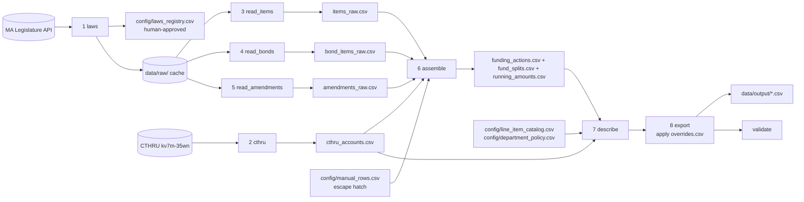

# Massachusetts Appropriations Dataset — Design Document

| | |
|---|---|
| **Status** | Draft v0.2 — CTHRU-first redesign; contracts not yet frozen (M0) |
| **Created** | 2026-10-21 (v0.1); revised 2026-10-28 (v0.2, see §20) |
| **Audience** | All 5 group members and any Claude session working in this repo |
| **Source of truth for** | Scope, architecture, file contracts, vocabularies, ownership, open questions |

> **How to use this document.** Read §1–§5 before touching code. Before changing a file contract (§7) or vocabulary (§9), propose the change, get group agreement, and log it in the Decision Log (§20). When a milestone or open question changes state, update the Status Board (§21) and Open Questions (§19) in the same commit. If code and this doc disagree, the doc wins until someone updates it deliberately. For a plain-language summary and the high-level tracker, see [`OVERVIEW.md`](OVERVIEW.md).

---

## Table of contents
1. [Purpose, scope, non-goals](#1-purpose-scope-non-goals)
2. [Glossary](#2-glossary)
3. [Sources](#3-sources)
4. [Seed law registry](#4-seed-law-registry)
5. [Core data model: the funding actions table](#5-core-data-model-the-funding-actions-table)
6. [Pipeline architecture](#6-pipeline-architecture)
7. [File contracts (schemas)](#7-file-contracts-schemas)
8. [Mapping to the `exampledata.csv` columns](#8-mapping-to-the-exampledatacsv-columns)
9. [Controlled vocabularies](#9-controlled-vocabularies)
10. [Counting rules: net new appropriation authority](#10-counting-rules-net-new-appropriation-authority)
11. [Parsing details and known patterns](#11-parsing-details-and-known-patterns)
12. [Policy-area classification](#12-policy-area-classification)
13. [Validation suite](#13-validation-suite)
14. [Human review workflow](#14-human-review-workflow)
15. [Repo layout and engineering conventions](#15-repo-layout-and-engineering-conventions)
16. [Workstreams and ownership](#16-workstreams-and-ownership)
17. [Milestones and acceptance criteria](#17-milestones-and-acceptance-criteria)
18. [Risks and mitigations](#18-risks-and-mitigations)
19. [Open questions](#19-open-questions)
20. [Decision log](#20-decision-log)
21. [Status board](#21-status-board)

---

## 1. Purpose, scope, non-goals

### Goal
Produce a complete, auditable, line-item dataset of **every Massachusetts state appropriation enacted in calendar years 2021–2025**, in the column format of [`exampledata.csv`](../exampledata.csv), with each row classified into one policy area from [`policyareas.csv`](../policyareas.csv).

Just as important, build **a program that future cohorts can re-run each year** to add the next year's laws: one command, followed by a short and predictable review checklist ([`RUNBOOK.md`](RUNBOOK.md), to be written by workstream A). The 2021–2025 dataset is the first release, not the end product.

### Design principles (v0.2)
1. **Structured data first.** Take everything the Comptroller's CTHRU data provides. Read law text only for what CTHRU lacks (§3.4): which law made each supplemental change, bond laws, outside-section amendments, and item descriptions.
2. **Automate, don't hand-annotate.** Every routine kind of law is read by code. `config/manual_rows.csv` is an escape hatch for true one-offs, and validation counts its rows (target: zero).
3. **Carry human judgment forward.** Labels are recorded per line item (`config/line_item_catalog.csv`), not per row, so a decision made once applies in every later year.
4. **Nothing hard-coded to 2021–2025.** The scope window is a setting in `config/settings.toml`. A held-out test on 2026 laws (§17, M6) checks that the readers generalize.
5. **Simple over clever.** There is no LLM in the pipeline, few stages, and few files. Yearly human work is limited to genuine judgment calls: approving new laws, labeling new line items, and explaining CTHRU mismatches.

### In scope
- **Enactment window:** laws whose governor approval date (API field `ApprovedDate`) is **2021-01-01 through 2025-12-31**. Filter on approval date, **not** the Acts volume year. Two 2020-volume chapters (2020 ch. 358 and ch. 383) were approved in January 2021 and are in scope.
- **Law types:** General Appropriations Acts (GAAs), supplemental budgets, state-surplus spending acts, capital bond authorization acts, and interim ("1/12th") budgets. Appropriations in outside sections of other acts are included where found (e.g., an item rewritten inside a policy act).
- **Granularity:** one row per line item per legal action. Earmarks ("not less than $X shall be expended for…") stay inside the parent item's text and are not separate rows.
- **Federal money:** captured, but **flagged** at the source-fund level and excluded from the main totals by default. This is pending a consultation with the group's partner at the Office of the State Auditor (see §19).
- **Spending vs. appropriations: to be decided (Q10).** The dataset currently records legal authority (appropriations). Whether it should also cover actual spending, and how far, is a scope decision that workstream E leads with the group and the partner (§16). Until then, nothing in the design depends on the answer.

### Reference-only data (ingested, not exported)
Laws outside the window that are needed for computation:
- **FY2021 GAA** (2020 ch. 227, approved 2020-12-11). Used to compute "Previously funded?" for FY2022 items.
- **Same-fiscal-year laws outside the window.** CTHRU reports totals per fiscal year, so FY2021 supplementals enacted in 2020 and FY2026 supplementals enacted in 2026 must be loaded for reconciliation.
- **Target acts of amendments.** For example, 2019 ch. 5 is amended by 2021 ch. 35.

### Non-goals
- Earmark-level extraction.
- Actual spending or expenditures, **pending Q10** (see In scope).
- Governor's mid-year "9C" cuts and other executive actions that aren't laws.
- Budgets of municipalities, authorities (MBTA, Massport), or quasi-public agencies, except where a state appropriation funds them.
- Laws enacted outside 2021–2025, except as reference data.

---

## 2. Glossary

Use these terms consistently in code, comments, commit messages, and conversations.

| Term | Meaning |
|---|---|
| **GAA** | General Appropriations Act: the annual state budget for one fiscal year. Example: 2023 Acts ch. 28 is the FY2024 GAA. |
| **Fiscal year (FY)** | July 1 – June 30, named for the ending year. FY2024 = 2023-07-01 → 2024-06-30. |
| **Calendar year** | In this project, the year the law was approved, which defines scope. |
| **Session law / chapter** | An enacted law, cited as "{year} Acts, ch. {n}". |
| **Section 2 / 2A / 2B / 2D / 2E / 2F** | Appropriation sections of an act. In GAAs: **2** = appropriations; **2B** = Intragovernmental Service Fund (ISF) chargebacks; **2D** = General Federal Grants Fund; **2E** = transfers from the General Fund to named trust funds; **2F** = Education and Transportation Fund (Fair Share surtax, FY2024+). In supplementals: **2** usually supplements existing items, **2A** makes new items for unanticipated obligations. Bond acts use 2–2I for capital items. |
| **Line item / item** | An 8-digit account ID in `NNNN-NNNN` form (e.g., `0930-0100`). The first 4 digits roughly identify the department. CTHRU writes it without the dash (`09300100`). |
| **Outside section** | Any section other than the appropriation sections (e.g., SECTION 178). It may amend earlier acts, including changing item amounts. |
| **Supplemental budget** | An act adding to, cutting, or creating items for a fiscal year already under way. |
| **Closeout supplemental** | The final supplemental for a fiscal year, usually enacted months after June 30 (e.g., 2023 ch. 77 for FY2023, approved 2023-12-04). |
| **Interim ("1/12th") budget** | A stopgap lump-sum appropriation before the GAA passes. By law, spending under it "shall apply against" the GAA, so it isn't additional money. |
| **Fund split** | Lines under an item giving the share paid by each fund (e.g., `General Fund … 52.63%`). |
| **Retained revenue (RR) item** | An item allowing an agency to spend revenue it collects, up to a ceiling stated in the text ("may expend … not more than $X"). |
| **ISF chargeback** | One agency paying another for services. The same money is already in the buying agency's Section 2 item, so counting it again double counts. |
| **Prior appropriation continued (PAC)** | Unspent authority carried into a later fiscal year. Not new money. |
| **Reauthorization** | An amendment extending the availability date of existing authority. Not new money. |
| **Alteration of purpose** | An amendment changing what existing money may be spent on, without new money. |
| **Bond authorization** | Capital authority to borrow and spend over several years (bond bills). Not an annual operating appropriation. |
| **Veto / reduction / override** | The governor may veto or reduce individual items. The Legislature may override, restoring the amount. Overrides can happen weeks or months after signing. |
| **Earmark** | A minimum amount inside an item's text for a named purpose or recipient. Not a separate row. |
| **Law key** | Our internal law identifier: `{year}-{chapter}`, e.g. `2023-77`. |
| **Record ID** | A stable identifier for an export row (see §9.6). |

---

## 3. Sources

### 3.1 MA Legislature public API (primary source)
- **Swagger spec:** `https://malegislature.gov/api/swagger/v1/swagger.json`
- **`GET /api/SessionLaws/{year}`** returns **every chapter in a year** as JSON, with `Year`, `ChapterNumber`, `Type` (`Acts`/`Resolves`), `ApprovalType`, `Title`, `Status`, `ApprovedDate` (e.g., `"Feb 28 2025"`), `ChapterText` (full HTML), and `OriginBill` (`BillNumber`, `GeneralCourtNumber`, and a `Details` URL).
  - Discovery is cheap: there are about 1,160 Acts in 2021–2025. Pulling one call per year gives the whole corpus.
  - **Quirk:** in the year list, each record's `Year` is the **approval** year, not the Acts volume, and its type varies (string or int). For example, 2020 ch. 358 appears in `/SessionLaws/2020` with `Year: 2021`. Always take the volume year from the year requested.
- **`GET /api/SessionLaws/{year}/{chapter}`** returns one chapter.
- **`GET /api/GeneralCourts/{court}/Documents/{bill}`** returns bill metadata.
- **`.../Documents/{bill}/DocumentHistoryActions`** returns the bill's action history, including veto overrides.
- `ApprovalType` values seen for 2021–2025 Acts: `Executive approval (signed)` (1,142), `Passed over veto` (12), `State election` (4), `Reoganization plan approved` (1, sic), and null (2). Discovery must record this field. A whole act passed over veto has a different effective enactment date (see §19).
- **The bill search in `URLs.csv` is not needed.** The SessionLaws endpoint lists only enacted laws, which is exactly the set we need.

### 3.2 Session-law web pages
- `https://malegislature.gov/Laws/SessionLaws/Acts/{year}/Chapter{n}` is the human-readable page, with the same HTML as `ChapterText`. **This URL goes in the `Source URL` column.**
- `https://malegislature.gov/Budget/FY{yyyy}/FinalBudget` shows the final GAA for each fiscal year and links to the session law. It is useful for spot-checking vetoes and overrides.

### 3.3 Governor veto messages and override history
**Not used in v0.2.** Vetoes are found by comparing the law's printed amount with CTHRU (§11.4).
- Veto annotations in the act text reference the governor's message (e.g. "for message see House, No. 4055"). The pipeline reads the inline markup as a hint and doesn't fetch the messages.
- Override votes appear in the bill's `DocumentHistoryActions`. They're needed only if the partner asks for separate veto and override rows with dates (Q4).

### 3.4 Comptroller CTHRU (primary source for annual budgets; check for everything else)
- Socrata dataset **`kv7m-35wn`** ("Budget_Actual_With_Other_Spending_Authorizationv3_Gen2", the production data behind CTHRU Budgets): `https://cthru.data.socrata.com/resource/kv7m-35wn.json`
- Useful fields: `fiscal_year` (e.g., `"2024.0"`), `appropriation_account_number` (8 digits, no dash), `appropriation_account_name`, `department_name`, `department_code`, `cabinet_secretariat_name`, `fund_number`, `fund_name`, `original_enacted_budget`, `supplemental_budget_appropriations`, `authorized_retained_revenue_ceiling`, `total_enacted_budget_appropriation`, `planned_saving_9c_cuts`.
- Spending-side fields, relevant only if Q10 brings spending into scope: `total_expenses`, `unexpended_reverted`, `balance_forward_prior_appropriation_continued`, `transfer_in`, `transfer_out`, `retained_revenue_collected`. Related datasets: `uaqe-2tpk` (Non-Budgeted Special Revenue and Trusts) and `pegc-naaa` (Comptroller spending).
- **Quirks:**
  - There are **many rows per account per FY**, mostly zero rows under other departments. **Always aggregate** by FY × account and take the department with non-zero amounts.
  - Totals are **per fiscal year, not per law**.
  - The dataset has been re-versioned before ("v3_Gen2"). Save a dated snapshot on every pull, and keep all CTHRU-specific code in `cthru.py`, so a format change is a one-file fix.
- Example query:
  ```
  https://cthru.data.socrata.com/resource/kv7m-35wn.json?$select=fiscal_year,appropriation_account_number,sum(original_enacted_budget),sum(supplemental_budget_appropriations)&$group=fiscal_year,appropriation_account_number&$where=fiscal_year>='2022'
  ```

**What CTHRU covers (design probe, 2026-10-28, 8 requests):**

| Question | Finding | Consequence |
|---|---|---|
| Does `original_enacted_budget` reflect vetoes and overrides? | **Yes, in 4 of 5 FY2024 vetoed items checked.** 4000-0700 reduced and sustained: $3,601,016,357. 7061-0012 reduced: $498,972,361. 3000-1042 overridden: $35,000,000. 3000-5000: $17,500,000. **Exception:** 1231-1000 is printed at $10,000,000 after an override, but CTHRU shows $1,500,000. | GAA amounts come from CTHRU. Printed vs. CTHRU gives `veto_status`. Mismatches go to E's review (1231-1000 is the first). |
| Which GAA sections are present? | §2 and §2F (Education and Transportation Fund, $1.0B in FY2024) are present. **§2B ISF accounts appear with $0.** **§2D federal grants are absent.** | ISF is excluded from totals anyway. §2D needs law text if Q1 brings federal grants in. |
| Is supplemental money broken down by law? | **No.** No CTHRU budget dataset has a law or chapter column. | Supplementals are read from law text. CTHRU checks the per-FY sum. |
| Is there a capital (bond) dataset? | **No**, among 52 datasets. | Bond laws are read from law text. |
| History and freshness | FY2005 onward. FY2027 is already present. Updated daily. | "Previously funded?" is a lookup. New years appear automatically. |

Also verified: for FY2024, `23300100` shows original 9,310,231 + supplemental 350,000; `09300100` shows original 6,077,671. FY2024's total `original_enacted_budget` is $55,303,686,185.

### 3.5 Secondary cross-checks (manual use only)
- **MassBudget Budget Browser:** line-item history across years. Useful when items are renumbered and for "previously funded?" sanity checks.
- **Governor signing letters, House/Senate Ways and Means summaries, and A&F fact sheets:** law-level totals.

### 3.6 Politeness and terms
- Identify the scraper in its User-Agent (project name plus a contact email in config).
- Make at most about 1 request per second to malegislature.gov.
- Cache everything in `data/raw/` and never re-fetch unchanged content (see §15).

---

## 4. Seed law registry

This is the candidate list produced during design research (2026-10-21) by scanning every 2020–2025 Act approved 2021-01-01 → 2025-12-31 for:
- appropriation-style titles,
- "hereby appropriated" language,
- line-item paragraphs ending in a dollar amount, and
- bond-issuance language.

**It is a seed, not the final registry.** Workstream A must re-run discovery as a full-text scan (§6, stage 1) and record an include/exclude decision with a reason for every candidate. The `items≈` column counts paragraphs starting with an item ID and ending in `$amount`. It is a rough lower bound: retained-revenue items and odd formats are missed.

| Law key | Approved | Proposed type | items≈ | Notes |
|---|---|---|---:|---|
| 2020-316 | 2021-01-11 | other | 1 | Hampshire Council of Governments. Likely a reference to an item, not an appropriation. **Probably exclude** after review. |
| 2020-358 | 2021-01-14 | bond | 27 | Economic development bond ("Enabling Partnerships for Growth"). 2020 volume, 2021 approval. |
| 2020-383 | 2021-01-15 | bond | 31 | Transportation bond (~$16.2B in items). 2020 volume, 2021 approval. |
| 2021-9 | 2021-04-01 | bond? | 1 | UI Trust Fund financing (special obligation bonds). **Decide include/exclude.** |
| 2021-15 | 2021-05-25 | bond | 2 | Holyoke Soldiers' Home reconstruction ($600M). |
| 2021-23 | 2021-06-28 | interim | 0 | FY2022 interim. |
| 2021-24 | 2021-07-16 | gaa | 1,178 | **FY2022 GAA.** |
| 2021-25 | 2021-07-19 | bond | 1 | Chapter 90 municipal roads. |
| 2021-29 | 2021-07-29 | supplemental | 28 | FY2021 supplemental. |
| 2021-35 | 2021-08-03 | other | 1 | Policy act that **rewrites item 8100-1014 of 2019 ch. 5**. The delta needs the running amounts table. |
| 2021-76 | 2021-10-20 | supplemental | 100 | FY2021 closeout. Creates the Transitional Escrow Fund. |
| 2021-102 | 2021-12-13 | surplus (+federal) | 59 | ARPA (Federal COVID-19 Response Fund) **and** state surplus. Mixed funds; federal flag. |
| 2022-22 | 2022-02-12 | supplemental | 3 | FY2022. |
| 2022-42 | 2022-04-01 | supplemental | 28 | FY2022. |
| 2022-89 | 2022-06-17 | bond | 1 | Chapter 90. |
| 2022-98 | 2022-06-27 | interim | 0 | FY2023 interim. |
| 2022-103 | 2022-07-11 | supplemental | 1 | FY2022. |
| 2022-126 | 2022-07-28 | gaa | 1,224 | **FY2023 GAA.** |
| 2022-140 | 2022-08-04 | bond | 21 | General governmental infrastructure (~$5.2B). |
| 2022-175 | 2022-08-10 | bond | 3 | Judiciary IT. |
| 2022-176 | 2022-08-10 | bond | 19 | Transportation and climate (~$11.4B). |
| 2022-268 | 2022-11-10 | surplus (+federal) | 52 | Economic growth and relief: FY2022 closeout, surplus, and ARPA. Mixed funds. |
| 2023-2 | 2023-03-29 | supplemental | 22 | FY2023. |
| 2023-15 | 2023-06-26 | interim | 0 | FY2024 interim, $6,660,000,000. |
| 2023-24 | 2023-07-31 | interim | 0 | FY2024 second interim. |
| 2023-26 | 2023-07-31 | supplemental | 2 | FY2023. |
| 2023-27 | 2023-08-03 | bond | 2 | Chapter 90. |
| 2023-28 | 2023-08-09 | gaa | 1,412 | **FY2024 GAA.** Source of EX-001…EX-003. |
| 2023-77 | 2023-12-04 | supplemental | 83 | FY2023 closeout. **EX-004 is §178.** |
| 2024-88 | 2024-04-30 | supplemental | 2 | FY2024. |
| 2024-89 | 2024-05-03 | bond | 1 | Chapter 90. |
| 2024-122 | 2024-06-28 | interim | 0 | FY2025 interim, $6,925,000,000. |
| 2024-139 | 2024-07-29 | bond | 12 | IT bond (~$1.66B). |
| 2024-140 | 2024-07-29 | gaa | 1,167 | **FY2025 GAA.** Veto markup nearly absent (see §11.4). |
| 2024-150 | 2024-08-06 | bond | 16 | Affordable Homes Act (~$5.0B). |
| 2024-206 | 2024-09-16 | supplemental | 2 | FY2024. |
| 2024-238 | 2024-11-20 | bond | 35 | Mass Leads economic development (~$4.0B). |
| 2024-248 | 2024-12-04 | supplemental | 67 | FY2024 closeout. |
| 2025-1 | 2025-02-28 | supplemental | 1 | FY2025, Transitional Escrow Fund ($425M shelter item). |
| 2025-3 | 2025-05-15 | supplemental | 1 | FY2025. Short item title, amount ends with a period. |
| 2025-4 | 2025-05-29 | supplemental | 2 | FY2025. Same format as 2025-3. |
| 2025-7 | 2025-06-24 | supplemental | 28 | FY2025. |
| 2025-8 | 2025-06-30 | interim | 0 | FY2026 interim. |
| 2025-9 | 2025-07-04 | gaa | 1,340 | **FY2026 GAA.** |
| 2025-14 | 2025-08-05 | supplemental | 17 | FY2025. |
| 2025-17 | 2025-08-08 | bond | 4 | Chapter 90 (~$1.19B). |
| 2025-33 | 2025-09-22 | supplemental | 2 | FY2025. |
| 2025-73 | 2025-11-25 | supplemental | 56 | FY2025 closeout. |

**Reference-only seeds:**
- 2020-227 (FY2021 GAA).
- FY2021 supplementals approved in 2020. A title scan at M0 found none (2020 ch. 201 is the FY2020 closeout; ch. 101, 131 and 198 are FY2021 interims). Discover's full-text scan should confirm this.
- FY2026 supplementals approved in 2026: 2026-55 and 2026-101.
- Any act named as an amendment target, such as 2019-5.

---

## 5. Core data model: the funding actions table

### 5.1 Why one row per funding action
A law doesn't just create items. It also raises, cuts, re-purposes, extends, transfers, vetoes, and restores them, sometimes in other laws and sometimes in a later calendar year. Storing **one row per legal action (event)** handles all of these the same way:

- Every event has its own law, section, date, fiscal year, and signed amount.
- The `exampledata.csv` export is a **view** over the funding actions table, filtered to in-window events.
- Totals are sums over events flagged `additive = true`.

### 5.2 Event types (`funding_action`)
The values (full list in §9.2) are: original appropriation, new supplemental item, supplemental increase, supplemental reduction, veto reduction, override restoration, reauthorization, alteration of purpose, transfer, interim appropriation, capital authorization, and prior appropriation continued. Under the v0.2 default (Q4), vetoes and overrides are netted into the item's amount (§5.7), so `VETO` and `OVR` are reserved and not emitted.

### 5.3 `amount_kind` and `additive`
Each event carries:
- **`amount_kind`**: what the dollar figure means. One of `appropriation`, `retained_revenue_ceiling`, `bond_authorization`, `transfer`, `delta`, `prior_appropriation_continued`, `interim`, or `none` (e.g., a purpose change).
- **`additive`** (true/false): whether it counts toward net new appropriation authority. Rules are in §10. Without this flag, totals will double count.

### 5.4 Fiscal year belongs to the event, not the law
- Take the FY from the appropriating section's text ("for the fiscal year ending June 30, 2024").
- **For amendments, take the FY of the act being amended.** EX-004 is in a law named "FY2023 Supplemental" but amends the FY2024 GAA, so its FY is **2024**.
- Multi-year items ("made available until June 30, 2027", "for the fiscal year in which the sums are disbursed") and bond items use the **FY containing the approval date**, set `fy_rule = enactment_fy`, and record `available_through`.

### 5.5 Running amounts
Keep the **current amount** of every `(target law, section, item)` after each event, in date order. This makes it possible to:
- compute deltas when an act replaces a whole item (2021 ch. 35) or inserts a new figure, and
- run the **struck-figure self-check**: when an amendment says it is "striking out the figure '$9,310,231'", the item's running amount must equal $9,310,231 (§13).

### 5.6 Fund attribution
Each event has zero or more fund splits (`fund_splits.csv`). The default fund is the one named in the section header (e.g., General Fund for GAA §2, General Federal Grants Fund for §2D, Education and Transportation Fund for §2F, Transitional Escrow Fund for 2025 ch. 1 §2A). Explicit split lines override the default. An item's own text can also name its fund. **The federal flag is computed from funds** (see §9.5).

### 5.7 Where amounts come from, and vetoes
- **GAA original appropriations** (`ORIG` in a GAA): the amount is CTHRU `original_enacted_budget` for that FY × item, which already reflects vetoes and overrides. These rows have `amount_source = cthru`. The law's printed amount goes in `amount_printed` (from `read_items`).
- **Everything else** (supplementals, amendments, bonds, interim) has `amount_source = law_text`. Escape-hatch rows have `manual`.
- **Vetoes are netted** (Q4 default). There's one row per item with its final amount. `veto_status` (§9.9) records `none`, `vetoed`, `reduced`, `overridden` or `unknown`. It's set by comparing `amount_printed` with CTHRU, with the inline veto markup as a hint. Unexplained differences are flagged `cthru_mismatch` and go to the review queue.
- Vetoes in bond laws (not in CTHRU) rely on inline markup only and are flagged `veto_unverified` when markup is present.

## 6. Pipeline architecture

Each stage reads and writes **versioned files**. Stages never call each other's internals, so people can work in parallel against fixtures. The one shared piece of code is `paragraphs.py`, which turns law HTML into paragraphs. Its output format (§7.2) is a contract, because three readers use it.



| # | Stage | Reads | Writes | Owner |
|---|---|---|---|---|
| 1 | `laws` | API year lists, registry | `config/laws_registry.csv` (new candidates as `tbd`), `data/raw/sessionlaws/{year}/{ch}.json`, `data/raw/manifest.csv` | A |
| 2 | `cthru` | CTHRU | `data/raw/cthru/{date}/…` (snapshot), `data/interim/cthru_accounts.csv` | E |
| 3 | `read_items` | raw supplemental and GAA laws | `data/interim/items_raw.csv`, `reports/unparsed_paragraphs.csv` | B |
| 4 | `read_bonds` | raw bond laws (incl. Chapter 90) | `data/interim/bond_items_raw.csv`, `reports/unparsed_paragraphs_bonds.csv` | A |
| 5 | `read_amendments` | raw laws | `data/interim/amendments_raw.csv`, `reports/unparsed_sections.csv` | C |
| 6 | `assemble` | everything above, registry, `manual_rows.csv` | `data/interim/funding_actions.csv`, `fund_splits.csv`, `running_amounts.csv` | everyone (E coordinates; C owns the running amounts table; E owns the CTHRU comparison) |
| 7 | `describe` | funding actions, `cthru_accounts.csv`, catalog, department table | `data/interim/descriptions.csv` | D |
| 8 | `export` | funding actions, descriptions, `review/overrides.csv` | `data/output/ma_appropriations_cy2021_2025.csv`, `…_extended.csv`, `data_dictionary.md`, `review/review_queue.csv` | everyone (E coordinates) |
| — | `validate` | everything | `reports/validation/*.csv`, `reports/law_status.csv` | E |

### Stage notes
1. **laws.** Pull `/SessionLaws/{year}` for the configured years, keep Acts approved in the window, and **scan full text, not just titles**. Flag a chapter as a candidate if it has any of:
   - a line-item paragraph,
   - "hereby appropriated",
   - "the sum of $X is hereby appropriated" or "the amount of $X is hereby appropriated",
   - "striking out the figure",
   - bond issuance language,
   - an appropriation-style title.

   New candidates are appended with `role = tbd`, and existing human decisions are never overwritten. The stage also adds reference-only laws: same-FY laws outside the window, and amendment targets found by `read_amendments`. It then downloads each registry law's JSON and stores the SHA-256 and fetch time in `manifest.csv`, skipping unchanged files and throttling requests. **This stage is what a future cohort runs first each year.**
2. **cthru.** One aggregated query per FY (FY2005 onward for history), saved as a dated snapshot. It writes one row per FY × account (§7.5). This is the source of every GAA original appropriation and of agency names.
3. **read_items.** Uses the item state machine (§11.2).
   - **Supplementals:** full items with amounts, fund splits and headers.
   - **GAAs:** item text, printed amount, struck amount and inline veto markup only. A missed GAA item costs only a blank description (the amount comes from CTHRU) and is reported.
4. **read_bonds.** The same state machine, applied to capital sections (§2–§2I) of bond laws and Chapter 90 bills. It shares `items_raw` columns.
5. **read_amendments.** Grammar for outside sections (§11.3), including **direct appropriations**. Interim budgets are read here, not typed by hand.
6. **assemble.** Builds GAA `ORIG` rows from `cthru_accounts.csv` (each FY has exactly one GAA in the registry). It adds rows from the readers, assigns Record IDs (§9.6), computes `additive`, fiscal year and fund splits, maintains the running amounts table, and sets `veto_status` from the CTHRU comparison.
7. **describe.** Agency/office from CTHRU, Program/purpose by rule, policy area from the catalog or department table (§12), and the three yes/no-style columns (§8).
8. **export.** Applies human overrides (§14) and writes the exact `exampledata.csv` columns and order, plus an extended file, a data dictionary, and the review queue.

## 7. File contracts (schemas)

> **Draft v0.2. Freeze these at Milestone M0 (§17).** After freezing, change them only through the Decision Log. All CSVs are UTF-8 with a header row, comma-delimited, and quoted per RFC 4180. Money is an **integer number of dollars** (no commas, no `$`) in interim files. Dates are ISO `YYYY-MM-DD` in interim files; the export reformats them to match `exampledata.csv`. Booleans are `true`/`false`, lists are `;`-separated, and an empty cell is null. The code copy of these contracts is `src/ma_approps/schemas.py`.

### 7.1 `config/laws_registry.csv` (human-curated)
| column | type | notes |
|---|---|---|
| `law_key` | str | `2023-77` |
| `acts_year` | int | volume year (2020 for 2020-383) |
| `chapter` | str | |
| `approved_date` | date | from `ApprovedDate` |
| `approval_type` | str | from API |
| `api_title` | str | full formal title |
| `law_name` | str | **curated** short name, e.g. `FY2024 General Appropriations Act`, `FY2023 Supplemental Appropriations Act (December 2023)` |
| `law_type` | enum | §9.1 |
| `role` | enum | `in_scope`, `reference_only`, `excluded`, `tbd` (a discovered candidate awaiting a human decision) |
| `include_reason` | str | why it is included, excluded, or reference-only |
| `primary_fy` | int | FY stated in the title or appropriation section, if any |
| `origin_bill` | str | `{court}/{bill}`, e.g. `194/H58`, matching the API path `/GeneralCourts/{court}/Documents/{bill}` |
| `parse_strategy` | enum | `auto`, `manual`, `auto+manual` (`manual` is the escape hatch) |
| `notes` | str | |

### 7.2 `paragraphs.paragraphs()` output (in memory; optionally `data/interim/paragraphs/{law_key}.jsonl`)
One object per paragraph: `law_key`, `para_idx`, `text` (normalized), `raw_html`, `classes` (list), `struck` (list of struck substrings), `bold` (list), `links` (list of hrefs). Owned by B; used by B, A and C.

### 7.3 `data/interim/items_raw.csv` and `bond_items_raw.csv`
The same columns for both. `read_items` (B) writes `items_raw.csv` for supplementals and GAAs; `read_bonds` (A) writes `bond_items_raw.csv`.
| column | notes |
|---|---|
| `law_key`, `section` | e.g. `2023-28`, `2` |
| `section_fund_default` | fund named in the section preamble |
| `fy_stated` | FY from the section preamble |
| `para_start`, `para_end` | paragraph span |
| `line_item` | `NNNN-NNNN` |
| `secretariat_header_raw`, `agency_header_raw` | nearest headers as printed |
| `item_text` | full description, including provisos |
| `amount` | final printed amount (int). Null for RR items with no trailing amount. For GAAs this becomes the funding action's `amount_printed`. |
| `amount_struck` | struck-through original amount, if any |
| `rr_ceiling` | retained-revenue ceiling parsed from the text, if any |
| `fund_splits_raw` | e.g. `General Fund:52.63;High-Quality Early Education & Care Affordability Fund:47.37` |
| `veto_annotation_raw` | annotation text as printed (a hint for `veto_status`) |
| `veto_kind_inline` | `none`, `disapproved`, `reduced`, `reduced_and_wording`, `overridden` |
| `parser_version` | semver of the reader |
| `confidence` | `high`, `medium`, `low` |

### 7.4 `data/interim/amendments_raw.csv`
| column | notes |
|---|---|
| `law_key`, `section` | the amending law and outside section (e.g. `2023-77`, `178`) |
| `action_type` | `figure_change`, `item_insert`, `item_strike`, `item_replace`, `text_insert`, `text_strike`, `date_extend`, `purpose_change`, `transfer`, `direct_appropriation` |
| `target_law_key`, `target_section`, `target_item` | e.g. `2023-28`, `2`, `2330-0100`. "Said …" references resolved. |
| `old_figure`, `new_figure` | ints, where applicable |
| `old_date`, `new_date` | for `date_extend` |
| `amount` | for `direct_appropriation` (including interim budgets) or `transfer` |
| `from_item`, `to_item` | for `transfer` |
| `fund_raw` | fund named, if any |
| `source_text` | verbatim section text |
| `parser_version`, `confidence` | |

### 7.5 `data/interim/cthru_accounts.csv`
One row per fiscal year × account, aggregated across CTHRU's per-department rows: `fiscal_year`, `line_item` (`NNNN-NNNN`), `account_name`, `department_code`, `department_name`, `secretariat`, `fund_numbers` (`;`-separated), `original_enacted`, `supplemental`, `rr_ceiling`, `total_enacted` (ints). Owned by E. If Q10 brings spending into scope, spending columns are added here through the Decision Log.

### 7.6 `config/manual_rows.csv` (escape hatch)
The same columns as `funding_actions.csv` (§7.7), except `record_id`, which assemble generates. Adds `source_quote` (verbatim text), `entered_by`, `entered_on`. **Use only for a true one-off law no reader handles.** Validation reports the count (target zero), and the runbook asks whether a reader should be extended instead.

### 7.7 `data/interim/funding_actions.csv` (canonical)
| column | notes |
|---|---|
| `record_id` | §9.6 |
| `law_key`, `section`, `line_item` | `line_item` may be empty for lump sums |
| `target_law_key` | the law whose item is affected (equals `law_key` for original items) |
| `event_date` | approval date |
| `calendar_year` | year of `event_date` |
| `fiscal_year`, `fy_rule` | `stated`, `target_act`, `enactment_fy` |
| `available_through` | date or empty |
| `section_type` | §9.4 |
| `funding_action` | §9.2 |
| `amount_kind` | §9.3 |
| `amount` | signed int (reductions negative) |
| `amount_source` | `cthru`, `law_text`, `manual` (§5.7) |
| `amount_printed` | for GAA rows: the law's printed amount, for comparison |
| `veto_status` | §9.9 |
| `additive` | bool (§10) |
| `fund_primary` | fund with the largest share |
| `federal_share` | 0–1, computed from fund splits |
| `flags` | `;`-separated (§9.5) |
| `agency_header_raw` | |
| `item_text` | |
| `source_url` | |
| `source_para_start` | for traceability |
| `parser_version` | |

### 7.8 Side tables
- **`fund_splits.csv`**: `record_id`, `fund_name`, `fund_number` (if known), `share`, `is_federal`.
- **`running_amounts.csv`**: `target_law_key`, `section`, `line_item`, `as_of_event` (`record_id`), `amount_after`. Owned by C.

### 7.9 `data/interim/descriptions.csv`
`record_id`, `agency_office`, `program_purpose`, `program_purpose_method` (`rule`, `human`), `policy_area`, `policy_area_method` (`catalog`, `department`, `human`), `previously_funded` (`Yes`, `No`, `Unknown`), `one_time_or_recurring`, `new_or_reapprop`. An empty `policy_area` means the row is waiting in the review queue.

### 7.10 Label tables (human-curated, committed; owned by D)
- **`config/line_item_catalog.csv`**: `line_item`, `policy_area` (§9.8), `label_every_year` (bool; `true` for catch-all items such as 1599-xxxx reserves, which always go to review), `decided_by`, `decided_on`, `note`. There's one row per line item, and it carries over between years.
- **`config/department_policy.csv`**: `department_code`, `department_name`, `policy_area` (empty when mixed), `mixed` (bool), `decided_by`, `decided_on`, `note`. The rule for items not yet in the catalog.

### 7.11 `review/overrides.csv` (human-edited, committed)
`record_id`, `field` (an export or description column name), `new_value`, `expected_old_value`, `reviewer`, `review_date`, `note`. Use it for one-row fixes only. Labels that should apply in every year go in the catalog (§7.10).

### 7.12 `review/review_queue.csv` (generated; do not edit)
`record_id`, `reason` (e.g. `new_line_item`, `mixed_department`, `label_every_year`, `cthru_mismatch`, `catalog_drift`, `unparsed_neighbor`, `federal_mixed`), `priority`, and context columns.

### 7.13 Export
`data/output/ma_appropriations_cy2021_2025.csv` uses **exactly** the 19 columns of `exampledata.csv`, in the same order (§8). `…_extended.csv` adds every funding-actions column.

### 7.14 `config/funds.csv` (human-curated)
`fund_name`, `fund_number`, `is_federal` (bool), `notes`. Drives the federal flag (§9.5).

## 8. Mapping to the `exampledata.csv` columns

| # | Column | Derivation | Stage |
|---|---|---|---|
| 1 | Record ID | `record_id` (§9.6). The example uses `EX-001`; our IDs are stable keys. | assemble |
| 2 | Law citation | `"{acts_year} Acts, ch. {chapter}"`, e.g. `2023 Acts, ch. 28` | assemble |
| 3 | Law name | registry `law_name` (curated) | registry |
| 4 | Enactment date | `event_date` as `MM/DD/YYYY` (e.g. `08/09/2023`) | export |
| 5 | Calendar year | year of `event_date` | assemble |
| 6 | Fiscal year | `fiscal_year` (§5.4) | assemble |
| 7 | Section | section of the **enacting** law: `2`, `2A`, `178` | extract |
| 8 | Line item | `NNNN-NNNN`; blank for lump sums | extract |
| 9 | Agency / office | **The most specific administering office**, taken from CTHRU for that FY (so reorganizations are handled automatically). Order: CTHRU account name or item text naming a division (e.g., "division of marine fisheries"), then the CTHRU department. The printed header is the fallback for items not in CTHRU (bonds). *Example:* item 2330-0100 sits under the header "Department of Fish and Game." but the example expects **"Division of Marine Fisheries"**. Check this against CTHRU's account name early. | describe |
| 10 | Program / purpose | Short summary of the item's purpose. **Rule only:** the first clause of the item text with boilerplate removed ("For the operation of…"); CTHRU account name when no text was read. Humans may override individual rows. | describe |
| 11 | Policy area | one value from `policyareas.csv`, from the catalog or department table (§12) | describe |
| 12 | Funding action | display label of `funding_action` (§9.2) | assemble |
| 13 | Appropriation/change ($) | `amount`, formatted with thousands separators (e.g. `6,077,671`). Negative for reductions. | export |
| 14 | Previously funded? | **Interim rule:** `Yes` if the same line item has non-zero enacted authority in any earlier fiscal year in CTHRU (history from FY2005) or the funding actions table; `No` if never seen; `Unknown` if the item number is new but the text suggests a renumbered program. **Note the example conflict:** EX-001's item 0930-0100 was funded in FY2023 (CTHRU shows $4,400,000) yet the example says `Unknown`. Confirm the definition with the partner (§19). | describe |
| 15 | One-time or recurring funding | **Interim rule:** default `Not classified`. GAA §2 items present in 2 or more consecutive GAAs → `Recurring`; supplemental, surplus, and bond events → `One-time`. Pending a partner definition. | describe |
| 16 | New funding appropriation or re-appropriation of existing funding? | From `amount_kind`/`funding_action`: appropriation, delta, or bond → `New`; PAC or reauthorization → `Re-appropriation`; transfer or alteration of purpose → `Transfer of existing authority`. Default `Pending` until validated. | describe |
| 17 | Human review status | `Human reviewed` if an override exists for the record or its policy area came from a human decision (catalog row or `human` method); otherwise `Not human reviewed` (§9.7) | export |
| 18 | Source URL | `https://malegislature.gov/Laws/SessionLaws/Acts/{acts_year}/Chapter{chapter}` | assemble |
| 19 | Source or calculation for total | **Law-level** validation note from `reports/law_status.csv`, repeated on each row of the law. Example: `Total checked: 1,412 items, net new $X; matches CTHRU FY2024 original_enacted within $0. Excludes ISF (2B), interim, reauthorizations; federal flagged.` Until validated: the example's text, beginning `Total not yet checked.` | validate → export |

---

## 9. Controlled vocabularies

### 9.1 `law_type`
`gaa`, `supplemental`, `surplus`, `bond`, `interim`, `other`. If a law is mixed (e.g., 2022-268), use its dominant type and set per-row flags.

### 9.2 `funding_action` (code → export label)
| code | export label | typical amount_kind | additive? |
|---|---|---|---|
| `ORIG` | Original appropriation | appropriation / retained_revenue_ceiling | yes (§10 caveats) |
| `NEW` | Supplemental appropriation | appropriation | yes |
| `INC` | Supplemental increase | delta (+) | yes |
| `RED` | Supplemental reduction | delta (−) | yes (negative) |
| `VETO` | Veto reduction | delta (−) | yes (negative). *Reserved: not emitted under the netted default (Q4, §5.7).* |
| `OVR` | Veto override restoration | delta (+) | yes. *Reserved, as above.* |
| `INT` | Interim appropriation | interim | **no** |
| `CAP` | Capital authorization | bond_authorization | **no** (separate capital total) |
| `REAUTH` | Reauthorization | none / prior_appropriation_continued | **no** |
| `PAC` | Prior appropriation continued | prior_appropriation_continued | **no** |
| `PURP` | Alteration of purpose | none | **no** |
| `XFER` | Transfer | transfer | **no** (see §10) |

The labels `Original appropriation` and `Supplemental increase` match the examples. The other labels need partner sign-off (§19).

### 9.3 `amount_kind`
`appropriation`, `retained_revenue_ceiling`, `bond_authorization`, `transfer`, `delta`, `prior_appropriation_continued`, `interim`, `none`.

### 9.4 `section_type`
`approp_main` (GAA §2, supplemental §2), `approp_new` (supplemental §2A), `isf` (§2B), `federal_grants` (§2D), `trust_transfer` (§2E), `surtax` (§2F), `capital` (bond §2–§2I), `outside` (outside section), `interim`.

### 9.5 `flags` (`;`-separated)
`federal` (federal_share > 0), `federal_mixed` (0 < share < 1), `isf_chargeback`, `trust_transfer`, `fund_transfer_chain` (money moved into a fund that another event spends from), `arpa_reallocation`, `multi_year`, `retained_revenue`, `veto_unverified`, `cthru_mismatch`, `manual_row`, `low_confidence_parse`.

**Federal funds** (`is_federal = true` in `config/funds.csv`, curated): General Federal Grants Fund, Federal COVID-19 Response Fund (ARPA), Coronavirus Relief Fund, and other funds the group confirms. General Fund items that are later federally reimbursed (e.g., MassHealth) are **not** federal under this rule. Revisit after the State Auditor consultation.

### 9.6 Record ID
Format: `{acts_year}-{chapter:03d}-S{section}-{line_item|NOITEM}-{funding_action}-{ordinal}`

Examples:
- `2023-028-S2-0930-0100-ORIG-1`
- `2023-077-S178-2330-0100-INC-1`
- `2023-015-S1-NOITEM-INT-1`

The ordinal counts duplicates of the same prefix in source order. IDs must be deterministic: re-running on the same raw inputs gives the same IDs.

### 9.7 Human review status
`Not human reviewed` (default), `Human reviewed`. (v0.1's `Review stale` was dropped in v0.2: enacted laws don't change text, and labels live in the catalog.)

### 9.8 Policy areas
Exactly the 18 values in `policyareas.csv`:
1. Education
2. Health and public health
3. Children and families
4. Human services and income support
5. Housing and homelessness
6. Economic development and workforce
7. Transportation
8. Environment and natural resources
9. Public safety and corrections
10. Courts and legal services
11. Veterans’ services
12. Arts, culture, and recreation
13. Government administration and oversight
14. General local aid
15. Public employee pensions and benefits
16. Debt service, reserves, and statewide finance
17. Multiple
18. Unclassified/other

Note: `Veterans’ services` uses a typographic apostrophe in the file. Match it exactly.

### 9.9 `veto_status` and `amount_source`
- `veto_status`: `none`, `vetoed`, `reduced`, `overridden`, `unknown` (§5.7).
- `amount_source`: `cthru`, `law_text`, `manual`.

---

## 10. Counting rules: net new appropriation authority

The **operating total** for a law (or fiscal year) is the sum of `amount` over events with `additive = true`, excluding `federal`-flagged shares by default.

| Event / section | Counted? | Why |
|---|---|---|
| GAA §2, §2F items; supplemental §2/§2A new items and increases | yes | new authority |
| Reductions, veto reductions (negative), override restorations | yes | net effect |
| Retained-revenue ceilings | yes, flagged | CTHRU tracks these separately; reconcile against `authorized_retained_revenue_ceiling` |
| §2B ISF chargebacks | **no** | duplicates §2 spending |
| §2D federal grants and federal fund shares | **no by default**, kept and flagged | pending the State Auditor decision |
| §2E transfers to trust funds | **open** | if the trust's later spending is also appropriated, count only one leg (§19) |
| Transfers into reserve or escrow funds (e.g., Transitional Escrow Fund) that later acts appropriate from | count the **appropriation out**, not the transfer in (proposal) | avoids double counting surplus money |
| Interim budgets | **no** | by statute they apply against the GAA |
| PAC, reauthorizations, alteration of purpose, item-to-item transfers, ARPA reallocations | **no** | not new money |
| Bond authorizations | **separate capital total**, never summed with operating | multi-year borrowing authority |

---

## 11. Parsing details and known patterns

### 11.1 Normalization (`paragraphs.py`, shared)
- Unicode NFKC. Convert `&nbsp;`/U+00A0 to a space, U+2011/U+2010/en dash inside item IDs to `-`, and smart quotes to plain quotes **only in matching keys** (keep the original text for display).
- Join text split across `<span>`s before matching. IDs and `$` amounts are sometimes split.
- Keep **strike-through** (`style="text-decoration: line-through;"`) and **bold** spans as attributes. They carry veto meaning.
- Treat `</p>` and `<br>` as paragraph boundaries. Keep the original HTML for debugging.
- Don't rely on CSS classes. `HWMLineItem`, `HWMAgency`, and `HWMSecretariat` exist in the FY2021 HTML but not reliably in later years.

### 11.2 Item extraction state machine (`read_items`, `read_bonds`)
One state machine, used in three modes: **supplementals** (full items), **GAAs** (description, printed amount and veto markup only; amounts come from CTHRU) and **bonds** (capital sections §2–§2I and Chapter 90 bills; `amount_kind = bond_authorization`). Bond formatting hasn't been checked yet. Workstream A's first task is to save one bond law as a fixture and see what needs to change.

States: `PREAMBLE → SECTION_HEADER → (SECRETARIAT_HEADER | AGENCY_HEADER | ITEM | FUND_SPLIT | VETO_NOTE)* → next SECTION`.

- **Section start:** a paragraph matching `^SECTION\s+(2[A-Z]{0,2})\.` (after normalization). Capture the preamble's fund and fiscal year.
- **Headers:** short paragraphs (roughly 90 characters or fewer) that don't start with an item ID or contain `$`. ALL-CAPS headers are usually secretariats or independent offices; Title-case ones are usually agencies. Keep both raw.
- **Item start:** an item ID **at the start of a paragraph**, optionally preceded by a veto note in the same paragraph. IDs inside provisos ("from item 1599-0026") are **not** item starts.
- **Item end:** the paragraph whose text ends with the **trailing amount after a dotted leader**: `\.{2,}\s*(?:\$[\d,]+\s*)?\$([\d,]+)\.?\s*$`. The amount may be several paragraphs after the start. Earmark amounts earlier in the text must be ignored, so always take the trailing one. A trailing period (`$240,000,000.`, 2025 ch. 3) is allowed.
- **Struck amounts:** if the trailing region contains a struck amount followed by a plain amount (`<s>$49,279,108</s> $48,420,108`), set `amount_struck` = the first and `amount` = the second.
- **Retained revenue:** if the text contains `may expend … not more than $X` and there is no trailing amount, set `rr_ceiling` and leave `amount` null. `amount_kind` = `retained_revenue_ceiling`.
- **Fund splits:** paragraphs like `General Fund…… 52.63%`, possibly several per paragraph separated by `<br>`. Attach them to the preceding item.
- **Unparsed:** any paragraph in an appropriation section that isn't consumed goes to `reports/unparsed_paragraphs.csv` (or `…_bonds.csv`). This file must be empty, or explained, before a law can be marked done.

### 11.3 Outside-section grammar (`read_amendments`)
Resolve "said item … of said section 2 of said chapter 28" by carrying the last explicitly named law, section, and item forward through consecutive sections. Patterns to support, each with a fixture:

| Pattern | Example | Action |
|---|---|---|
| Figure change | 2023-77 §178: *Said Item 2330-0100 of said section 2 of said chapter 28 is hereby further amended by striking out the figure "$9,310,231" and inserting in place thereof the following figure:- $9,660,231.* | `figure_change` → `INC` +350,000, FY of the target (2024) |
| Figure decrease | the same with a smaller new figure | `RED` (negative) |
| Several items in one section | "items 1234-5678 and 2345-6789 … are hereby amended" | one action per item |
| Date extension | 2023-77 §41: *Item 7008-1117 of section 2A of chapter 142 of the acts of 2019 is hereby amended by striking out the figure "2023" … inserting … 2024* | `date_extend` → `REAUTH` |
| Whole-item replacement | 2021-35 §1: *Section 2A of chapter 5 of the acts of 2019 is hereby amended by striking out item 8100-1014 … and inserting in place thereof the following item:-* | `item_replace`; delta = new − running amount of the target |
| Item insertion | "…is hereby amended by inserting after item X the following item:-" | `item_insert` → `NEW` |
| Item strike | "…by striking out item X" | `item_strike` → `RED` by the running amount |
| Text-only change | 2023-77 §179: inserting proviso words | `text_insert` → `PURP` with no amount, or ignore if trivial |
| Transfer | "the comptroller shall transfer $X from item A to item B" | `transfer` → `XFER` |
| Direct appropriation | "the sum of $X is hereby appropriated…" in an outside section or policy act | `direct_appropriation` → `NEW` |
| Interim lump sum | 2023-15 §1: *the amount of $6,660,000,000 is hereby appropriated for the fiscal year ending June 30, 2024…* | `direct_appropriation` in an interim law → `INT` (read by code, not typed) |
| Bond-on-bond amendment | a bond act amending an earlier bond act's item | `figure_change` on `CAP` |

Anything in an outside section mentioning `$` and an item or appropriation that isn't matched goes to `reports/unparsed_sections.csv`.

### 11.4 Veto markup variants (inline)
| Year (GAA) | Markup |
|---|---|
| FY2021 (2020-227) | `The Governor disapproved the following item [for message, see House, No. 5190]` + `The Legislature overrode the Governor's veto.` (142 items, all overridden) |
| FY2022 (2021-24) | strike-through present (~100 spans); a few "disapproved/overrode" notes |
| FY2024 (2023-28) | `Governor reduced the following item, for message see House, No. 4055` with a struck old amount and a new amount; `Legislature overrode Governor's disapproval`; `…and disapproved of certain wording and added wording in place thereof` |
| FY2025 (2024-140) | **Only one** annotated reduction (`1108-5200`: struck $2,169,893,912 → $2,163,893,912). The governor vetoed more than that, so **the text is incomplete**. |

**Rule (v0.2):** treat inline markup as a hint, not truth. For every GAA item, the dataset amount is CTHRU `original_enacted_budget`. Compare it with the printed amount to set `veto_status` (§5.7):
- They're equal: `none`, or `overridden` if the markup says so.
- CTHRU is lower: `reduced`, or `vetoed` if CTHRU is 0.
- Anything inconsistent, such as 1231-1000 in FY2024: `unknown` plus a `cthru_mismatch` flag for E's review.

Bill history and veto messages are not fetched (§3.3).

---

## 12. Policy-area classification

Rules and humans only, with no LLM (Decision Log 2026-10-28). Each row records `policy_area_method`. Labels are kept **per line item** so they carry over between years.

1. **Catalog lookup** (`config/line_item_catalog.csv`). If the item is in the catalog and `label_every_year = false`, use its policy area. After the first year this covers nearly every row.
2. **Department default** (`config/department_policy.csv`). About 150 CTHRU departments, each mapped once to its usual area. A new item in a non-mixed department gets that area automatically, and is queued as `new_line_item` so a human can add it to the catalog. Examples:
   - Division of Marine Fisheries → *Environment and natural resources*
   - Office of the Child Advocate → *Children and families*
   - Department of Veterans' Services → *Veterans’ services*
   - State Retiree Benefits Trust / GIC → *Public employee pensions and benefits*
   - Courts and CPCS → *Courts and legal services*
   - DOT → *Transportation*
   - DHCD/EOHLC → *Housing and homelessness*
   - DESE, EEC, higher-ed campuses → *Education*
   - DPH, DMH, MassHealth → *Health and public health*
   - DTA, DDS, Elder Affairs → *Human services and income support*
   - DOC, sheriffs, State Police → *Public safety and corrections*
   - Legislature, A&F, DOR, elections → *Government administration and oversight*
   - Unrestricted local aid (7061-0008, 0611-xxxx lottery aid) → *General local aid*
   - Debt service and stabilization transfers → *Debt service, reserves, and statewide finance*
3. **Mixed departments, `label_every_year` items, and items with no CTHRU department** (e.g., bond items) go to the review queue with an empty policy area. Mixed departments include the EOHHS umbrella, A&F reserves (1599-xxxx), and DCR (parks vs. water).
4. **Human decisions** are written into the catalog (one row per item), not into `overrides.csv`, so they apply in every later year. **Unclassified/other** requires a written reason in `review/research_log.md`, as `policyareas.csv` requires.
5. **Seeding (D, week 1):** pull CTHRU's account and department list, fill `department_policy.csv`, then generate catalog rows for every account in a non-mixed department. Humans review the mixed-department items plus a random 5% spot-check of the generated rows.
6. **Catalog drift:** if CTHRU's account name or department for a catalog item changes from one year to the next, validation queues it as `catalog_drift` so a human can confirm the label still fits.

## 13. Validation suite

`python -m ma_approps validate` writes `reports/validation/*.csv` and `reports/law_status.csv`. Checks:

1. **Schema and vocabulary:** every file matches §7 and every enum value is in §9. Record IDs are unique.
2. **Golden test:** reproduces the parser- and assemble-derived fields of EX-001…EX-004 (§17, M1).
3. **Struck-figure self-check:** for every `figure_change`, `old_figure` equals the running amount for the target. A mismatch means a missed amendment, a veto, or a parse error.
4. **CTHRU comparison** per FY × line item (owned by E):
   - GAA: printed amount vs. `original_enacted` sets `veto_status` (§11.4). Unexplained differences go to `reports/validation/cthru_mismatches.csv`.
   - Supplementals: `Σ NEW + INC + RED` (for that FY, with reference-only laws loaded) vs. `supplemental`. Where several laws touch one item, a difference can't be attributed and is flagged.
   - RR items vs. `rr_ceiling`.
   - Report dollar and percent differences. Known non-law differences (9C cuts) are annotated.
5. **Internal consistency:** fund splits sum to 100% (±0.01); the item-ID prefix is consistent with the CTHRU department; no item appears twice in one section without a reason.
6. **Coverage:** `unparsed_*` reports are empty or every row is explained; every registry `in_scope` law has at least one funding-action row; every GAA item in CTHRU has a description or is listed as missing.
7. **Bond totals:** for each bond act, the sum of `CAP` items is compared with the act's stated borrowing authorization.
8. **Law status:** each law gets `checked` / `partially_checked` / `not_checked` plus a sentence. This text becomes the `Source or calculation for total` column.
9. **Orphaned overrides:** overrides whose record ID no longer exists are listed in `reports/override_problems.csv`.
10. **Manual rows:** the number of `manual_rows.csv` rows per law (target zero), for the runbook.
11. **Catalog drift:** see §12 step 6.

## 14. Human review workflow

Each workstream owner works the review items for their own area (§16).

1. Run the pipeline. Open `review/review_queue.csv` (sorted by priority).
2. Record each decision in the right place:
   - **A policy area for a line item** goes in `config/line_item_catalog.csv` (it applies in every year).
   - **A one-row fix** (e.g., one supplemental row's purpose text) goes in `review/overrides.csv` with `record_id`, `field`, `new_value`, `expected_old_value`, your name, and the date.
   - Never edit generated CSVs.
3. Write any reasoning longer than one line in `review/research_log.md` under a heading with the record ID or line item.
4. Re-run `describe` and `export`. Commit the changed config and review files together with a message such as `review: policy areas for 12 new FY2024 items`.

## 15. Repo layout and engineering conventions

```
capstone-fall26/
├── CLAUDE.md                     # pointer + rules for Claude sessions
├── README.md                     # quickstart
├── docs/                         # OVERVIEW, WORKFLOW, DESIGN (this file), RUNBOOK (to write)
├── exampledata.csv  policyareas.csv  URLs.csv   # reference inputs (keep at root)
├── pyproject.toml                # deps, ruff, pytest config
├── config/
│   ├── settings.toml             # user agent, rate limit, scope dates
│   ├── laws_registry.csv         # A
│   ├── line_item_catalog.csv     # D
│   ├── department_policy.csv     # D
│   ├── funds.csv                 # fund → is_federal
│   └── manual_rows.csv           # escape hatch only
├── src/ma_approps/
│   ├── cli.py                    # python -m ma_approps run --stage X --law 2023-28
│   ├── laws.py  cthru.py  read_items.py  read_bonds.py  read_amendments.py
│   ├── assemble.py  describe.py  export.py  validate.py
│   ├── paragraphs.py             # shared HTML → paragraphs helper (B)
│   └── schemas.py                # column lists + enums from §7/§9 (single source in code)
├── data/
│   ├── raw/                      # gitignored cache (law JSON, CTHRU snapshots)
│   ├── interim/                  # gitignored except small samples
│   └── output/                   # committed at milestones
├── review/{overrides.csv, review_queue.csv, research_log.md}
├── reports/                      # generated validation reports (committed at milestones)
└── tests/
    ├── fixtures/                 # raw law JSON, a CTHRU snapshot, expected rows
    └── test_*.py
```

**Conventions**
- **Python 3.11+.** Dependencies: `requests`, `lxml` and/or `beautifulsoup4`, `pandas`, `pytest`, `ruff`. Pin versions in `pyproject.toml`. No LLM or API key is needed to run the pipeline.
- **`schemas.py` is the only place column lists and enums live in code.** It must match §7 and §9.
- **Determinism:** the same raw inputs (including the CTHRU snapshot), config, and overrides must produce byte-identical outputs. Sort outputs by `record_id`.
- **Fixtures** (commit them; they let everyone work offline and in CI):
  - `2023-28` (FY2024 GAA; EX-001…003 descriptions; veto variants; fund splits; retained revenue)
  - `2023-77` (EX-004; figure changes; date extensions; text-only changes)
  - `2024-140` (FY2025; missing veto markup)
  - `2025-3` (short title, trailing period)
  - `2021-35` (whole-item replacement)
  - `2023-15` (interim)
  - **to add:** a small CTHRU snapshot for FY2023–FY2024 covering the golden and veto items (E); one bond law and one Chapter 90 bill (A).
- **CLI:** `python -m ma_approps run --stage {laws…validate|all} [--law 2023-28] [--offline]`.
- **Git:** branch per task (`a/bond-fixture`, `b/paragraphs`, …), PRs reviewed by one other person where possible, CI runs `ruff` and `pytest` (golden plus fixtures). Never commit `data/raw/` or API keys. See [`WORKFLOW.md`](WORKFLOW.md).
- **Politeness:** about 1 request per second, a descriptive User-Agent, exponential backoff on 429/5xx, and the cache first.

## 16. Workstreams and ownership

The work is split so that **every workstream has something to start on immediately**. Combining the pieces is a shared step at M1 ("Putting it together"), not one person's job. Each owner also handles the human review items for their own area.

| WS | Name | Owner | Scope | Available now | Waits on |
|---|---|---|---|---|---|
| **A** | **Law list and bond bills** | Emma | `laws` (find and download laws), registry curation, `read_bonds` (bond laws and Chapter 90), `manual_rows.csv` escape hatch; later `docs/RUNBOOK.md` and the 2026 held-out test (M6) | Review every registry row and decide Q7; build the downloader; save one bond law and one Chapter 90 bill as fixtures | B's paragraph format, for bond reading |
| **B** | **Supplemental budgets** | Tierney | `paragraphs.py` (publish the paragraph format first), `read_items` (supplemental items; GAA descriptions and printed amounts) | `paragraphs.py` on the committed fixtures | — |
| **C** | **Amendments** | Emily H. | `read_amendments` (§11.3, incl. interim budgets), "said …" resolution, the running amounts table, the struck-figure check | Write expected rows by hand for the 2023-77, 2021-35 and 2023-15 fixtures | B's paragraph format, to start coding |
| **D** | **Labels** | Emily R. | `describe`: agency, Program/purpose rule, policy area, Previously funded and the other yes/no columns; `line_item_catalog.csv`, `department_policy.csv`, `funds.csv` | Pull CTHRU's account and department list; seed `department_policy.csv` and the catalog (§12 step 5) | The funding actions table, for final runs |
| **E** | **Annual budgets and checks** | Mario | `cthru` (snapshots, `cthru_accounts.csv`), the CTHRU comparison and `veto_status`, `validate`, `schemas.py` and CI; coordinates "Putting it together"; **leads the spending-scope decision (Q10)** | Build the CTHRU download; commit a small CTHRU fixture; explain the 1231-1000 mismatch; prepare the Q10 discussion | — |
| — | **Putting it together** | everyone (E coordinates) | `assemble` and `export`: combining the pieces, Record IDs, `additive`, the final CSV | — | All of the above (M1) |

**Spending-scope decision (E, with the group and the partner, before M2).** Decide whether the project should cover actual spending as well as appropriations (Q10). Bring to the discussion:
- the two-table idea: the current per-law action table, plus an **item × fiscal year summary** joining total authorized, CTHRU enacted, spent, reverted and carried forward;
- the four layers, from cheap to hard:
  1. budgeted-fund spending per item (same CTHRU dataset);
  2. non-budgeted trust and special-revenue spending (`uaqe-2tpk`);
  3. capital spending matched to bond authorizations (unverified whether account numbers match);
  4. payment-level spending (probably out of scope).

Record the outcome in the Decision Log and update §1, §7 and the workstream table.

**Freeze at M0, before parallel work starts:**
1. `law_key` and Record ID formats (§9.6)
2. Schemas for `paragraphs`, `items_raw`, `amendments_raw`, `cthru_accounts`, `manual_rows`, `funding_actions`, `laws_registry`, `descriptions`, the label tables, and `overrides` (§7)
3. Vocabularies: `law_type`, `funding_action`, `amount_kind`, `section_type`, `flags`, `veto_status`, `amount_source` (§9)
4. Committed fixtures **with expected rows** for each fixture law

**Interface rule:** stages exchange files only. A stage may read upstream outputs but never writes them.

## 17. Milestones and acceptance criteria

| Milestone | Deliverable | Done when |
|---|---|---|
| **M0: Foundations** | repo skeleton, `schemas.py`, frozen §7/§9 (v0.2), registry curated, fixtures plus expected rows (incl. CTHRU and bond fixtures), CI running | the group signs off in the Decision Log; CI is green on an empty pipeline |
| **M1: Vertical slice** | 2023-28 (from CTHRU plus descriptions) and 2023-77 end to end through export | the **golden test** below passes; `unparsed_*` reports are explained |
| **M2: All GAAs** | FY2022–FY2026 GAA rows from CTHRU, with descriptions and `veto_status`; FY2021 as reference | every GAA item has a row; at least 99% of items have a description; every CTHRU mismatch is explained or flagged; Q10 decided |
| **M3: Supplementals, surplus, interim** | all `supplemental`, `surplus`, `interim`, and `other` registry laws, read by code | the struck-figure check passes; CTHRU `supplemental` reconciles per FY with reference laws loaded; `manual_rows.csv` is empty or justified |
| **M4: Bond bills** | all `bond` laws (incl. Chapter 90) as `CAP` events, read by code | bond item sums match each act's authorization; capital totals are reported separately |
| **M5: Labels and release** | policy areas, description columns, review queue worked down, final export, data dictionary | every row has a policy area; high-priority review items are cleared; release tagged |
| **M6: Re-run test and runbook** | `docs/RUNBOOK.md`; run the finished program on 2026 laws (e.g. 2026-55, 2026-101, the FY2027 GAA) **without code changes** | the runbook is followed end to end by someone who didn't write it; what broke on 2026 laws is listed with fixes or issues |

### Golden test (M1): parser and assemble-derived fields must match exactly
Fields checked: Law citation, Enactment date, Calendar year, Fiscal year, Section, Line item, Funding action, Appropriation/change ($), Source URL, plus **Agency / office** once describe runs. EX-001…003 amounts come from the CTHRU fixture; EX-004 comes from reading 2023-77 §178.

Fields **not** checked, because they are curated or human-entered: Record ID, Law name (comes from the registry), Program / purpose, Policy area, Previously funded?, One-time or recurring, New vs. re-appropriation, Human review status, Source or calculation for total.

| Example | Law citation | Enactment date | Cal. yr | FY | Section | Line item | Agency / office | Funding action | Amount | Source URL |
|---|---|---|---|---|---|---|---|---|---|---|
| EX-001 | 2023 Acts, ch. 28 | 08/09/2023 | 2023 | 2024 | 2 | 0930-0100 | Office of the Child Advocate | Original appropriation | 6,077,671 | https://malegislature.gov/Laws/SessionLaws/Acts/2023/Chapter28 |
| EX-002 | 2023 Acts, ch. 28 | 08/09/2023 | 2023 | 2024 | 2 | 0930-0101 | Office of the Child Advocate | Original appropriation | 3,750,000 | https://malegislature.gov/Laws/SessionLaws/Acts/2023/Chapter28 |
| EX-003 | 2023 Acts, ch. 28 | 08/09/2023 | 2023 | 2024 | 2 | 2330-0100 | Division of Marine Fisheries | Original appropriation | 9,310,231 | https://malegislature.gov/Laws/SessionLaws/Acts/2023/Chapter28 |
| EX-004 | 2023 Acts, ch. 77 | 12/04/2023 | 2023 | 2024 | 178 | 2330-0100 | Division of Marine Fisheries | Supplemental increase | 350,000 | https://malegislature.gov/Laws/SessionLaws/Acts/2023/Chapter77 |

Expected curated values, for the registry: `law_name` = `FY2024 General Appropriations Act` (2023-28) and `FY2023 Supplemental Appropriations Act (December 2023)` (2023-77).

---

## 18. Risks and mitigations

| Risk | Impact | Mitigation |
|---|---|---|
| CTHRU changes format or dataset ID | the `cthru` stage breaks | all CTHRU code in `cthru.py`; dated snapshots; a CTHRU fixture in tests |
| CTHRU disagrees with the law for some items (e.g., 1231-1000) | wrong amount or veto status | mismatch report; human explanation (E); `amount_printed` kept alongside |
| HTML format drift across years and acts | missed supplemental, bond or amendment items | shared `paragraphs.py`; state machine keyed on text, not CSS; `unparsed_*` reports must be empty; fixtures per variant; 2026 held-out test (M6) |
| Double counting (interim, ISF, PAC, transfers into funds later spent, ARPA reallocations) | inflated totals | `amount_kind` + `additive`; §10 rules; validation reports totals with and without each category |
| Record ID collisions or instability | lost human review work | deterministic IDs with action and ordinal; orphaned-override report; most labels live in the catalog, keyed by line item |
| Agency reorganizations (e.g., DHCD → EOHLC in 2023) and renumbered items | wrong agency or policy area | agency comes from CTHRU per FY; catalog-drift check (§12) |
| Future cohorts can't run it | the project ends with this cohort | runbook, M6 re-run test, no LLM or API key required, scope window in settings |
| Scope uncertainty (spending vs. appropriations) | rework late in the term | Q10 decided before M2, led by E |
| Definitions not yet agreed (federal, totals, previously funded) | rework | keep raw facts in the extended export; derive labels by config-driven rules that are easy to change |

## 19. Open questions

Keep this list current. When one is resolved, move it to the Decision Log.

| # | Question | Who decides | Current default |
|---|---|---|---|
| Q1 | How to treat federal funds (exclude, separate total, or include)? Is federally reimbursed General Fund spending (MassHealth) ever "federal"? | partner at the Office of the State Auditor | keep, flag by source fund, exclude from main totals |
| Q2 | Exact definition of "net new appropriation authority": §2E trust transfers, retained revenue, and transfer-then-spend chains | group + partner | §10 table |
| Q3 | Definitions of *Previously funded?*, *One-time or recurring*, and *New vs. re-appropriation*. Why is EX-001 `Unknown` when 0930-0100 was funded in FY2023? | partner | interim rules in §8 |
| Q4 | Should vetoes and overrides appear as separate export rows, or only net into the item amount? | partner | **netted** into the amount, with `veto_status` and `amount_printed` (v0.2, §5.7). Separate rows would need bill history for override dates. |
| Q5 | Should bond authorizations be in the main export or a separate capital file? | group + partner | same export, `Funding action = Capital authorization`, separate total |
| Q6 | Overrides in 2026 of items in laws enacted in 2025: in scope? Which enactment date applies to acts "Passed over veto"? | group | include override events dated 2026 in the extended file, out of the main window; for a whole act passed over veto, use the override date |
| Q7 | Include 2021 ch. 9 (UI Trust Fund financing)? Exclude 2020 ch. 316? | group | decide at M0 registry review |
| Q8 | Funding-action labels beyond the two in the examples | partner | §9.2 labels |
| Q10 | Should the project cover actual **spending** as well as appropriations? If so, which layers (§16)? | E leads, with the group, partner and researchers | appropriations only, until decided (before M2) |

---

## 20. Decision log

| Date | Decision | Decided by / rationale |
|---|---|---|
| 2026-10-21 | Scope is laws **approved** 2021-01-01 → 2025-12-31, filtered on `ApprovedDate`, not volume year. | Group. Matches "laws enacted 2021–2025." |
| 2026-10-21 | Include GAAs, supplementals, state-surplus acts, capital bond bills, and interim budgets. | Group. "Everything the state spends money on." |
| 2026-10-21 | Federal money: keep, flag by source fund, exclude from default totals pending the OSA partner. | Group, pending Q1. |
| 2026-10-21 | Granularity: line items only; earmarks stay in the text. | Group. Matches the examples; keeps parsing tractable. |
| 2026-10-21 | Classification: crosswalk → rules → Claude for ambiguous items → human review. *(Superseded 2026-10-28: catalog → department table → human; no LLM.)* | Group. |
| 2026-10-21 | Review lives in repo CSVs (`review/overrides.csv` keyed by Record ID). | Group. Versioned and re-applied each run. |
| 2026-10-21 | Python stack. | Group. |
| 2026-10-21 | The primary source is the MA Legislature JSON API (`/api/SessionLaws`), not bill search; CTHRU `kv7m-35wn` is the validation oracle. *(Amended 2026-10-28: CTHRU is also the source for GAA amounts.)* | Design research: the API returns full text of all enacted laws; CTHRU exactly matches the example rows. |
| 2026-10-21 | Event-ledger data model with `amount_kind` and `additive`; the export is a view. *(Renamed 2026-10-28: the ledger is now the funding actions table.)* | Design review: handles amendments, vetoes, cuts, and interim budgets without double counting. |
| 2026-10-21 | Work split by layer (A–E), not by law type. | Design review: one shared item extractor and one outside-section grammar. |
| 2026-10-21 | **Proposed, pending group sign-off at M0:** contract clarifications in `schemas.py`: add registry `role = tbd` (§6 stage 1 already appends candidates as TBD); `origin_bill` as `{court}/{bill}`; CSV booleans `true`/`false`; new `config/funds.csv` contract (§7.14). | Claude session (M0 scaffolding). Needed so the files written at M0 validate; reverse any the group rejects. |
| 2026-10-21 | **Proposed, pending group sign-off at M0:** fixtures are the full, untrimmed chapter records (~4.4 MB total), not trimmed sections. | Claude session. Avoids deciding a trimming rule before the normalizer exists; revisit if repo size becomes a problem. |
| 2026-10-28 | Workstream owners: A Emma, B Tierney, C Emily H., D Emily R., E Mario. | Group. Recorded in §21 and the `OVERVIEW.md` tracker. |
| 2026-10-28 | **v0.2 goal:** the program must be re-runnable each year by future cohorts; add `docs/RUNBOOK.md` and a 2026 held-out test (M6). The dataset scope stays 2021–2025. | Instructor review with Claude. The project is meant to give future researchers continually updated data. |
| 2026-10-28 | **CTHRU-first:** GAA original appropriations come from CTHRU `original_enacted_budget`; law text is read only for supplementals, amendments, bonds and GAA descriptions. | CTHRU probe (§3.4): structured, includes vetoes and overrides, history from FY2005, already has FY2027. Scrapers are fragile across format changes. |
| 2026-10-28 | **Vetoes netted** into the amount, with `veto_status` and `amount_printed` (working default for Q4); veto detection by CTHRU comparison; bill history and veto-message parsing dropped. `veto_events.csv` removed. | Follows from CTHRU-first; removes a stage. |
| 2026-10-28 | **Labels per line item:** `config/line_item_catalog.csv` + `config/department_policy.csv` replace the planned crosswalk, item rules and per-row classification; agency from CTHRU; Program/purpose by rule. **No LLM in the pipeline** (resolves Q9). | Labels carry over between years; rules are cheaper and more deterministic than an LLM; future cohorts need no API key. |
| 2026-10-28 | **Read everything by code:** bonds and Chapter 90 via `read_bonds`, interim budgets via `read_amendments`. `manual_rows.csv` becomes an escape hatch, with its row count reported. | Hand-typed rows don't scale to yearly re-runs. |
| 2026-10-28 | **Stages: 12 → 8** (`laws`, `cthru`, `read_items`, `read_bonds`, `read_amendments`, `assemble`, `describe`, `export`) plus `validate`. Review-staleness hashes (`source_text_sha1`, `Review stale`) dropped; `line_item_master`, `enrichment` and `classifications` replaced by `cthru_accounts` and `descriptions`. | Fewer contracts for a small team and future cohorts. Enacted law text doesn't change, so staleness detection isn't needed. |
| 2026-10-28 | **Workstreams renamed and rebalanced:** A Law list and bond bills, B Supplemental budgets, C Amendments, D Labels, E Annual budgets and checks. `assemble` and `export` are a shared "Putting it together" step. Owners review their own areas. | Every workstream can start immediately; E is no longer bottlenecked on everyone else. |
| 2026-10-28 | **Renamed** `ledger.csv` → `funding_actions.csv`, `amount_ledger.csv` → `running_amounts.csv`, `actions_raw.csv` → `amendments_raw.csv`. | Instructor: "ledger" is jargon; the new names say what the tables hold. |
| 2026-10-28 | **Spending scope (Q10) is to be decided** by the group, led by E, before M2. | The instructor is not the subject expert; the students and partner should decide scope. |

---

## 21. Status board

Update this table in the same commit as the work it describes. Edit only your own rows.

| Item | Owner | Status | Notes |
|---|---|---|---|
| Assign workstream owners A–E | group | ☑ done | A Emma, B Tierney, C Emily H., D Emily R., E Mario (2026-10-28) |
| v0.2 redesign (CTHRU-first, 8 stages, label tables) | group | ◐ in progress | docs and code skeleton updated 2026-10-28; needs group sign-off in §20 |
| M0: repo skeleton, `pyproject.toml`, CLI, CI | E | ◐ in progress | PR #1 merged; v0.2 stubs in place; `pytest` + `ruff` + `validate` green locally (2026-10-28) |
| M0: contracts frozen | E | ◐ in progress | `schemas.py` matches §7/§9 v0.2; clarifications in the Decision Log await sign-off |
| M0: registry seeded and curated | A | ◐ in progress | `config/laws_registry.csv`: 48 §4 laws + 4 reference-only, API fields filled; 2020-316 and 2021-9 are `tbd` (Q7); `law_name` blank except GAAs, the golden laws and 2019-5; all rows need human review |
| M0: law fixtures and expected rows | B, C | ◐ in progress | six §15 fixture laws committed; `expected/golden.csv` for EX-001…004; expected rows for other fixtures still to write (C) |
| M0: CTHRU fixture | E | ☐ todo | small FY2023–FY2024 snapshot covering golden and veto items |
| M0: bond and Chapter 90 fixtures | A | ☐ todo | one of each |
| D: seed department table and catalog | D | ☐ todo | §12 step 5 |
| E: explain 1231-1000 CTHRU mismatch | E | ☐ todo | printed $10,000,000 (overridden) vs CTHRU $1,500,000 |
| Q10: spending-scope decision | E + group | ☐ open | before M2 |
| M1: vertical slice and golden test | all | ☐ todo | |
| M2: all GAAs | E, B | ☐ todo | |
| M3: supplementals, surplus, interim | B, C | ☐ todo | |
| M4: bond bills | A | ☐ todo | |
| M5: labels, review, release | D, all | ☐ todo | |
| M6: runbook and 2026 re-run test | A | ☐ todo | |
| Q1: federal treatment (OSA partner) | group | ☐ open | |
