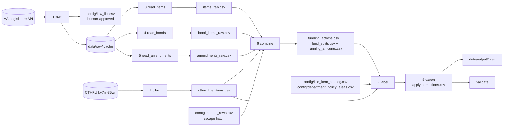

# Massachusetts Appropriations Dataset — Design Document

| | |
|---|---|
| **Status** | v0.2 — CTHRU-first design; file formats frozen since 2026-11-10 (change them only through §20) |
| **Created** | 2026-10-21 (v0.1); revised 2026-10-28 (v0.2, see §20) |
| **Audience** | Claude sessions and anyone who changes the program. Students: start with [`OVERVIEW.md`](OVERVIEW.md) |
| **Source of truth for** | Scope, architecture, file formats, allowed values, counting rules, checks, open questions, decisions |

> **How to use this document.** Read §1–§5 before touching code. A file format (§7) or allowed value (§9) changes only together with `schemas.py` and a Decision Log entry (§20); the student working with you decides, and no sign-off is needed. When an open question is answered, move it to the Decision Log in the same commit. If code and this doc disagree, the doc wins until someone updates it deliberately. What's left to do, and by when, is the task list in [`OVERVIEW.md`](OVERVIEW.md) §5. Section numbers are cited throughout the code, so they never change: §16, §18 and §21 were removed on 2026-11-18 and their numbers are not reused.

---

## Table of contents
1. [Purpose, scope, non-goals](#1-purpose-scope-non-goals)
2. [Glossary](#2-glossary)
3. [Sources](#3-sources)
4. [Seed law list](#4-seed-law-list)
5. [Core data model: the funding actions table](#5-core-data-model-the-funding-actions-table)
6. [Pipeline architecture](#6-pipeline-architecture)
7. [File formats](#7-file-formats)
8. [Mapping to the `exampledata.csv` columns](#8-mapping-to-the-exampledatacsv-columns)
9. [Allowed values](#9-allowed-values)
10. [Counting rules: net new appropriation authority](#10-counting-rules-net-new-appropriation-authority)
11. [Parsing details and known patterns](#11-parsing-details-and-known-patterns)
12. [Policy-area classification](#12-policy-area-classification)
13. [Validation suite](#13-validation-suite)
14. [Human review workflow](#14-human-review-workflow)
15. [Repo layout and engineering conventions](#15-repo-layout-and-engineering-conventions)
17. [Example-rows test](#17-example-rows-test)
19. [Open questions](#19-open-questions)
20. [Decision log](#20-decision-log)

---

## 1. Purpose, scope, non-goals

### Goal
Produce a complete, auditable, line-item dataset of **every Massachusetts state appropriation enacted in calendar years 2021–2025**, in the column format of [`exampledata.csv`](../exampledata.csv), with each row classified into one policy area from [`policyareas.csv`](../policyareas.csv).

Just as important, build **a program an analyst at the State Auditor's office can re-run each year** to add the next year's laws: clone the repository and follow [`RUNBOOK.md`](RUNBOOK.md), without Claude Code, with as few steps and commands as possible and a short, predictable review checklist (Decision Log, 2026-11-18). The analyst isn't a programmer. The 2021–2025 dataset is the first release, not the end product.

### Design principles (v0.2)
1. **Structured data first.** Take everything the Comptroller's CTHRU data provides. Read law text only for what CTHRU lacks (§3.4): which law made each supplemental change, bond laws, outside-section amendments, and item descriptions.
2. **Automate, don't hand-annotate.** Every routine kind of law is read by code. `config/manual_rows.csv` is an escape hatch for true one-offs, and validation counts its rows (target: zero).
3. **Carry human judgment forward.** Labels are recorded per line item (`config/line_item_catalog.csv`), not per row, so a decision made once applies in every later year.
4. **Nothing hard-coded to 2021–2025.** The scope window is a setting in `config/settings.toml`. A re-run test on 2026 laws (task list, [`OVERVIEW.md`](OVERVIEW.md) §5) checks that the readers generalize.
5. **Simple over clever.** There is no LLM in the pipeline, few stages, and few files. Yearly human work is limited to genuine judgment calls: approving new laws, labeling new line items, and explaining CTHRU mismatches.

### In scope
- **Enactment window:** laws whose governor approval date (API field `ApprovedDate`) is **2021-01-01 through 2025-12-31**. Filter on approval date, **not** the Acts volume year. Two 2020-volume chapters (2020 ch. 358 and ch. 383) were approved in January 2021 and are in scope.
- **Law types:** General Appropriations Acts (GAAs), supplemental budgets, state-surplus spending acts, capital bond authorization acts, and interim ("1/12th") budgets. Appropriations in outside sections of other acts are included where found (e.g., an item rewritten inside a policy act).
- **Granularity:** one row per line item per legal action. Earmarks ("not less than $X shall be expended for…") stay inside the parent item's text and are not separate rows.
- **Federal money:** captured, but **flagged** at the source-fund level and excluded from the main totals (decided by the partner, Q1; Decision Log 2026-11-02). Only money from federal sources is flagged; state surplus counts as state money.
- **Appropriations only, not spending (decided, Q10).** The dataset records legal authority (appropriations), not what the state actually spent. Our partner set this scope at the proposal stage (Decision Log, 2026-11-01).

### Reference-only data (ingested, not exported)
Laws outside the window that are needed for computation:
- **FY2021 GAA** (2020 ch. 227, approved 2020-12-11). Used to compute "Previously funded?" for FY2022 items.
- **Same-fiscal-year laws outside the window.** CTHRU reports totals per fiscal year, so FY2021 supplementals enacted in 2020 and FY2026 supplementals enacted in 2026 must be loaded for reconciliation.
- **Target acts of amendments.** For example, 2019 ch. 5 is amended by 2021 ch. 35.

### Non-goals
- Earmark-level extraction.
- Actual spending or expenditures (appropriations only; Q10, decided).
- Governor's mid-year "9C" cuts and other executive actions that aren't laws.
- Budgets of municipalities, authorities (MBTA, Massport), or quasi-public agencies, except where a state appropriation funds them.
- Laws enacted outside 2021–2025, except as reference data.

---

## 2. Glossary

Use these terms consistently in code, comments, commit messages, and conversations.

| Term | Meaning |
|---|---|
| **GAA** | General Appropriations Act: the annual state budget for one fiscal year. Example: 2023 Acts ch. 28 is the FY2024 GAA. |
| **Fiscal year (FY)** | July 1 – June 30, named for the ending year. FY2024 = 2023-07-01 → 2024-06-30. |
| **Calendar year** | In this project, the year the law was approved, which defines scope. |
| **Session law / chapter** | An enacted law, cited as "{year} Acts, ch. {n}". |
| **Section 2 / 2A / 2B / 2D / 2E / 2F** | Appropriation sections of an act. In GAAs: **2** = appropriations; **2B** = Intragovernmental Service Fund (ISF) chargebacks; **2D** = General Federal Grants Fund; **2E** = transfers from the General Fund to named trust funds; **2F** = Education and Transportation Fund (Fair Share surtax, FY2024+). In supplementals: **2** usually supplements existing items, **2A** makes new items for unanticipated obligations. Bond acts use 2–2I for capital items. |
| **Line item / item** | An 8-digit account ID in `NNNN-NNNN` form (e.g., `0930-0100`). The first 4 digits roughly identify the department. CTHRU writes it without the dash (`09300100`). |
| **Outside section** | Any section other than the appropriation sections (e.g., SECTION 178). It may amend earlier acts, including changing item amounts. |
| **Supplemental budget** | An act adding to, cutting, or creating items for a fiscal year already under way. |
| **Closeout supplemental** | The final supplemental for a fiscal year, usually enacted months after June 30 (e.g., 2023 ch. 77 for FY2023, approved 2023-12-04). |
| **Interim ("1/12th") budget** | A stopgap lump-sum appropriation before the GAA passes. By law, spending under it "shall apply against" the GAA, so it isn't additional money. |
| **Fund split** | Lines under an item giving the share paid by each fund (e.g., `General Fund … 52.63%`). |
| **Retained revenue (RR) item** | An item allowing an agency to spend revenue it collects, up to a ceiling stated in the text ("may expend … not more than $X"). |
| **ISF chargeback** | One agency paying another for services. The same money is already in the buying agency's Section 2 item, so counting it again double counts. |
| **Prior appropriation continued (PAC)** | Unspent authority carried into a later fiscal year. Not new money. |
| **Reauthorization** | An amendment extending the availability date of existing authority. Not new money. |
| **Alteration of purpose** | An amendment changing what existing money may be spent on, without new money. |
| **Bond authorization** | Capital authority to borrow and spend over several years (bond bills). Not an annual operating appropriation. |
| **Veto / reduction / override** | The governor may veto or reduce individual items. The Legislature may override, restoring the amount. Overrides can happen weeks or months after signing. |
| **Earmark** | A minimum amount inside an item's text for a named purpose or recipient. Not a separate row. |
| **Law key** | Our internal law identifier: `{year}-{chapter}`, e.g. `2023-77`. |
| **Record ID** | A stable identifier for an export row (see §9.6). |

---

## 3. Sources

### 3.1 MA Legislature public API (primary source)
- **Swagger spec:** `https://malegislature.gov/api/swagger/v1/swagger.json`
- **`GET /api/SessionLaws/{year}`** returns **every chapter in a year** as JSON, with `Year`, `ChapterNumber`, `Type` (`Acts`/`Resolves`), `ApprovalType`, `Title`, `Status`, `ApprovedDate` (e.g., `"Feb 28 2025"`), `ChapterText` (full HTML), and `OriginBill` (`BillNumber`, `GeneralCourtNumber`, and a `Details` URL).
  - Discovery is cheap: there are about 1,160 Acts in 2021–2025. Pulling one call per year gives the whole corpus.
  - **Quirk:** in the year list, each record's `Year` is the **approval** year, not the Acts volume, and its type varies (string or int). For example, 2020 ch. 358 appears in `/SessionLaws/2020` with `Year: 2021`. Always take the volume year from the year requested.
- **`GET /api/SessionLaws/{year}/{chapter}`** returns one chapter.
- **`GET /api/GeneralCourts/{court}/Documents/{bill}`** returns bill metadata.
- **`.../Documents/{bill}/DocumentHistoryActions`** returns the bill's action history, including veto overrides.
- `ApprovalType` values seen for 2021–2025 Acts: `Executive approval (signed)` (1,142), `Passed over veto` (12), `State election` (4), `Reoganization plan approved` (1, sic), and null (2). Discovery must record this field. A whole act passed over veto takes the override date as its enactment date (Q6, decided 2026-11-11).
- **Bill search is not needed.** The SessionLaws endpoint lists only enacted laws, which is exactly the set we need.

### 3.2 Session-law web pages
- `https://malegislature.gov/Laws/SessionLaws/Acts/{year}/Chapter{n}` is the human-readable page, with the same HTML as `ChapterText`. **This URL goes in the `Source URL` column.**
- `https://malegislature.gov/Budget/FY{yyyy}/FinalBudget` shows the final GAA for each fiscal year and links to the session law. It is useful for spot-checking vetoes and overrides.

### 3.3 Governor veto messages and override history
**Not used in v0.2.** Vetoes are found by comparing the law's printed amount with CTHRU (§11.4).
- Veto annotations in the act text reference the governor's message (e.g. "for message see House, No. 4055"). The pipeline reads the inline markup as a hint and doesn't fetch the messages.
- Override votes appear in the bill's `DocumentHistoryActions`. They aren't needed: vetoes and overrides are netted into each item's final amount (Q4, decided).

### 3.4 Comptroller CTHRU (primary source for annual budgets; check for everything else)
- Socrata dataset **`kv7m-35wn`** ("Budget_Actual_With_Other_Spending_Authorizationv3_Gen2", the production data behind CTHRU Budgets): `https://cthru.data.socrata.com/resource/kv7m-35wn.json`
- Useful fields: `fiscal_year` (e.g., `"2024.0"`), `appropriation_account_number` (8 digits, no dash), `appropriation_account_name`, `department_name`, `department_code`, `cabinet_secretariat_name`, `fund_number`, `fund_name`, `original_enacted_budget`, `supplemental_budget_appropriations`, `authorized_retained_revenue_ceiling`, `total_enacted_budget_appropriation`, `planned_saving_9c_cuts`.
- Spending-side fields, **not used** because the project covers appropriations only (Q10, decided): `total_expenses`, `unexpended_reverted`, `balance_forward_prior_appropriation_continued`, `transfer_in`, `transfer_out`, `retained_revenue_collected`. Related datasets: `uaqe-2tpk` (Non-Budgeted Special Revenue and Trusts) and `pegc-naaa` (Comptroller spending).
- **Quirks:**
  - There are **many rows per account per FY**, mostly zero rows under other departments. **Always aggregate** by FY × account and take the department with non-zero amounts.
  - Totals are **per fiscal year, not per law**.
  - The dataset has been re-versioned before ("v3_Gen2"). Save a dated snapshot on every pull, and keep all CTHRU-specific code in `cthru.py`, so a format change is a one-file fix.
- Example query:
  ```
  https://cthru.data.socrata.com/resource/kv7m-35wn.json?$select=fiscal_year,appropriation_account_number,sum(original_enacted_budget),sum(supplemental_budget_appropriations)&$group=fiscal_year,appropriation_account_number&$where=fiscal_year>='2022'
  ```

**What CTHRU covers (design probe, 2026-10-28, 8 requests):**

| Question | Finding | Consequence |
|---|---|---|
| Does `original_enacted_budget` reflect vetoes and overrides? | **Yes, in 4 of 5 FY2024 vetoed items checked.** 4000-0700 reduced and sustained: $3,601,016,357. 7061-0012 reduced: $498,972,361. 3000-1042 overridden: $35,000,000. 3000-5000: $17,500,000. **Exception:** 1231-1000 is printed at $10,000,000 after an override, but CTHRU shows $1,500,000. | GAA amounts come from CTHRU. Printed vs. CTHRU gives `veto_status`. Mismatches go to E's review (1231-1000 is the first). |
| Which GAA sections are present? | §2, §2E (trust transfers: $2.06B in FY2024 across 17 items, found 2026-11-11) and §2F (Education and Transportation Fund, $1.0B in FY2024) are present. **§2B ISF accounts appear with $0.** **§2D federal grants are absent.** | ISF is excluded from totals anyway. §2D needs law text if Q1 brings federal grants in. |
| Is supplemental money broken down by law? | **No.** No CTHRU budget dataset has a law or chapter column. | Supplementals are read from law text. CTHRU checks the per-FY sum. |
| Is there a capital (bond) dataset? | **No**, among 52 datasets. | Bond laws are read from law text. |
| History and freshness | FY2005 onward. FY2027 is already present. Updated daily. | "Previously funded?" is a lookup. New years appear automatically. |

Also verified: for FY2024, `23300100` shows original 9,310,231 + supplemental 350,000; `09300100` shows original 6,077,671. FY2024's total `original_enacted_budget` is $55,303,686,185.

### 3.5 Secondary cross-checks (manual use only)
- **MassBudget Budget Browser:** line-item history across years. Useful when items are renumbered and for "previously funded?" sanity checks.
- **Governor signing letters, House/Senate Ways and Means summaries, and A&F fact sheets:** law-level totals.

### 3.6 Politeness and terms
- Identify the scraper in its User-Agent (project name plus a contact email in config).
- Make at most about 1 request per second to malegislature.gov.
- Cache everything in `data/raw/` and never re-fetch unchanged content (see §15).

---

## 4. Seed law list

This is the candidate list produced during design research (2026-10-21) by scanning every 2020–2025 Act approved 2021-01-01 → 2025-12-31 for:
- appropriation-style titles,
- "hereby appropriated" language,
- line-item paragraphs ending in a dollar amount, and
- bond-issuance language.

**It is a seed, not the final law list.** Workstream A must re-run discovery as a full-text scan (§6, stage 1) and record an include/exclude decision with a reason for every candidate. The `items≈` column counts paragraphs starting with an item ID and ending in `$amount`. It is a rough lower bound: retained-revenue items and odd formats are missed.

| Law key | Approved | Proposed type | items≈ | Notes |
|---|---|---|---:|---|
| 2020-316 | 2021-01-11 | other | 1 | Hampshire Council of Governments. Likely a reference to an item, not an appropriation. **Probably exclude** after review. *(Decided 2026-11-04, Q7: in scope, as a supplemental.)* |
| 2020-358 | 2021-01-14 | bond | 27 | Economic development bond ("Enabling Partnerships for Growth"). 2020 volume, 2021 approval. |
| 2020-383 | 2021-01-15 | bond | 31 | Transportation bond (~$16.2B in items). 2020 volume, 2021 approval. |
| 2021-9 | 2021-04-01 | bond? | 1 | UI Trust Fund financing (special obligation bonds). **Decide include/exclude.** *(Decided 2026-11-04, Q7: in scope, as a bond law.)* |
| 2021-15 | 2021-05-25 | bond | 2 | Holyoke Soldiers' Home reconstruction ($600M). |
| 2021-23 | 2021-06-28 | interim | 0 | FY2022 interim. |
| 2021-24 | 2021-07-16 | gaa | 1,178 | **FY2022 GAA.** |
| 2021-25 | 2021-07-19 | bond | 1 | Chapter 90 municipal roads. |
| 2021-29 | 2021-07-29 | supplemental | 28 | FY2021 supplemental. |
| 2021-35 | 2021-08-03 | other | 1 | Policy act that **rewrites item 8100-1014 of 2019 ch. 5**. The delta needs the running amounts table. |
| 2021-76 | 2021-10-20 | supplemental | 100 | FY2021 closeout. Creates the Transitional Escrow Fund. |
| 2021-102 | 2021-12-13 | surplus (+federal) | 59 | ARPA (Federal COVID-19 Response Fund) **and** state surplus. Mixed funds; federal flag. |
| 2022-22 | 2022-02-12 | supplemental | 3 | FY2022. |
| 2022-42 | 2022-04-01 | supplemental | 28 | FY2022. |
| 2022-89 | 2022-06-17 | bond | 1 | Chapter 90. |
| 2022-98 | 2022-06-27 | interim | 0 | FY2023 interim. |
| 2022-103 | 2022-07-11 | supplemental | 1 | FY2022. |
| 2022-126 | 2022-07-28 | gaa | 1,224 | **FY2023 GAA.** |
| 2022-140 | 2022-08-04 | bond | 21 | General governmental infrastructure (~$5.2B). |
| 2022-175 | 2022-08-10 | bond | 3 | Judiciary IT. |
| 2022-176 | 2022-08-10 | bond | 19 | Transportation and climate (~$11.4B). |
| 2022-268 | 2022-11-10 | surplus (+federal) | 52 | Economic growth and relief: FY2022 closeout, surplus, and ARPA. Mixed funds. |
| 2023-2 | 2023-03-29 | supplemental | 22 | FY2023. |
| 2023-15 | 2023-06-26 | interim | 0 | FY2024 interim, $6,660,000,000. |
| 2023-24 | 2023-07-31 | interim | 0 | FY2024 second interim. |
| 2023-26 | 2023-07-31 | supplemental | 2 | FY2023. |
| 2023-27 | 2023-08-03 | bond | 2 | Chapter 90. |
| 2023-28 | 2023-08-09 | gaa | 1,412 | **FY2024 GAA.** Source of EX-001…EX-003. |
| 2023-77 | 2023-12-04 | supplemental | 83 | FY2023 closeout. **EX-004 is §178.** |
| 2024-88 | 2024-04-30 | supplemental | 2 | FY2024. |
| 2024-89 | 2024-05-03 | bond | 1 | Chapter 90. |
| 2024-122 | 2024-06-28 | interim | 0 | FY2025 interim, $6,925,000,000. |
| 2024-139 | 2024-07-29 | bond | 12 | IT bond (~$1.66B). |
| 2024-140 | 2024-07-29 | gaa | 1,167 | **FY2025 GAA.** Veto markup nearly absent (see §11.4). |
| 2024-150 | 2024-08-06 | bond | 16 | Affordable Homes Act (~$5.0B). |
| 2024-206 | 2024-09-16 | supplemental | 2 | FY2024. |
| 2024-238 | 2024-11-20 | bond | 35 | Mass Leads economic development (~$4.0B). |
| 2024-248 | 2024-12-04 | supplemental | 67 | FY2024 closeout. |
| 2025-1 | 2025-02-28 | supplemental | 1 | FY2025, Transitional Escrow Fund ($425M shelter item). |
| 2025-3 | 2025-05-15 | supplemental | 1 | FY2025. Short item title, amount ends with a period. |
| 2025-4 | 2025-05-29 | supplemental | 2 | FY2025. Same format as 2025-3. |
| 2025-7 | 2025-06-24 | supplemental | 28 | FY2025. |
| 2025-8 | 2025-06-30 | interim | 0 | FY2026 interim. |
| 2025-9 | 2025-07-04 | gaa | 1,340 | **FY2026 GAA.** |
| 2025-14 | 2025-08-05 | supplemental | 17 | FY2025. |
| 2025-17 | 2025-08-08 | bond | 4 | Chapter 90 (~$1.19B). |
| 2025-33 | 2025-09-22 | supplemental | 2 | FY2025. |
| 2025-73 | 2025-11-25 | supplemental | 56 | FY2025 closeout. |

**Reference-only seeds:**
- 2020-227 (FY2021 GAA).
- FY2021 supplementals approved in 2020. A title scan at M0 found none (2020 ch. 201 is the FY2020 closeout; ch. 101, 131 and 198 are FY2021 interims). Discover's full-text scan should confirm this.
- FY2026 supplementals approved in 2026: 2026-55 and 2026-101.
- Any act named as an amendment target, such as 2019-5. Targets older than the Legislature's API (1993-52, 1993-494) are kept as text in `review/sources/`, marked `parse_strategy = manual`.

---

## 5. Core data model: the funding actions table

### 5.1 Why one row per funding action
A law doesn't just create items. It also raises, cuts, re-purposes, extends, transfers, vetoes, and restores them, sometimes in other laws and sometimes in a later calendar year. Storing **one row per legal action (event)** handles all of these the same way:

- Every event has its own law, section, date, fiscal year, and signed amount.
- The `exampledata.csv` export is a **view** over the funding actions table, filtered to in-window events.
- Totals are sums over events flagged `counts_toward_total = true`.

### 5.2 Event types (`funding_action`)
The values (full list in §9.2) are: original appropriation, new supplemental item, supplemental increase, supplemental reduction, veto reduction, override restoration, reauthorization, alteration of purpose, transfer, interim appropriation, capital authorization, and prior appropriation continued. Under the Q4 decision, vetoes and overrides are netted into the item's amount (§5.7), so `VETO` and `OVR` are reserved and not emitted.

### 5.3 `amount_kind` and `counts_toward_total`
Each event carries:
- **`amount_kind`**: what the dollar figure means. One of `appropriation`, `retained_revenue_ceiling`, `bond_authorization`, `transfer`, `delta`, `prior_appropriation_continued`, `interim`, or `none` (e.g., a purpose change).
- **`counts_toward_total`** (true/false): whether it counts toward net new appropriation authority. Rules are in §10. Without this flag, totals will double count.

### 5.4 Fiscal year belongs to the event, not the law
- Take the FY from the appropriating section's text ("for the fiscal year ending June 30, 2024").
- **For amendments, take the FY of the act being amended.** EX-004 is in a law named "FY2023 Supplemental" but amends the FY2024 GAA, so its FY is **2024**. When the amended act has no single FY (a surplus law such as 2022-268, whose `primary_fy` is empty), take the amending law's own FY (`fy_rule = stated`), else the FY containing its approval: 2023-77, the FY2023 closeout supplemental approved in December 2023, adds $4,000,000 to 2022-268's item 1599-6063, and CTHRU books it in **FY2023** (Q28, proposed 2026-11-11).
- Multi-year items ("made available until June 30, 2027", "for the fiscal year in which the sums are disbursed") and bond items use the **FY containing the approval date**, set `fy_rule = enactment_fy`, and record `available_through`.

### 5.5 Running amounts
Keep the **current amount** of every `(target law, section, item)` after each event, in date order. This makes it possible to:
- compute deltas when an act replaces a whole item (2021 ch. 35) or inserts a new figure, and
- run the **struck-figure self-check**: when an amendment says it is "striking out the figure '$9,310,231'", the item's running amount must equal $9,310,231 (§13).

**How it's worked out** (`combine.amendment_amounts`, built by C): each item starts at the amount **printed** in the law that created it (`items_raw`, `bond_items_raw`; its retained-revenue ceiling if it has no amount), not CTHRU's, because an amendment strikes the figure as printed. The amendments that change an amount (`figure_change`, `item_insert`, `item_replace`, `item_strike`) are applied in approval-date order, then section order within a law. A figure change sets the item to the new figure, except when the struck figure is another figure in the item's text (a cap or an earmark, Q21) or the item already shows the new figure: then the item's amount doesn't change. A replacement sets the new amount (its change is new − running amount), and a strike sets $0. `change` is what happened to the item's figure; whether it counts is decided when funding actions are built (§10, Q27). `running_amounts.csv` itself is written by `combine` once it assigns Record IDs.

### 5.6 Fund attribution
Each event has zero or more fund splits (`fund_splits.csv`). The default fund is the one named in the section header (e.g., General Fund for GAA §2, General Federal Grants Fund for §2D, Education and Transportation Fund for §2F, Transitional Escrow Fund for 2025 ch. 1 §2A). Explicit split lines override the default. An item's own text can also name its fund. **The federal flag is computed from funds** (see §9.5).

### 5.7 Where amounts come from, and vetoes
- **GAA original appropriations** (`ORIG` in a GAA): the amount is CTHRU `original_enacted_budget` for that FY × item, which already reflects vetoes and overrides. These rows have `amount_source = cthru`. The law's printed amount goes in `amount_printed` (from `read_items`).
- **Everything else** (supplementals, amendments, bonds, interim) has `amount_source = law_text`. Escape-hatch rows have `manual`.
- **Vetoes are netted** (Q4, decided 2026-11-01). There's one row per item with its final amount. `veto_status` (§9.9) records `none`, `vetoed`, `reduced`, `partial_override`, `overridden`, `wording_vetoed` or `unknown`, and appears in the main export as "Veto status" (Q14, decided 2026-11-06). It's set by comparing `amount_printed` with CTHRU, with the inline veto markup as a hint. Unexplained differences are flagged `cthru_mismatch` and go to the review queue.
- Vetoes in bond laws (not in CTHRU) rely on inline markup only and are flagged `veto_unverified` when markup is present.

## 6. Pipeline architecture

Each stage reads and writes **versioned files**. Stages never call each other's internals, so people can work in parallel against samples. The one shared piece of code is `paragraphs.py`, which turns law HTML into paragraphs. Its output format (§7.2) is a contract, because three readers use it.



| # | Stage | Reads | Writes | Started by |
|---|---|---|---|---|
| 1 | `laws` | API year lists, law list | `config/law_list.csv` (new candidates as `tbd`), `data/raw/sessionlaws/{year}/{ch}.json`, `data/raw/manifest.csv` | A |
| 2 | `cthru` | CTHRU | `data/raw/cthru/{date}/…` (snapshot), `data/interim/cthru_line_items.csv` | E |
| 3 | `read_items` | raw supplemental and GAA laws | `data/interim/items_raw.csv`, `reports/unread_paragraphs.csv` | B |
| 4 | `read_bonds` | raw bond laws (incl. Chapter 90) | `data/interim/bond_items_raw.csv`, `reports/unread_paragraphs_bonds.csv` | A |
| 5 | `read_amendments` | raw laws | `data/interim/amendments_raw.csv`, `reports/unread_sections.csv` | C |
| 6 | `combine` | everything above, law list, `manual_rows.csv` | `data/interim/funding_actions.csv`, `fund_splits.csv`, `running_amounts.csv` | A built the shared core (IDs, totals, fund splits, writing the file); each piece's rows by whoever started that piece; C built the running amounts table; E the CTHRU comparison |
| 7 | `label` | funding actions, `cthru_line_items.csv`, catalog, department table | `data/interim/labels.csv` | D |
| 8 | `export` | funding actions, labels, `review/corrections.csv` | `data/output/ma_appropriations_cy2021_2025.csv`, `…_extended.csv`, `data/output/ma_capital_authorizations_cy2021_2025.csv` (bond laws, Q5), `review/review_queue.csv` (the data dictionary is [`CODEBOOK.md`](CODEBOOK.md), written by hand) | everyone |
| — | `validate` | everything | `reports/validation/*.csv`, `reports/law_status.csv` | E |

**Interface rule:** stages exchange files only. A stage may read upstream outputs but never writes them.

### Stage notes
1. **laws.** Pull `/SessionLaws/{year}` for the configured years (`[scope] discover_years`) and **scan full text, not just titles**. Flag an Act not yet on the law list as a candidate if it has any of (tightened 2026-11-07, see the Decision Log):
   - a line-item paragraph (an item ID at the start, a dollar amount at the end),
   - "hereby appropriated",
   - an amendment of a line item ("item NNNN-NNNN … is hereby amended", in either order),
   - borrowing language ("issue and sell … bonds" or "notes"),
   - the comptroller transferring a dollar amount ("the comptroller shall transfer $…", "transferring no less than … $…"; added 2026-11-08),
   - an appropriation-style title ("making appropriations", "appropriations for", "supplementing", "financing the …").

   Laws approved outside the window are flagged too, with a note, because they may be needed as reference-only laws.

   **Amendment targets** (2026-11-08): the stage also reads `read_amendments`' output from the previous run and adds, as `tbd`, every law that an **in-scope** law amends but the law list lacks, naming the amending sections. Laws amended only by reference-only laws are left out. A target missing from the API (older laws, e.g. 1993) is reported for a person to add by hand. Because `laws` runs before `read_amendments`, run `laws` again after reading.

   New candidates are appended with `role = tbd`, and existing human decisions are never overwritten. The stage also adds reference-only laws: same-FY laws outside the window, and amendment targets found by `read_amendments`. It then downloads each listed law's JSON and stores the SHA-256 and fetch time in `manifest.csv`, skipping unchanged files and throttling requests. **This stage is what a future cohort runs first each year.**
2. **cthru.** One aggregated query per FY (FY2005 onward for history), saved as a dated snapshot. It writes one row per FY × account (§7.5). This is the source of every GAA original appropriation and of agency names.
3. **read_items.** Uses the item state machine (§11.2).
   - **Supplementals:** full items with amounts, fund splits and headers.
   - **GAAs:** item text, printed amount, struck amount and inline veto markup only. A missed GAA item costs only a blank description (the amount comes from CTHRU) and is reported.
4. **read_bonds.** The same state machine, applied to capital sections (§2–§2I) of bond laws and Chapter 90 bills. It shares `items_raw` columns.
5. **read_amendments.** Grammar for outside sections (§11.3), including **direct appropriations**. Interim budgets are read here, not typed by hand.
6. **combine.** Builds GAA `ORIG` rows from `cthru_line_items.csv` (each FY has exactly one GAA in the law list). It adds rows from the readers, assigns Record IDs (§9.6), computes `counts_toward_total`, fiscal year and fund splits, maintains the running amounts table, and sets `veto_status` from the CTHRU comparison. **How the pieces plug in** (2026-11-10): each piece is one row builder in `combine.BUILDERS`, returning rows in this format in source order; the shared core (A) keeps in-scope laws, assigns Record IDs, sets `counts_toward_total` (§10) and builds the fund splits (§5.6), then writes the three files and `reports/combine_problems.csv`. **Amendment rows** (C, `combine.amendment_rows`, 2026-11-11): one row per `amendments_raw` row of an in-scope law, with the funding action of §11.3. An amount comes from the item's running amount (§5.5), so a replaced item counts only its change. A change to an existing item takes the amended act's fiscal year (`fy_rule = target_act`, §5.4; for a surplus law with no single year, the amending law's own year) and counts the way the item does: its `section_type` is that of the item's section in the target law, so a change to a §2B chargeback, §2D federal grant or §2E trust transfer doesn't count (§10). A figure change counts **$0** when it doesn't change the item's amount (a cap or earmark in its text, or the item already shows the new figure: Q21) or when the same law's §2 adds the same money (Q27); one whose running amount is unknown or doesn't match uses the law's own change, flagged `low_confidence_parse`. An item replaced at the same amount is `PURP` $0 (Q26, option 1). A change to a **bond** item is `CAP` by its change (a restated one $0), never counted, with the amending law's fiscal year; its wording changes are `PURP` (issue #41). Transfers (`XFER`) and direct appropriations (`NEW`; `INT` in an interim law) take the approval's fiscal year; a transfer's line item is the item it goes to, else the one it comes from, and its fund is the one fund it comes from. Money moved from a fund into a line item is the appropriation out of that fund (Q24): an `INC` (`delta`) to the item, flagged `fund_transfer_chain`, which counts (2024-88 §25, +$175,000,000 from the Transitional Escrow Fund to 1599-0514, FY2024, the only such transfer on the 70 downloaded laws). A change to an operating item takes the item's fund, as supplemental items do: the law's printed split, else the one fund CTHRU books the item to that fiscal year, else the item's section fund, so a change to an ARPA item is flagged `federal` (Q33). A date extension's whole new date is `available_through`, flagged `multi_year`. Hand-kept items in `config/manual_rows.csv` give starting amounts too (`combine.starting_items`), for laws no stage reads (1993-52, issue #41).
7. **label.** Agency/office from CTHRU, Program/purpose by rule, policy area from the catalog or department table (§12), and the three yes/no-style columns (§8).
8. **export.** Applies human corrections (§14) and writes the exact `exampledata.csv` columns and order, plus an extended file and the review queue. The data dictionary is `docs/CODEBOOK.md`, written by hand.

## 7. File formats

> **v0.2, frozen on 2026-11-10 (§20).** Change them only through the Decision Log. All CSVs are UTF-8 with a header row, comma-delimited, and quoted per RFC 4180. Money is an **integer number of dollars** (no commas, no `$`) in interim files. Dates are ISO `YYYY-MM-DD` in interim files; the export reformats them to match `exampledata.csv`. Booleans are `true`/`false`, lists are `;`-separated, and an empty cell is null. The code copy of these formats is `src/ma_approps/schemas.py`.

### 7.1 `config/law_list.csv` (human-curated)
| column | type | notes |
|---|---|---|
| `law_key` | str | `2023-77` |
| `acts_year` | int | volume year (2020 for 2020-383) |
| `chapter` | str | |
| `approved_date` | date | from `ApprovedDate` |
| `approval_type` | str | from API |
| `api_title` | str | full formal title |
| `law_name` | str | **curated** short name, e.g. `FY2024 General Appropriations Act`, `FY2023 Supplemental Appropriations Act (December 2023)` |
| `law_type` | enum | §9.1 |
| `role` | enum | `in_scope`, `reference_only`, `excluded`, `tbd` (a discovered candidate awaiting a human decision) |
| `include_reason` | str | why it is included, excluded, or reference-only |
| `primary_fy` | int | FY stated in the title or appropriation section, if any |
| `origin_bill` | str | `{court}/{bill}`, e.g. `194/H58`, matching the API path `/GeneralCourts/{court}/Documents/{bill}` |
| `parse_strategy` | enum | `auto`, `manual`, `auto+manual` (`manual` is the escape hatch) |
| `notes` | str | |

### 7.2 `paragraphs.paragraphs()` output (in memory; optionally `data/interim/paragraphs/{law_key}.jsonl`)
One object per paragraph: `law_key`, `para_idx`, `text` (normalized), `raw_html`, `classes` (list), `struck` (list of struck substrings), `bold` (list), `links` (list of hrefs). Built by B; used by B, A and C.

### 7.3 `data/interim/items_raw.csv` and `bond_items_raw.csv`
The same columns for both. `read_items` (B) writes `items_raw.csv` for supplementals and GAAs; `read_bonds` (A) writes `bond_items_raw.csv`.
| column | notes |
|---|---|
| `law_key`, `section` | e.g. `2023-28`, `2` |
| `section_fund_default` | fund named in the section preamble |
| `fy_stated` | FY from the section preamble |
| `para_start`, `para_end` | paragraph span |
| `line_item` | `NNNN-NNNN` |
| `secretariat_header_raw`, `agency_header_raw` | nearest headers as printed |
| `item_text` | full description, including provisos; final wording only, struck words left out (§11.2) |
| `amount` | final printed amount (int). Null for RR items with no trailing amount. For GAAs this becomes the funding action's `amount_printed`. |
| `amount_struck` | struck-through original amount, if any |
| `retained_revenue_ceiling` | retained-revenue ceiling parsed from the text, if any |
| `fund_splits_raw` | e.g. `General Fund:52.63;High-Quality Early Education & Care Affordability Fund:47.37` |
| `veto_annotation_raw` | annotation text as printed (a hint for `veto_status`) |
| `veto_kind_inline` | `none`, `disapproved`, `reduced`, `reduced_and_wording`, `overridden`, `wording_vetoed` (§11.4) |
| `reader_version` | semver of the reader |
| `confidence` | `high`, `medium`, `low` |

### 7.4 `data/interim/amendments_raw.csv`
| column | notes |
|---|---|
| `law_key`, `section` | the amending law and outside section (e.g. `2023-77`, `178`) |
| `action_type` | `figure_change`, `item_insert`, `item_strike`, `item_replace`, `text_insert`, `text_strike`, `date_extend`, `purpose_change`, `transfer`, `direct_appropriation` |
| `target_law_key`, `target_section`, `target_item` | e.g. `2023-28`, `2`, `2330-0100`. "Said …" references resolved. |
| `old_figure`, `new_figure` | ints, where applicable |
| `old_date`, `new_date` | for `date_extend`: an ISO date (`2024-06-30`), a year (`2024`) when the law changes only a year, or month and day as written (`November 30`) when the law gives no year |
| `amount` | for `direct_appropriation` (including interim budgets) or `transfer` |
| `from_item`, `to_item` | for `transfer`; `to_item` is also a renumbered item's new number (`purpose_change`, §11.3) |
| `fund_raw` | fund named, if any, as written in the law; for a `transfer`, the source funds, separated by `; ` |
| `to_fund` | for a `transfer`: the funds the money goes to, as written, separated by `; `: those named after "to" and before any item, purpose or proviso (2021-33 §2 → Student Opportunity Act Investment Fund; 2024-206 §58 → `Transitional Escrow Fund; federal COVID-19 response fund`). Blank when it goes to an item (`to_item`) or to something that isn't a fund ("the Massachusetts Life Sciences Center", 2025-73 §189). `combine` uses it for Q2/Q15 (transfers into trusts) and Q24 (escrow into items). Added 2026-11-10 |
| `source_text` | verbatim section text |
| `reader_version`, `confidence` | |

### 7.5 `data/interim/cthru_line_items.csv`
One row per fiscal year × account, aggregated across CTHRU's per-department rows: `fiscal_year`, `line_item` (`NNNN-NNNN`), `account_name`, `department_code`, `department_name`, `secretariat`, `fund_numbers` (`;`-separated), `original_enacted`, `supplemental`, `retained_revenue_ceiling`, `total_enacted` (ints). Built by E.

### 7.6 `config/manual_rows.csv` (escape hatch)
The same columns as `funding_actions.csv` (§7.7), except `record_id`, which combine generates. Adds `source_quote` (verbatim text), `entered_by`, `entered_on`. **Use only for a true one-off law no reader handles.** Validation reports the count (target zero), and the runbook asks whether a reader should be extended instead.

### 7.7 `data/interim/funding_actions.csv` (canonical)
| column | notes |
|---|---|
| `record_id` | §9.6 |
| `law_key`, `section`, `line_item` | `line_item` may be empty for lump sums |
| `target_law_key` | the law whose item is affected (equals `law_key` for original items) |
| `event_date` | approval date |
| `calendar_year` | year of `event_date` |
| `fiscal_year`, `fy_rule` | `stated`, `target_act`, `enactment_fy` |
| `available_through` | date or empty |
| `section_type` | §9.4 |
| `funding_action` | §9.2 |
| `amount_kind` | §9.3 |
| `amount` | signed int (reductions negative) |
| `amount_source` | `cthru`, `law_text`, `manual` (§5.7) |
| `amount_printed` | for GAA rows: the law's printed amount, for comparison |
| `veto_status` | §9.9 |
| `counts_toward_total` | bool (§10) |
| `fund_primary` | fund with the largest share |
| `federal_share` | 0–1, computed from fund splits |
| `flags` | `;`-separated (§9.5) |
| `agency_header_raw` | |
| `item_text` | |
| `source_url` | |
| `source_para_start` | for traceability |
| `reader_version` | |

### 7.8 Side tables
- **`fund_splits.csv`**: `record_id`, `fund_name`, `fund_number` (if known), `share`, `is_federal`. `share` is empty when CTHRU lists several funds for an item whose law prints no split (2026-11-10).
- **`running_amounts.csv`**: `target_law_key`, `section`, `line_item`, `as_of_event` (`record_id`), `amount_after`. Built by C.

### 7.9 `data/interim/labels.csv`
`record_id`, `agency_office`, `program_purpose`, `program_purpose_method` (`rule`, `human`), `policy_area`, `policy_area_method` (`catalog`, `department`, `rule`, `human`), `previously_funded` (`Yes`, `No`, `Unknown`), `one_time_or_recurring`, `new_or_reapprop`. An empty `policy_area` means the row is waiting in the review queue.

### 7.10 Label tables (human-curated, committed; started by D)
- **`config/line_item_catalog.csv`**: `line_item`, `policy_area` (§9.8), `label_every_year` (bool; `true` for catch-all items such as 1599-xxxx reserves, which always go to review), `decided_by`, `decided_on`, `note`. There's one row per line item, and it carries over between years. Rows generated from the department table have `decided_by = department list (automatic)`; a person who checks one replaces it with their name.
- **`config/department_policy_areas.csv`**: `department_code`, `department_name`, `policy_area` (empty when mixed), `mixed` (bool), `decided_by`, `decided_on`, `note`. The rule for items not yet in the catalog.

### 7.11 `review/corrections.csv` (human-edited, committed)
`record_id`, `field` (an export or description column name), `new_value`, `expected_old_value`, `reviewer`, `review_date`, `note`. Use it for one-row fixes only. Labels that should apply in every year go in the catalog (§7.10).

### 7.12 `review/review_queue.csv` (generated; do not edit)
Written by `export` on every run (`export.review_queue`), from the finished main and capital files (corrections applied) and the checks the program already runs, so it is never out of date. One line per row and reason, sorted by `priority`, then reason, fiscal year and line item. Columns: `record_id` (blank when the problem has no row in the files, e.g. money CTHRU has and we don't), `reason`, `priority` (1 changes a total, chart or flag; 2 needs checking; 3 other), then the context columns `law_key`, `fiscal_year`, `line_item`, `detail` (what was found, in words) and `where_to_record` (where the decision goes, §14).

| `reason` | Priority | A row is listed when… |
|---|---|---|
| `policy_area` | 1 | it still has no policy area after corrections |
| `cthru_mismatch` | 1 | our amount for that fiscal year and item differs from CTHRU's and isn't `flagged` or `earlier_laws` (§13 check 4) |
| `unknown_fund` | 1 | the law names a fund missing from `config/funds.csv`, so the program can't tell whether it is federal (`reports/combine_problems.csv`) |
| `amendment_check` | 2 | an in-scope law's amendment needs a person (§13 check 3; Q21, Q27) |
| `borrowing_limit` | 2 | the bond item is under a borrowing limit its items don't add up to (§13 check 7; Q11) |
| `combine_problem` | 3 | any other line of `reports/combine_problems.csv` |

Rows flagged only `veto_unverified` aren't listed: every §2D federal grant row carries that flag. Known gap: a CTHRU difference, amendment or borrowing limit that a person has explained in `review/research_log.md` stays in the queue, because nothing the program reads records the explanation yet.

### 7.13 Export
`data/output/ma_appropriations_cy2021_2025.csv` uses the 19 columns of `exampledata.csv`, in the same order, plus **"Veto status"** right after "Appropriation/change ($)" (§8; Q14, decided 2026-11-06), then the two counting columns **"Counts toward total?"** and **"Amount counted toward total ($)"** (§8 rows 13b–13c, decided 2026-11-21), so the file can be totalled in Excel. The amount before a veto (`amount_printed`) stays in the extended file only. `…_extended.csv` adds every funding-actions column. **Wording-only changes to bond items** (`PURP` rows with `section_type = capital`, e.g. 2024-150 §71–§76 rewording 1993 item 4000-8200) go in the extended file only, not the main or capital file (Decision Log, 2026-11-11).

**Bond laws go in a separate capital file, not the main export (Q5, decided).** Rows with `funding_action = CAP` are written to `data/output/ma_capital_authorizations_cy2021_2025.csv`. **Its columns (Q16, decided 2026-11-06)** are the main export's columns plus 11 more (`schemas.CAPITAL_EXPORT_COLUMNS`), each repeating the details of the borrowing limit that covers the item (§7.16): Borrowing limit section; Borrowing limit ($); Total of items under this limit ($); Identified federal share ($); Federal split; Limit difference note; Bond name; Maximum term (years); Final payable date; Fund paying the bonds; Spending authority through. The item's own amount (its full project amount) is "Appropriation/change ($)". Pocket-vetoed items are left out (vetoes are netted). Every item covered by a limit with a difference gets a Limit difference note naming the limit and the gap, e.g. "covered by §4: items exceed the borrowing limit by $400,000,000" (Q11).

### 7.14 `config/funds.csv` (human-curated)
`fund_name`, `fund_number`, `is_federal` (bool), `notes`. Drives the federal flag (§9.5). A name a law prints is matched ignoring case, punctuation, "&" vs "and", a leading "the" and a trailing "fund" (`combine._fund_key`). A name that differs more ("George L. Darey Inland Fisheries and Game Fund") gets its own row with the same `fund_number`; that row stands for the first row with that number. A fund the laws name that isn't listed is kept, not treated as federal, and sent to the review queue (`unknown_fund`, §7.12).

### 7.15 `data/raw/manifest.csv` (written by `laws`)
One row per cached file, sorted by `path`: `path` (relative to `data/raw/`, `/`-separated), `source_url`, `sha256`, `bytes` (int), `fetched_at` (UTC, `YYYY-MM-DDTHH:MM:SSZ`). A row changes only when its file's content changes. Cached law files:
- `sessionlaws/_lists/{acts_year}.json`: the whole `/SessionLaws/{year}` response (also what discovery will scan)
- `sessionlaws/{acts_year}/{chapter}.json`: one Acts chapter split out of it (Resolves are numbered separately and skipped)

JSON is written with sorted keys and a one-space indent, the same as `tests/samples/`. The cache comes first: an existing file is never re-downloaded; delete it to refresh.

### 7.16 `data/interim/bond_authorizations_raw.csv` (written by `read_bonds`)
One row per borrowing-limit section (Q11, Q12, Q17, decided 2026-11-06). Numbered 7.16 because PR #3 adds §7.15.

| column | notes |
|---|---|
| `law_key`, `section` | the borrowing-limit section, e.g. `2024-139`, `4` |
| `covers_sections` | `;`-separated capital sections it pays for, e.g. `2A;2B` |
| `covers_items` | `;`-separated line items, only when the limit names items rather than whole sections (2021-15 §6: `4000-2026`) |
| `authorized` | the borrowing limit ($) |
| `items_total` | total of the items it covers ($): the full project amount |
| `federal_share` | identified federal share ($), when `federal_split = identified` |
| `federal_split` | `identified` (the law says the items depend on federal funds, so the limit is the state share: `federal_share` = `items_total` − `authorized`); `unknown` (federal money is expected but the law gives no amount: the items exceed the limit and the law doesn't support calling the limit the state share, or the item's borrowing depends on federal reimbursement, as in 2021-15 item 4000-2026); `none` (items equal the limit) |
| `bond_name` | as printed on the bonds |
| `max_term_years` | maximum term |
| `payable_by` | final payable date |
| `paying_fund` | the fund that pays interest and principal (the General Fund, or a special obligation bond's fund) |
| `available_through` | how long spending authority lasts (from §1, e.g. "made available through December 31, 2030"), or empty |
| `reader_version`, `confidence` | as in §7.3 |

Only what the laws say is collected: no bond sale data (actual maturities, interest rates) and no spending (Q17; Q10 stands).

### 7.17 `config/item_number_fixes.csv` (human-curated)
Item numbers misprinted in a law, so the item is read instead of landing in the unread report (issue #18). `law_key`, `printed` (as in the law, e.g. `911-1003`), `line_item` (the right number, `NNNN-NNNN`), `evidence` (how we know, e.g. the same item's number in other years' budgets). `read_items` applies the fixes for the law it reads, marks those items `confidence = medium`, and warns if a fix isn't used. `read_bonds` can pass them to `read_items.read_law` the same way (its optional `fixes` argument); no bond law needs one yet. When a future law has a misprinted number, it shows up in `unread_paragraphs.csv`; add a row here.

### 7.18 `config/citation_fixes.csv` (human-curated)
Laws misprinted in an amending section's citation (§11.3). `law_key` and `section` (the amending section, e.g. `2024-248`, `35`), `printed` (the law as cited, e.g. `2022-24`), `target_law_key` (the law meant, e.g. `2021-24`), `evidence` (how we know). `read_amendments` replaces `printed` with `target_law_key` in that section's rows, gives them `confidence = medium`, and warns if a fix isn't used. Numbered 7.18 because `config/item_number_fixes.csv` (PR #31) takes §7.17.

### 7.19 `review/unread_explanations.csv` (human-edited, committed)
Where a person says why a row of an `unread_*` report needs no code (Q22, decided 2026-11-11). `report` (the report's file name: `unread_paragraphs.csv`, `unread_paragraphs_bonds.csv` or `unread_sections.csv`), `law_key`, `section`, `explanation`, `explained_by`, `date`. `validate` (§13 check 6) treats an unread row as explained when this file has a row with the same report, law and section and a written explanation, or when the report's own `explanation` column is filled. One row covers every row of its section, which is what a paragraph report needs. The reports are generated and are never hand-edited. A row that matches no unread row, for example after a reader fix removed it, is listed in `reports/validation/unread_explanations_orphaned.csv` and doesn't fail `validate`.

### 7.20 `reports/law_status.csv` (written by `validate`, check 8)
One row per in-scope law with funding actions (decided 2026-11-12): `law_key`, `status` (`checked`, `partially_checked` or `not_checked`) and `note`, the plain-language sentence the export repeats on each of the law's rows as "Source or calculation for total" (§8 column 19). The export works the same rows out itself from the run's files, because it runs before `validate` (`export.law_notes`).

## 8. Mapping to the `exampledata.csv` columns

| # | Column | Derivation | Stage |
|---|---|---|---|
| 1 | Record ID | `record_id` (§9.6). The example uses `EX-001`; our IDs are stable keys. | combine |
| 2 | Law citation | `"{acts_year} Acts, ch. {chapter}"`, e.g. `2023 Acts, ch. 28` | combine |
| 3 | Law name | law list `law_name` (curated) | law list |
| 4 | Enactment date | `event_date` as `MM/DD/YYYY` (e.g. `08/09/2023`) | export |
| 5 | Calendar year | year of `event_date` | combine |
| 6 | Fiscal year | `fiscal_year` (§5.4) | combine |
| 7 | Section | section of the **enacting** law: `2`, `2A`, `178` | extract |
| 8 | Line item | `NNNN-NNNN`; blank for lump sums | extract |
| 9 | Agency / office | **The most specific administering office**, taken from CTHRU for that FY (so reorganizations are handled automatically). Order: CTHRU account name or item text naming a division (e.g., "division of marine fisheries"), then the CTHRU department. The printed header is the fallback for items not in CTHRU (bonds). *Example:* item 2330-0100 sits under the header "Department of Fish and Game." but the example expects **"Division of Marine Fisheries"**. Check this against CTHRU's account name early. | label |
| 10 | Program / purpose | Short summary of the item's purpose. **Rule only:** the first clause of the item text with boilerplate removed ("For the operation of…"); CTHRU account name when no text was read. Humans may override individual rows. | label |
| 11 | Policy area | one value from `policyareas.csv`, from the catalog or department table (§12) | label |
| 12 | Funding action | display label of `funding_action` (§9.2) | combine |
| 13 | Appropriation/change ($) | `amount`, formatted with thousands separators (e.g. `6,077,671`). Negative for reductions. | export |
| 13a | Veto status | `veto_status` (§9.9). Not in `exampledata.csv`; added after the amount (Q14, decided 2026-11-06). | combine |
| 13b | Counts toward total? | `Yes` if the row's money counts toward the file's total (§10): in the main file when `counts_toward_total` is true, in the capital file for every bond item (the separate capital total); else `No`. Not in `exampledata.csv` (decided 2026-11-21). | export |
| 13c | Amount counted toward total ($) | The dollars that count: the amount less any federal share (`federal_share`), `0` for a `No` row, blank when the row has no amount. Follows a corrected amount. Summing it gives `combine.operating_total` in the main file and `combine.capital_total` in the capital file; `export` prints both sums. Not in `exampledata.csv` (decided 2026-11-21). | export |
| 14 | Previously funded? | **Prior fiscal year only** (Q3, partner, 2026-11-01): `Yes` if the same line item has non-zero enacted authority in the **immediately preceding fiscal year** (FY−1) in CTHRU or the funding actions table; `No` if it had none in FY−1, even if it was funded in some earlier year. `Unknown` only when the fact can't be established, e.g. the item number is new but the text suggests a renumbered program (Q3, partner, 2026-11-06). **EX-001:** its item 0930-0100 was funded in FY2023, the year before (CTHRU shows $4,400,000), so the answer is `Yes`; the example's `Unknown` was a placeholder (Q3, 2026-11-06). | label |
| 15 | One-time or recurring funding | **Recurring = funded in at least 2 consecutive budgets** (Q3, partner, 2026-11-02): `Recurring` if the line item has non-zero enacted GAA authority in the row's fiscal year **and** in the year before **or** the year after; otherwise `One-time`. So a program's first year is recurring when the next budget funds it again. The newest year's labels can change when the next GAA passes, so a re-run updates them. Supplemental, surplus and bond events → `One-time` (Q3, decided 2026-11-11). | label |
| 16 | New funding appropriation or re-appropriation of existing funding? | From `amount_kind`/`funding_action`: appropriation, delta (supplemental increases **and** reductions), or bond → `New`; PAC or reauthorization → `Re-appropriation`; transfer or alteration of purpose → `Transfer of existing authority` (Q3, decided 2026-11-11: these defaults stand). A row that counts $0 because it only restates an operating item is recorded as an alteration of purpose (Q26); a restated bond item stays a `CAP` row of $0. | label |
| 17 | Human review status | `Human reviewed` if a correction exists for the record or its policy area came from a human decision (a catalog row decided by a person, not one marked `department list (automatic)`, or the `human` method); otherwise `Not human reviewed` (§9.7) | export |
| 18 | Source URL | `https://malegislature.gov/Laws/SessionLaws/Acts/{acts_year}/Chapter{chapter}` | combine |
| 19 | Source or calculation for total | **Law-level** note from §13 check 8 (`reports/law_status.csv`, §7.20), repeated on each row of the law. It states only what was checked: the law's rows with an amount, its net new money (§10), how many items compared with CTHRU match exactly, the dollar gap of those that differ, items whose difference is shared with other laws (no dollar figure), and what the total excludes; for bond items, how many borrowing limits match their items and the gap of those that don't. Example (2023 ch. 28, the FY2024 budget, offline run of 2026-11-12 with the Nov 5 CTHRU snapshot): `Total partly checked: 1,423 rows with an amount, net new $53,736,254,123; 837 of 846 items compared match CTHRU FY2024; 9 items differ by $317,591,060 in total. Excludes §2B chargebacks, …`. For bond items, a borrowing limit whose gap is exactly its identified federal share is said to be so, and doesn't count against the law (§10, New 1). A law with nothing to compare gets `Total not checked against CTHRU.` | validate → export |

**Placeholder answers** (partner, 2026-11-06): `Unknown` means the fact has not been established; `Not classified` means a category has not been assigned; `Pending` means a review or counting decision remains open. Use them only when there truly isn't enough information or a decision is still open. Columns 15 and 16 follow the rules above (Q3, decided 2026-11-11).

---

## 9. Allowed values

### 9.1 `law_type`
`gaa`, `supplemental`, `surplus`, `bond`, `interim`, `other`. If a law is mixed (e.g., 2022-268), use its dominant type and set per-row flags.

### 9.2 `funding_action` (code → export label)
| code | export label | typical amount_kind | counts toward total? |
|---|---|---|---|
| `ORIG` | Original appropriation | appropriation / retained_revenue_ceiling | yes (§10 caveats) |
| `NEW` | Supplemental appropriation | appropriation | yes |
| `INC` | Supplemental increase | delta (+) | yes |
| `RED` | Supplemental reduction | delta (−) | yes (negative) |
| `VETO` | Veto reduction | delta (−) | yes (negative). *Reserved: not emitted, because vetoes are netted (Q4, §5.7).* |
| `OVR` | Veto override restoration | delta (+) | yes. *Reserved, as above.* |
| `INT` | Interim appropriation | interim | **no** |
| `CAP` | Capital authorization | bond_authorization | **no** (separate capital total and separate capital file, Q5) |
| `REAUTH` | Reauthorization | none / prior_appropriation_continued | **no** |
| `PAC` | Prior appropriation continued | prior_appropriation_continued | **no** |
| `PURP` | Alteration of purpose | none | **no** |
| `XFER` | Transfer | transfer | **no** (see §10) |

The labels `Original appropriation` and `Supplemental increase` match the examples. The other labels need partner sign-off (§19).

### 9.3 `amount_kind`
`appropriation`, `retained_revenue_ceiling`, `bond_authorization`, `transfer`, `delta`, `prior_appropriation_continued`, `interim`, `none`.

### 9.4 `section_type`
`approp_main` (GAA §2, supplemental §2), `approp_new` (supplemental §2A), `isf` (§2B), `federal_grants` (§2D), `trust_transfer` (§2E), `surtax` (§2F), `capital` (bond §2–§2I), `outside` (outside section), `interim`, `prior_approp` (supplemental §2CI and §2CII: balances carried into the next fiscal year; proposed 2026-11-11).

### 9.5 `flags` (`;`-separated)
`federal` (federal_share > 0), `federal_mixed` (0 < share < 1), `isf_chargeback`, `trust_transfer`, `fund_transfer_chain` (money moved through a reserve or escrow fund: the move in doesn't count, the move out to an item does; Q2, Q24. A marker only: whether a row counts follows its `amount_kind`), `arpa_reallocation`, `multi_year`, `retained_revenue`, `veto_unverified`, `cthru_mismatch`, `manual_row`, `low_confidence_parse`.

**Federal funds** (`is_federal = true` in `config/funds.csv`, curated): General Federal Grants Fund, Federal COVID-19 Response Fund (ARPA), Coronavirus Relief Fund, and trust funds filled with ARPA money (Broadband Innovation Fund, Behavioral Health Trust Fund). State surplus funds such as the Transitional Escrow Fund are **not** federal. General Fund items that are later federally reimbursed (e.g., MassHealth) are **not** federal under this rule (Q1, decided 2026-11-02).

### 9.6 Record ID
Format: `{acts_year}-{chapter:03d}-S{section}-{line_item|NOITEM}-{funding_action}-{ordinal}`

Examples:
- `2023-028-S2-0930-0100-ORIG-1`
- `2023-077-S178-2330-0100-INC-1`
- `2023-015-S1-NOITEM-INT-1`

The ordinal counts duplicates of the same prefix in source order. IDs must be deterministic: re-running on the same raw inputs gives the same IDs.

### 9.7 Human review status
`Not human reviewed` (default), `Human reviewed`. (v0.1's `Review stale` was dropped in v0.2: enacted laws don't change text, and labels live in the catalog.)

### 9.8 Policy areas
Exactly the 18 values in `policyareas.csv`:
1. Education
2. Health and public health
3. Children and families
4. Human services and income support
5. Housing and homelessness
6. Economic development and workforce
7. Transportation
8. Environment and natural resources
9. Public safety and corrections
10. Courts and legal services
11. Veterans’ services
12. Arts, culture, and recreation
13. Government administration and oversight
14. General local aid
15. Public employee pensions and benefits
16. Debt service, reserves, and statewide finance
17. Multiple
18. Unclassified/other

Note: `Veterans’ services` uses a typographic apostrophe in the file. Match it exactly.

### 9.9 `veto_status` and `amount_source`
- `veto_status`: `none`, `vetoed`, `reduced`, `partial_override` (the governor reduced the item and the Legislature restored only part of the cut; Q13), `overridden`, `wording_vetoed` (wording struck, amount unchanged), `unknown` (§5.7; the two new values decided 2026-11-06).
- `amount_source`: `cthru`, `law_text`, `manual`.

---

## 10. Counting rules: net new appropriation authority

The **operating total** for a law (or fiscal year) is the sum of `amount` over events with `counts_toward_total = true`, excluding `federal`-flagged shares by default.

| Event / section | Counted? | Why |
|---|---|---|
| GAA §2, §2F items; supplemental §2/§2A new items and increases | yes | new authority |
| Reductions, veto reductions (negative), override restorations | yes | net effect |
| Retained-revenue ceilings (fee-based items) | yes, flagged `retained_revenue` (Q2, decided) | CTHRU tracks these separately; reconcile against `authorized_retained_revenue_ceiling` |
| §2B ISF chargebacks | **no** | duplicates §2 spending |
| §2D federal grants and federal fund shares | **no by default**, kept and flagged | pending the State Auditor decision |
| §2E transfers to trust funds | **no** for the transfer in, flagged `trust_transfer`; count the **appropriation out** of the trust instead (Q2, decided) | the same money would otherwise be counted twice. For trusts that spend without a further appropriation, see Q15 |
| Transfers into reserve or escrow funds (e.g., Transitional Escrow Fund) that later acts appropriate from | count the **appropriation out**, not the transfer in, flagged `fund_transfer_chain` (Q2, decided) | avoids double counting surplus money |
| Transfers **from** a reserve or escrow fund **into a line item** (2024-88 §25: up to $175,000,000 from the Transitional Escrow Fund to item 1599-0514) | **yes**, recorded as an `INC` (`delta`) to item 1599-0514, which is how CTHRU books it, and flagged `fund_transfer_chain` as a marker (Q24, decided 2026-11-11) | this is the appropriation out: the transfer into the fund wasn't counted, so the money counts here, once |
| Interim budgets | **no** | by statute they apply against the GAA |
| PAC, reauthorizations, alteration of purpose, item-to-item and fund-to-fund transfers (except Q24's), ARPA reallocations | **no** | not new money |
| Bond authorizations | **separate capital total**, never summed with operating; exported in the separate capital file (§7.13, Q5). The capital total is the items' total **minus any identified federal share**, which is kept and flagged; where the split is `unknown`, the full amount stays in, flagged (2026-11-06, amends Q11). A later law that restates an earlier bond item counts **only a change in amount** (2024-150 §60 restates 1993 item 4000-8200 at the same $50,000,000: $0). Pocket-vetoed items count $0 and are left out of the capital file | multi-year borrowing authority |

---

## 11. Parsing details and known patterns

### 11.1 Normalization (`paragraphs.py`, shared)
- Unicode NFKC. Convert `&nbsp;`/U+00A0 to a space, U+2011/U+2010/en dash inside item IDs to `-`, and smart quotes to plain quotes **only in matching keys** (keep the original text for display).
- Join text split across `<span>`s before matching. IDs and `$` amounts are sometimes split.
- Keep **strike-through** (`style="text-decoration: line-through;"`) and **bold** spans as attributes. They carry veto meaning.
- Apply CSS **`text-transform: uppercase`** to the text, so it reads as the page shows it. The 2021 and 2022 GAAs type some secretariat headings in lower case and show them in capitals; without this, `read_items` missed them and kept the heading above (2026-11-12).
- Treat `</p>` and `<br>` as paragraph boundaries. Keep the original HTML for debugging.
- Don't rely on CSS classes. `HWMLineItem`, `HWMAgency`, and `HWMSecretariat` exist in the FY2021 HTML but not reliably in later years.

### 11.2 Item extraction state machine (`read_items`, `read_bonds`)
One state machine, used in three modes: **supplementals** (full items), **GAAs** (description, printed amount and veto markup only; amounts come from CTHRU) and **bonds** (capital sections §2–§2I and Chapter 90 bills; `amount_kind = bond_authorization`). Bond formatting was checked on the two bond samples on 2026-10-29 (see **Bond laws** below).

States: `PREAMBLE → SECTION_HEADER → (SECRETARIAT_HEADER | AGENCY_HEADER | ITEM | FUND_SPLIT | VETO_NOTE)* → next SECTION`.

- **Section start:** a paragraph matching `^SECTION\s+(2[A-Z]{0,4}(\.[IVX]+)?)\.` (2, 2A, 2CI, "2C.I"), or a paragraph that is **only** the heading, in any case and with or without the period ("Section 2" in 2021-24, "SECTION 2" in 2024-140; issue #12). The section is recorded without inner periods (`2CI`). The **first outside section** (§3 or higher) ends the budget part, so statute text quoted later ("Section 2PPP.") is ignored. Capture the preamble's fund and fiscal year; a section without its own takes §1's, except §2C sections (prior appropriations continued), whose default fund is left blank. A section with no items (e.g. 2021-35's policy "SECTION 2.") is ignored.
- **Headers:** short paragraphs (120 characters or fewer, 150 for ALL CAPS) that don't start with an item ID or contain `$`. ALL-CAPS headers are usually secretariats or independent offices; Title-case ones are usually agencies. Keep both raw: they are the **nearest headers as printed**, and the laws aren't consistent (FY2024 prints "Judiciary." and "State ethics commission.", and independent offices sit among a secretariat's agencies), so agency names come from CTHRU (§12).
- **Item start:** an item ID **at the start of a paragraph**, optionally preceded by a veto note in the same paragraph. IDs inside provisos ("from item 1599-0026") are **not** item starts. No space is required after the ID (2024-140 prints `4125-0122vFor`). IDs misprinted with a missing digit (`911-1003` in 2024-140, `340-1000` in 2020-227, `4190-010` in 2025-9) are corrected through `config/item_number_fixes.csv` (§7.17); any other misprint lands in the unread report.
- **Item end:** the paragraph whose text ends with the **trailing amount after a dotted leader**: `\.{2,}\s*(?:\$[\d,]+\s*)?\$([\d,]+)\.?\s*$` (`paragraphs.TRAILING_AMOUNT_RE`, shared with `read_amendments`). The amount may be several paragraphs after the start. Earmark amounts earlier in the text must be ignored, so always take the trailing one. A trailing period (`$240,000,000.`, 2025 ch. 3) is allowed. Also accepted: no dotted leader (the normal layout of the FY2021 and FY2022 GAAs), and, at `confidence = medium`, printed typos: `$186.409,929`, `3,369,875`, `.$4,100,000`, `$$515,000`, `$ 2,629`, `$4,371,777.42`. A replacement amount printed on its own line under a struck amount belongs to the item above (2025-9, 1595-6368).
- **Struck amounts:** if the trailing region contains a struck amount followed by a plain amount (`<s>$49,279,108</s> $48,420,108`), set `amount_struck` = the first and `amount` = the second.
- **Struck wording:** where the governor struck wording and substituted new wording (2210-0106 in FY2024), `item_text` keeps **only the final wording**. `veto_kind_inline = reduced_and_wording` records that the wording changed (group decision 2026-11-01). Wording struck with the amount unchanged is `wording_vetoed` (2026-11-06).
- **Retained revenue:** if the text contains `may expend … not more than $X` and there is no trailing amount, set `retained_revenue_ceiling` and leave `amount` null. `amount_kind` = `retained_revenue_ceiling`.
- **Fund splits:** paragraphs like `General Fund…… 52.63%`, possibly several per paragraph separated by `<br>`. Attach them to the preceding item. Variants seen: no dotted leader (`Marijuana Regulation Fund 100%`), a fund name wrapped onto two lines, a split on the same line as the amount, and a missing `%` (`General Fund …… 80.32`, 2024-140). In all 31 law-list GAAs and supplementals, every item's splits add up to 100%.
- **Unread:** any paragraph in an appropriation section that isn't consumed goes to `reports/unread_paragraphs.csv` (`unread_paragraphs_bonds.csv` for `read_bonds`). This file must be empty, or explained, before a law can be marked done.

**Bond laws** (checked 2026-10-29 on samples 2024-139 and 2025-17, using `paragraphs.py` from PR #6). Expected output is in `tests/samples/expected/bond_items.csv` and `bond_authorizations.csv`.
- **The state machine works unchanged for the items.** Every item is one paragraph that starts with its ID and ends with a dotted leader and amount. Headers follow the ALL-CAPS secretariat / Title-case agency pattern. Earmarks inside the text ("not less than $300,000 …") are skipped by the trailing-amount rule. Spacing before the `$` varies, which the end pattern already allows. The samples have no fund splits, veto markup or retained revenue. All 16 items in the two samples are found, and no capital-section paragraph is left unread.
- **Capital sections may start at §2A.** 2024-139 has no §2. They end at the first `SECTION 3.` or higher.
- **No preamble per section.** `SECTION 1` introduces all the capital sections at once. It names no fund and no fiscal year, so `section_fund_default` and `fy_stated` stay empty and the fiscal year comes from the enactment date (§5.4, `fy_rule = enactment_fy`). It may give an availability date ("made available through December 31, 2030", 2024-139), which becomes `available_through`.
- **Borrowing limits come after the items**, one section each: "the state treasurer shall … issue and sell bonds … not exceeding, in the aggregate, $X". Each names the capital sections it covers, which may be more than one (2024-139 §4 covers §2A and §2B). It also gives the bond's name, its maximum term, its final payment date and the fund that pays it. `read_bonds` writes them to `bond_authorizations_raw.csv` (§7.16; Q11, Q12, Q17, decided 2026-11-06).
- **Items don't always add up to the borrowing limit.** In 2024-139, the §2A and §2B items total $1,455,000,000, but §4 allows borrowing of only $1,055,000,000. The item text doesn't explain the $400,000,000 gap, but §3 does (see the survey below). Check 7 must still report differences for review rather than treat them as reader errors. **Decided (Q11, partner, 2026-11-01):** a law's capital total is the sum of its items, any difference from its borrowing limits is flagged, and the borrowing limits are recorded too.

**Survey of every law with capital sections** (2026-11-04: the 15 bond laws plus supplemental 2023-2; 191 capital items). Findings marked ✓ were hand-checked by Emma against the official text.
- **Every item is one paragraph** that starts with its line item number and ends with its amount, so the item rules above still apply, with two adjustments:
  - **The amount may have no dotted leader** ("…applies $4,400,000,000"; 2020-383, 2022-176, 2023-2, 2024-150). ✓ (2024-150 item 7004-0074.)
  - **The line item number may be followed by dots or a space** ("6121-2114.. For" or "6121-2617 For"), sometimes both in one law.
- **Capital sections can sit inside a supplemental budget,** numbered §3 and up: 2023-2 §3–§3B (10 items, $740,300,000), with borrowing limits in §§77–79 that match exactly. ✓ (found by Emma.) **Decided (Q25, 2026-11-06):** these are capital authorizations (unusual ones: mostly matching grants), go in the capital file, and are read by `read_bonds` (A), which therefore also reads capital sections in non-bond laws.
- **Read capital sections only from the first capital heading to the first section after them.** A later amendment can contain its own "Section 2." heading as part of the new text it inserts. For example, 2024-238 §183 replaces section 2 of General Laws chapter 61A ("Section 2. Land shall be considered to be in horticultural use…"). That's part of §183, not a capital section. ✓
- **Borrowing limits:**
  - may cover **several sections** (2022-140 §7 covers §2, §2A and §2B);
  - may cover **a single line item** rather than a section: 2021-15 §6 is for item 4000-2026 ($400,000,000) and §7 for item 4000-2027 ($200,000,000), both in §2 ✓;
  - use varying wording ("in the aggregate" or "in an aggregate principal amount", 2021-9 §23 ✓);
  - may be **special obligation bonds** paid from a named fund (2020-383 §36, 2021-9, 2022-176 §44);
  - may be **federal grant anticipation notes** instead of bonds: 2020-383 §34 ($1,250,000,000 for §2C), secured by a pledge of federal highway construction funds. `read_bonds` records it as a limit with federal split `unknown`: the notes are repaid from federal highway money but meet only "a portion of the expenditures" of §2C, and the law doesn't say how much (Emma, 2026-11-06). The survey had missed it because it doesn't say "issue and sell bonds";
  - name the fund that repays them ("shall be payable from the General Fund"), except 2024-139, which doesn't; `paying_fund` is then left blank (Emma, 2026-11-06).
- **Spending end dates** in §1 may be per section: 2024-238 makes §2–§2B available until June 30, 2029 and §2C until June 30, 2034; 2024-139 gives one date for the act.
- **Vetoes appear in bond laws** and are read from the inline markup (CTHRU has no capital data, so these rows are flagged `veto_unverified`, §5.7):
  - **A reduction** shows the old amount crossed out before the new one. 2020-383 item 6621-2117: $400,000,000 → $370,000,000. The capital total uses **$370,000,000**. ✓
  - **A pocket-vetoed item** is entirely crossed out under "Governor pocket vetoed the following item". 2020-383 items 6720-2127 ($250,000,000) and 6921-2110 ($25,000,000) **never became law and are left out of the capital total.** ✓ `read_bonds` keeps each as a row for the record, with `amount` blank, the printed amount in `amount_struck` and `veto_kind_inline = disapproved`.
  - Wording vetoes and section vetoes (2020-383, 2022-176) don't change amounts.
- **Federal-aid items exceed their borrowing limits because the limit is the state's share.** These items may only be committed "based upon a prior or anticipated future commitment of federal funds and the availability of corresponding state funding", so the borrowing limit covers only the state's part. ✓ Cases:
  - 2020-383 item 6121-2114: $4,400,000,000 of items against a §32 limit of $880,000,000;
  - 2022-176 §2 against §41's $611,800,000;
  - 2022-176 item 6720-2215 ($3,500,000,000) against §47's $1,750,000,000;
  - 2022-176 item 6622-2214 ($25,501,000) against §48's $8,300,000. This item lacks that sentence, but allows spending on projects in the federal Infrastructure Investment and Jobs Act of 2021.

  Under the Q11 decision, these laws' capital totals therefore **include federally funded amounts**, which bears on Q1. **2024-139 §4** (items $1,455,000,000 against a limit of $1,055,000,000) is explained the same way. §3 creates a fund (new G.L. c. 29 §2EEEEEE) that is also credited with "federal financial participation revenues" claimed for eligible expenditures, and with interest. Amounts credited "shall be expended without further appropriation", so part of the items can be paid without borrowing. The law gives no dollar figure for those other sources. ✓ (found by Emma.) **So every gap between items and borrowing limits in the 16 laws is now explained** by vetoes, federal shares or other fund sources.
- **Amendments to earlier bond laws** go to `read_amendments` (§11.3, "bond-on-bond amendment"). 2024-150 §60 replaces item 4000-8200 of 1993 ch. 52, and §61 changes the wording of item 3722-8899 of 1993 ch. 494. ✓ Both laws predate the Legislature's API (the 1993 year list returns HTTP 400) and website, so their text comes from the State Archives and is kept in `review/sources/`. They are listed as reference-only with `parse_strategy = manual`, which the `laws` stage doesn't download. Sources and the item histories are in `review/research_log.md` (Emma, 2026-11-04). 4000-8200 was also amended by 1993 ch. 494 §4 and 2002 ch. 244 §15–18 (listed as reference-only); none of these changed its $50,000,000.

### 11.3 Outside-section grammar (`read_amendments`)
Resolve "said item … of said section 2 of said chapter 28" by carrying the last explicitly named law, section, and item forward through consecutive sections. A section that amends the **General Laws** gives no row. Laws name them in several ways: "chapter 62 of the General Laws", a bare "Chapter 40R is hereby amended" (an act always says "of the acts of …"), "The General Laws are hereby amended", or "as appearing in the 2022 Official Edition" / "as so appearing" (only the General Laws have an Official Edition). Chapter numbers can carry a half ("chapter 159A1⁄2"). A chapter of the resolves is treated the same, since it isn't an appropriation act. Patterns to support, each with a sample:

| Pattern | Example | Action |
|---|---|---|
| Figure change | 2023-77 §178: *Said Item 2330-0100 of said section 2 of said chapter 28 is hereby further amended by striking out the figure "$9,310,231" and inserting in place thereof the following figure:- $9,660,231.* | `figure_change` → `INC` +350,000, FY of the target (2024) |
| Figure decrease | the same with a smaller new figure | `RED` (negative) |
| Several items in one section | "items 1234-5678 and 2345-6789 … are hereby amended" | one action per item |
| Date extension | 2023-77 §41: *Item 7008-1117 of section 2A of chapter 142 of the acts of 2019 is hereby amended by striking out the figure "2023" … inserting … 2024* | `date_extend` → `REAUTH` |
| Date with no year | 2023-77 §49: *…striking out the words "July 1" and inserting in place thereof the following words:- November 30.* The year is in the target item's text | `date_extend` → `REAUTH`, dates as written, `medium` confidence |
| Non-reversion | 2023-77 §214: *any unexpended balances, not exceeding a total of $40,000,000, in items 4000-0700 and 4000-1426 of section 2 of chapter 126 of the acts of 2022 shall not revert … until September 1, 2023* | `date_extend` per item → `REAUTH`, `medium` confidence (often only part of the balance) |
| Whole-item replacement | 2021-35 §1: *Section 2A of chapter 5 of the acts of 2019 is hereby amended by striking out item 8100-1014 … and inserting in place thereof the following item:-* | `item_replace`; delta = new − running amount of the target |
| Replacement by a renumbered item | 2022-268 §228: *…striking out item 4003-0100 and inserting in place thereof the following item:- 4003-0122 … $10,000,000* | `item_strike` of the old item → `RED` by its running amount, plus `item_insert` of the new item → `NEW` |
| Item insertion | "…is hereby amended by inserting after item X the following item:-" | `item_insert` → `NEW` |
| Item strike | "…by striking out item X" | `item_strike` → `RED` by the running amount |
| Text-only change | 2023-77 §179: inserting proviso words | `text_insert` → `PURP` with no amount, or ignore if trivial |
| Transfer | "the comptroller shall transfer $X from item A to item B" | `transfer` → `XFER`. The source runs to the first "to" after the source's first fund or item, since its description can contain "to" ("related to the planning … established in item 1599-6077", 2023-2 §76). The destination is the first item after that, however it is named ("to the reserve established in item 1599-0514 …", 2024-88 §25) |
| Clause of an item | 2024-150 §61: *Clause (2) of item 3722-8899 of section 2 of chapter 494 of the acts of 1993 is hereby amended by striking out the words … and inserting in place thereof …* | the same as an amendment of the item itself (here `purpose_change` → `PURP`) |
| Item renumbered | 2021-102 §46: *Section 2 of chapter 112 of the acts of 2018 is hereby amended by striking out the figure "7002-0015" and inserting in place thereof the following figure:- 7002-0016* (also "the item number") | `purpose_change` → `PURP`, no money; the new number in `to_item` |
| Transfer, other word order | 2023-28 §95: *the comptroller shall transfer from the General Fund to the Health Safety Net Trust Fund … the greater of $45,000,000 or 1/12 of …* | `transfer` → `XFER`; `low` confidence when the figure is only a bound ("the greater of", "the lesser of") |
| Transfer, other wordings | by the comptroller or the secretary of administration and finance, with the figure within 60 characters of "transfer": a list, *transfer: (i) an amount not to exceed $10,000,000 from … to …; and (ii) …* (2021-102 §84); no source, *transferring no less than: (i) $350,000,000 to the Student Opportunity Act Investment Fund …* (2021-33 §2); words before "from", *transfer $4,891,987,249.40 allocated to the commonwealth from the Coronavirus State Fiscal Recovery Fund …* (2021-22 §3) | one `transfer` per figure (per "(i)", "(ii)" … in a list), in whole dollars; `low` confidence when the figure is an estimate ("or such amount as may be required", 2022-126 §163) or for each of several years ("$50,000,000 each such fiscal year", 2025-73 §191). A figure further from the verb isn't the amount moved ("reduce any transfers … by an amount not to exceed $375,000,000", 2024-140 §224) |
| Amendment of an amendment | 2023-77 §56: *Said chapter 102 is hereby further amended by striking out section 67 … and inserting in place thereof the following section:- Section 67. Item 8200-0200 of said section 2 of said chapter 24 is hereby amended …* | read the inner amendment, `low` confidence (its "said" references belong to the earlier law) |
| Direct appropriation | "the sum of $X is hereby appropriated…" in an outside section or policy act | `direct_appropriation` → `NEW` |
| Interim lump sum | 2023-15 §1: *the amount of $6,660,000,000 is hereby appropriated for the fiscal year ending June 30, 2024…* | `direct_appropriation` in an interim law → `INT` (read by code, not typed) |
| Bond-on-bond amendment | a bond act amending an earlier bond act's item | `figure_change` on `CAP` |

These go to `reports/unread_sections.csv`: anything in an outside section mentioning `$` and an item or appropriation that isn't matched; a transfer by the comptroller or the secretary of administration and finance with a figure soon after "transfer" (the `laws` stage's "transfers money" signal, §6 stage 1) that no pattern reads, since a transfer between funds names no item (2021-22 §3 was missed this way before reader 0.10.0); an amendment whose text names a line item but produces no row, even with no `$` (2021-24 §73); and an outside section that lists line items itself (paragraphs starting with an item number), which no stage reads. Sections 2… of the law types `read_items` reads are left to it, and so are the capital sections outside §2 that `read_bonds` reads (2023-2 §3–§3B, Q25): `read_amendments` asks `read_bonds.capital_sections()` which those are, so the two stages agree. In bond laws and other laws with capital items, the borrowing-limit sections ("issue and sell bonds", §7.16) are also left to `read_bonds`. Only **in-scope** laws are reported. A reference-only law is read for its items' history (its amendment rows are kept), but it adds no rows to the dataset, so its unread sections are only counted in the run summary (2002 ch. 244 §5, §20, §22). Hand-kept laws (`parse_strategy = manual`, e.g. 1993 ch. 52) have no cached text and are skipped. A section the Governor **returned with a recommendation of amendment** (a note before it says so) isn't law in that chapter: the Legislature's version, if any, is a separate later chapter. It gives no rows, and is listed when it would otherwise have given rows (Q23).

A dollar figure whose commas aren't in groups of three is a misprint, in the law or in the one it quotes (2022-42 §46 strikes "$15,000,0000" from 2021 ch. 102). Every row of a section with one gets `low` confidence, so a human checks it instead of combine reading a $135,000,000 cut.

A section can also cite the wrong law: 2024-248 §35 amends item 8200-0200 "of section 2 of chapter 24 of the acts of 2022", but the item is in 2021 ch. 24. Such citations are corrected through `config/citation_fixes.csv` (§7.18). They usually come to light when the `laws` stage proposes an unrelated law as an amendment target (§6 stage 1): mark that law `excluded` and add a row.

An outside section that looks vetoed is still read, but its rows get `low` confidence and the section is also listed in `reports/unread_sections.csv`, so a human checks whether the veto was overridden (§11.4: markup is a hint, not truth; Q23). "Looks vetoed" means some of its text is struck through, or a "The Governor disapproved of the following section" note is printed just before it. Example: 2023-28 §100, a $205,000,000 transfer.

### 11.4 Veto markup variants (inline)
| Year (GAA) | Markup |
|---|---|
| FY2021 (2020-227) | `The Governor disapproved the following item [for message, see House, No. 5190]` + `The Legislature overrode the Governor's veto.` (142 items, all overridden) |
| FY2022 (2021-24) | strike-through present (~100 spans); a few "disapproved/overrode" notes |
| FY2024 (2023-28) | `Governor reduced the following item, for message see House, No. 4055` with a struck old amount and a new amount; `Legislature overrode Governor's disapproval`; `…and disapproved of certain wording and added wording in place thereof` |
| FY2025 (2024-140) | **Only one** annotated reduction (`1108-5200`: struck $2,169,893,912 → $2,163,893,912). The governor vetoed more than that, so **the text is incomplete**. |

**Reading the notes into `veto_kind_inline`** (`read_items`, and `read_bonds` through it). A note is a paragraph starting "Governor"/"The Legislature" that also uses veto words, so the bold header "LEGISLATURE." (item 9500-0000) isn't one. In order: "overrode" → `overridden`; "reduced" → `reduced_and_wording` if it mentions wording, else `reduced`; wording disapproved and the amount not struck → `wording_vetoed` (18 items: 2020-383, 2021-24, 2021-102, 2022-176; issue #28); any other disapproval, including "pocket vetoed the following item" (2020-383) and the misspelled "dissaproved" (2025-9) → `disapproved`.

**Rule (v0.2):** treat inline markup as a hint, not truth. For every GAA item, the dataset amount is CTHRU `original_enacted_budget`. Compare it with the printed amount to set `veto_status` (§5.7):
- They're equal: `none`, or `overridden` if the markup says so.
- CTHRU is lower: `reduced`, or `vetoed` if CTHRU is 0.
- Anything inconsistent, such as 1231-1000 in FY2024: `unknown` plus a `cthru_mismatch` flag for E's review.

Bill history and veto messages are not fetched (§3.3).

---

## 12. Policy-area classification

Rules and humans only, with no LLM (Decision Log 2026-10-28). Each row records `policy_area_method`. Labels are kept **per line item** so they carry over between years.

1. **Catalog lookup** (`config/line_item_catalog.csv`). If the item is in the catalog and `label_every_year = false`, use its policy area. After the first year this covers nearly every row.
2. **Department default** (`config/department_policy_areas.csv`). About 150 CTHRU departments, each mapped once to its usual area. A new item in a non-mixed department gets that area automatically, and is queued as `new_line_item` so a human can add it to the catalog. Examples:
   - Division of Marine Fisheries → *Environment and natural resources*
   - Office of the Child Advocate → *Children and families*
   - Department of Veterans' Services → *Veterans’ services*
   - State Retiree Benefits Trust / GIC → *Public employee pensions and benefits*
   - Courts and CPCS → *Courts and legal services*
   - DOT → *Transportation*
   - DHCD/EOHLC → *Housing and homelessness*
   - DESE, EEC, higher-ed campuses → *Education*
   - DPH, DMH, MassHealth → *Health and public health*
   - DTA, DDS, Elder Affairs → *Human services and income support*
   - DOC, sheriffs, State Police → *Public safety and corrections*
   - Legislature, A&F, DOR, elections → *Government administration and oversight*
   - Unrestricted local aid (7061-0008, 0611-xxxx lottery aid) → *General local aid*
   - Debt service and stabilization transfers → *Debt service, reserves, and statewide finance*
3. **Mixed departments, `label_every_year` items, and items with no CTHRU department** (e.g., bond items) go to the review queue with an empty policy area. Mixed departments include the EOHHS umbrella, A&F reserves (1599-xxxx), and DCR (parks vs. water).
4. **Human decisions** are written into the catalog (one row per item), not into `corrections.csv`, so they apply in every later year. **Unclassified/other** requires a written reason in `review/research_log.md`, as `policyareas.csv` requires.
5. **Seeding (D, week 1):** pull CTHRU's account and department list, fill `department_policy_areas.csv`, then generate catalog rows for every account in a non-mixed department. Humans review the mixed-department items plus a random 5% spot-check of the generated rows.
6. **Catalog drift:** if CTHRU's account name or department for a catalog item changes from one year to the next, validation queues it as `catalog_drift` so a human can confirm the label still fits.

## 13. Validation suite

`python -m ma_approps validate` writes `reports/validation/*.csv` and `reports/law_status.csv`. Checks:

1. **File formats and allowed values:** every file matches §7 and every value is allowed by §9. Record IDs are unique.
2. **Example-rows test:** reproduces the reader- and combine-derived fields of EX-001…EX-004 (§17).
3. **Struck-figure self-check:** for every `figure_change`, `old_figure` equals the running amount for the target. A mismatch means a missed amendment, a veto, or a parse error. `validate` writes every amendment that changes an item's amount to `reports/validation/amendment_amounts.csv`: the amendment's columns from `amendments_raw`, then `amount_before`, `amount_after`, `change`, `check`, `review` and `note` (§5.5). `check` is `match`, `already_new` (the item already shows the new figure), `in_item_text` (the struck figure is a cap or earmark in the item's text), `mismatch`, or `target_not_read` (the target law isn't downloaded or is kept by hand). `review = true` for anything but a match, and for a figure change that probably restates the same law's §2 supplement (Q27). **Reported, not yet a failure**, until Q21 and Q27 are decided and there's a place to record explanations (Q22).
4. **CTHRU comparison** per FY × line item (built by E):
   - GAA: printed amount vs. `original_enacted` sets `veto_status` (§11.4). Unexplained differences go to `reports/validation/cthru_mismatches.csv`.
   - Supplementals: `Σ NEW + INC + RED` (for that FY, with reference-only laws loaded) vs. `supplemental`. Every row counts, whether or not it counts toward the operating total, because CTHRU carries federal money too. Where several laws touch one item, a difference can't be attributed and is flagged.
   - RR items vs. `retained_revenue_ceiling`. §2B chargebacks are compared here too, because CTHRU shows them only as ceilings, and a same-year increase to such an item is added to its ceiling, because CTHRU folds it in.
   - Report dollar and percent differences. Known non-law differences (9C cuts) are annotated.
5. **Internal consistency:** fund splits sum to 100% (±0.01); the item-ID prefix is consistent with the CTHRU department; no item appears twice in one section without a reason.
6. **Coverage:** `unread_*` reports are empty or every row is explained (in the report's own `explanation` column or in `review/unread_explanations.csv`, §7.19); every law-list `in_scope` law has at least one funding-action row; every GAA item in CTHRU has a description or is listed as missing.
7. **Bond totals:** for each borrowing limit (§7.16), the total of the `CAP` items it covers is compared with the limit. A difference is not a reader error: it is reported, sent to the review queue, and flagged on every item row the limit covers, with a note naming the limit and the gap (Q11, decided 2026-11-06). The capital total excludes identified federal shares (§10).
8. **Law status** (`reports/law_status.csv`, §7.20; decided 2026-11-12): each in-scope law gets `checked` (nothing it touches differs from CTHRU, or for bond items from its borrowing limits, without a known reason), `partially_checked` (something does) or `not_checked` (nothing could be compared), plus a sentence that becomes the `Source or calculation for total` column. Differences marked `flagged` or `earlier_laws` (check 4) have a known reason and don't count against a law. There is **no tolerance**: any difference, even $1, is reported.
9. **Orphaned corrections:** corrections whose record ID no longer exists are listed in `reports/correction_problems.csv`.
10. **Manual rows:** the number of `manual_rows.csv` rows per law (target zero), for the runbook.
11. **Catalog drift:** see §12 step 6.

## 14. Human review workflow

Anyone can work any review item.

1. Run the pipeline. Open `review/review_queue.csv` (sorted by priority).
2. Record each decision in the right place:
   - **A policy area for a line item** goes in `config/line_item_catalog.csv` (it applies in every year).
   - **A one-row fix** (e.g., one supplemental row's purpose text) goes in `review/corrections.csv` with `record_id`, `field`, `new_value`, `expected_old_value`, your name, and the date.
   - Never edit generated CSVs.
3. Write any reasoning longer than one line in `review/research_log.md` under a heading with the record ID or line item.
4. Re-run `label` and `export`. Commit the changed config and review files together with a message such as `review: policy areas for 12 new FY2024 items`.

## 15. Repo layout and engineering conventions

```
capstone-fall26/
├── CLAUDE.md                     # pointer + rules for Claude sessions
├── README.md                     # quickstart
├── docs/                         # OVERVIEW (students), WORKFLOW (git + Claude), DESIGN (this file), RUNBOOK and CODEBOOK (analyst; CODEBOOK to write)
├── exampledata.csv  policyareas.csv   # reference inputs (keep at root)
├── pyproject.toml                # deps, ruff, pytest config
├── config/
│   ├── settings.toml             # user agent, rate limit, scope dates
│   ├── law_list.csv         # A
│   ├── citation_fixes.csv        # laws misprinted in an amendment's citation (§7.18)
│   ├── line_item_catalog.csv     # D
│   ├── department_policy_areas.csv     # D
│   ├── funds.csv                 # fund → is_federal
│   ├── item_number_fixes.csv     # item numbers misprinted in a law (§7.17)
│   └── manual_rows.csv           # escape hatch only
├── src/ma_approps/
│   ├── cli.py                    # python -m ma_approps run --stage X --law 2023-28
│   ├── laws.py  cthru.py  read_items.py  read_bonds.py  read_amendments.py
│   ├── combine.py  label.py  export.py  validate.py
│   ├── paragraphs.py             # shared HTML → paragraphs helper (B)
│   └── schemas.py                # column lists + enums from §7/§9 (single source in code)
├── data/
│   ├── raw/                      # gitignored cache (law JSON, CTHRU snapshots)
│   ├── interim/                  # gitignored except small samples
│   └── output/                   # ignored by git; the final files are attached to a GitHub release
├── review/{corrections.csv, review_queue.csv, research_log.md}
├── reports/                      # generated check reports (ignored by git; the final run's go on the GitHub release)
└── tests/
    ├── samples/                  # raw law JSON, a CTHRU snapshot, expected rows
    └── test_*.py
```

**Conventions**
- **Python 3.11+.** Dependencies: `requests`, `lxml` and/or `beautifulsoup4`, `pandas`, `pytest`, `ruff`. Pin versions in `pyproject.toml`. No LLM or API key is needed to run the pipeline.
- **`schemas.py` is the only place column lists and enums live in code.** It must match §7 and §9.
- **Determinism:** the same raw inputs (including the CTHRU snapshot), config, and corrections must produce byte-identical outputs. Sort outputs by `record_id`.
- **Samples** (commit them; they let everyone work offline and in CI, GitHub's automatic checks):
  - `2023-28` (FY2024 GAA; EX-001…003 descriptions; veto variants; fund splits; retained revenue)
  - `2023-77` (EX-004; figure changes; date extensions; text-only changes)
  - `2024-140` (FY2025; missing veto markup)
  - `2025-3` (short title, trailing period)
  - `2021-35` (whole-item replacement)
  - `2023-15` (interim)
  - `2024-139` (IT bond; capital sections start at §2A; one borrowing section covers two item sections)
  - `2025-17` (Chapter 90; §2 municipal roads and §2A MassDOT programs, each with its own borrowing section)
  - a small CTHRU snapshot for FY2023–FY2024 (`tests/samples/cthru/2026-11-01/`, covering the example-row and veto items).
- **CLI:** `python -m ma_approps run --stage {laws…validate|all} [--law 2023-28] [--offline]`.
- **Git:** branch per task (`check/random-review`, `edge/…`, `sheet/…`, `rerun/…`, `docs/…`), reviews optional (anyone may merge; Decision Log 2026-11-11), CI (GitHub's automatic checks) runs `ruff`, `pytest` (example rows plus samples) and `validate`. Never commit `data/raw/` or API keys. See [`WORKFLOW.md`](WORKFLOW.md).
- **Politeness:** about 1 request per second, a descriptive User-Agent, exponential backoff on 429/5xx, and the cache first.

## 17. Example-rows test

Reader- and combine-derived fields must match exactly.

Fields checked: Law citation, Enactment date, Calendar year, Fiscal year, Section, Line item, Funding action, Appropriation/change ($), Source URL, plus **Agency / office** once label runs. EX-001…003 amounts come from the CTHRU sample; EX-004 comes from reading 2023-77 §178.

Fields **not** checked, because they are curated or human-entered: Record ID, Law name (comes from the law list), Program / purpose, Policy area, Previously funded?, One-time or recurring, New vs. re-appropriation, Human review status, Source or calculation for total.

| Example | Law citation | Enactment date | Cal. yr | FY | Section | Line item | Agency / office | Funding action | Amount | Source URL |
|---|---|---|---|---|---|---|---|---|---|---|
| EX-001 | 2023 Acts, ch. 28 | 08/09/2023 | 2023 | 2024 | 2 | 0930-0100 | Office of the Child Advocate | Original appropriation | 6,077,671 | https://malegislature.gov/Laws/SessionLaws/Acts/2023/Chapter28 |
| EX-002 | 2023 Acts, ch. 28 | 08/09/2023 | 2023 | 2024 | 2 | 0930-0101 | Office of the Child Advocate | Original appropriation | 3,750,000 | https://malegislature.gov/Laws/SessionLaws/Acts/2023/Chapter28 |
| EX-003 | 2023 Acts, ch. 28 | 08/09/2023 | 2023 | 2024 | 2 | 2330-0100 | Division of Marine Fisheries | Original appropriation | 9,310,231 | https://malegislature.gov/Laws/SessionLaws/Acts/2023/Chapter28 |
| EX-004 | 2023 Acts, ch. 77 | 12/04/2023 | 2023 | 2024 | 178 | 2330-0100 | Division of Marine Fisheries | Supplemental increase | 350,000 | https://malegislature.gov/Laws/SessionLaws/Acts/2023/Chapter77 |

Expected curated values, for the law list: `law_name` = `FY2024 General Appropriations Act` (2023-28) and `FY2023 Supplemental Appropriations Act (December 2023)` (2023-77).

---

## 19. Open questions

Keep this list current. When one is resolved, move it to the Decision Log. Questions marked for the partner wait on the partner; anyone may decide the rest (no sign-offs), and each one is also a row in the task list (`OVERVIEW.md` §5). Numbers already used: Q1–Q35; the next new question is Q36.

| # | Question | Who decides | Current default |
|---|---|---|---|
| Q28 | **CTHRU totals vs our rows, per year** (E; check 4 is built, `reports/validation/cthru_mismatches.csv`): annual rows plus the supplemental and amendment `INC`/`NEW`/`RED` rows, against CTHRU `total_enacted` (rough check, 2026-11-11): FY2022 +$1.2M, FY2023 +$98.6M, FY2024 +$15.5M, FY2025 −$124.7M, FY2026 −$1.71B (2026 laws are outside the window, §1). Largest items: 1595-4514 +$100M (2023-77 §2A, B's row; CTHRU shows $0), 1599-0514 −$175M (Q24), 4000-0103 +$14M (2024-248 §126, C's row), 1599-6063 ±$4M (CTHRU books it in FY2023, the 2023-77 §167 row says FY2024; C's row), 4190-0400 and 4190-0401 about $2.4M (2023-77 §2), 8324-0050 $1.75M (2023-77 §191). §2B chargeback increases and fee-revenue ceiling increases aren't in CTHRU's total and must be compared with the right fields. | the student working on it | proposed: explain or fix each item in `cthru_mismatches.csv` |
| Q29 | **Annual items read as vetoed to $0** (E, B): an item absent from CTHRU gets `veto_status = vetoed` and $0 (Mario's rule). Counts for FY2022 to FY2026: 11, 10, 9, 19 and 12. FY2025's law text doesn't mark vetoes, so a CTHRU data gap can't be told from a veto. | the student working on it | proposed: scan them against the budget bills' histories; record the result in `review/research_log.md` |
| Q30 | **Override figures** (follows Q13; E, B): for an override the law text prints the Governor's reduced figure and CTHRU has the restored amount, and `items_raw` keeps no pre-veto figure for these items. So `partial_override` can't be told from `overridden`, and annual rows mark every override `overridden`. Annual rows compare CTHRU with the final printed amount, where §5.7 says to compare `amount_printed`. | the student working on it | proposed: `read_items` keeps the struck pre-veto figure for override items; reword §5.7 |
| Q31 | **Fee-revenue ceilings vs CTHRU's ceiling** (E): for about 80 fee-revenue items a year with a CTHRU ceiling, the printed ceiling is used. 7 differences are the same year's §2 supplement (Q27). About 10 are unexplained and not flagged: 1775-0124 is +$100,000 in CTHRU every year (a second ceiling in the item's text?), 3000-7040 (FY2024), 7003-0201, 8100-0018 and 8000-0122 (−$1) in FY2022, and 7006-0011 (−$1.5M) in FY2025. | the student working on it | proposed: flag only the unexplained ones `cthru_mismatch` and check 1775-0124's text |
| Q32 | **9C cuts aren't kept** (E; §3.4, §13 check 4): `cthru_line_items.csv` drops `planned_saving_9c_cuts`. CTHRU has $492M of it in FY2024 and $0 in the other years, and check 4 says to annotate known non-law differences. | the student working on it | proposed: add a column (a §7.5 change, with a Decision Log entry) when check 4 is built |
| Q34 | **Fiscal year of the FY2022 GAA's §2B items** (B): all 36 §2B rows of 2021-24 come out as FY2021, because `items_raw.fy_stated` is 2021 although the text says "fiscal year ending June 30, 2022". They don't count, so no total changes. Annual rows now take a GAA item's year from the law list's `primary_fy` (2026-11-11, PR #48), so those rows say FY2022; `items_raw` still says FY2021. | the student working on it | proposed: fix `fy_stated` in `read_items` |

---

## 20. Decision log

| Date | Decision | Decided by / rationale |
|---|---|---|
| 2026-10-21 | Scope is laws **approved** 2021-01-01 → 2025-12-31, filtered on `ApprovedDate`, not volume year. | Group. Matches "laws enacted 2021–2025." |
| 2026-10-21 | Include GAAs, supplementals, state-surplus acts, capital bond bills, and interim budgets. | Group. "Everything the state spends money on." |
| 2026-10-21 | Federal money: keep, flag by source fund, exclude from default totals pending the OSA partner. *(Resolved 2026-11-02, Q1.)* | Group, pending Q1. |
| 2026-10-21 | Granularity: line items only; earmarks stay in the text. | Group. Matches the examples; keeps parsing tractable. |
| 2026-10-21 | Classification: crosswalk → rules → Claude for ambiguous items → human review. *(Superseded 2026-10-28: catalog → department table → human; no LLM.)* | Group. |
| 2026-10-21 | Review lives in repo CSVs (`review/corrections.csv` keyed by Record ID). | Group. Versioned and re-applied each run. |
| 2026-10-21 | Python stack. | Group. |
| 2026-10-21 | The primary source is the MA Legislature JSON API (`/api/SessionLaws`), not bill search; CTHRU `kv7m-35wn` is the validation oracle. *(Amended 2026-10-28: CTHRU is also the source for GAA amounts.)* | Design research: the API returns full text of all enacted laws; CTHRU exactly matches the example rows. |
| 2026-10-21 | Event-ledger data model with `amount_kind` and `counts_toward_total`; the export is a view. *(Renamed 2026-10-28: the ledger is now the funding actions table.)* | Design review: handles amendments, vetoes, cuts, and interim budgets without double counting. |
| 2026-10-21 | **Proposed, pending group sign-off at M0:** format clarifications in `schemas.py`: add law-list `role = tbd` (§6 stage 1 already appends candidates as TBD); `origin_bill` as `{court}/{bill}`; CSV booleans `true`/`false`; new `config/funds.csv` format (§7.14). *(Signed off by the group at M0, 2026-11-10.)* | Claude session (M0 scaffolding). Needed so the files written at M0 validate; reverse any the group rejects. |
| 2026-10-21 | **Proposed, pending group sign-off at M0:** samples are the full, untrimmed chapter records (~4.4 MB total), not trimmed sections. *(Signed off by the group at M0, 2026-11-10.)* | Claude session. Avoids deciding a trimming rule before the normalizer exists; revisit if repo size becomes a problem. |
| 2026-10-28 | **v0.2 goal:** the program must be re-runnable each year by future cohorts; add `docs/RUNBOOK.md` and a 2026 held-out test (M6). The dataset scope stays 2021–2025. *(Superseded 2026-11-18: the re-run user is an analyst at the State Auditor's office, not future cohorts; the re-run test is a task in `OVERVIEW.md` §5.)* | Suggested by Lawrence (library text mining specialist; facilitator, not a supervisor), working with Claude. The project is meant to give future researchers continually updated data. |
| 2026-10-28 | **CTHRU-first:** GAA original appropriations come from CTHRU `original_enacted_budget`; law text is read only for supplementals, amendments, bonds and GAA descriptions. | CTHRU probe (§3.4): structured, includes vetoes and overrides, history from FY2005, already has FY2027. Scrapers are fragile across format changes. |
| 2026-10-28 | **Vetoes netted** into the amount, with `veto_status` and `amount_printed` (working default for Q4; *confirmed 2026-11-01*); veto detection by CTHRU comparison; bill history and veto-message parsing dropped. `veto_events.csv` removed. | Follows from CTHRU-first; removes a stage. |
| 2026-10-28 | **Labels per line item:** `config/line_item_catalog.csv` + `config/department_policy_areas.csv` replace the planned crosswalk, item rules and per-row classification; agency from CTHRU; Program/purpose by rule. **No LLM in the pipeline** (resolves Q9). | Labels carry over between years; rules are cheaper and more deterministic than an LLM; future cohorts need no API key. |
| 2026-10-28 | **Read everything by code:** bonds and Chapter 90 via `read_bonds`, interim budgets via `read_amendments`. `manual_rows.csv` becomes an escape hatch, with its row count reported. | Hand-typed rows don't scale to yearly re-runs. |
| 2026-10-28 | **Stages: 12 → 8** (`laws`, `cthru`, `read_items`, `read_bonds`, `read_amendments`, `combine`, `label`, `export`) plus `validate`. Review-staleness hashes (`source_text_sha1`, `Review stale`) dropped; `line_item_master`, `enrichment` and `classifications` replaced by `cthru_line_items` and `labels`. | Fewer file formats for a small team and future cohorts. Enacted law text doesn't change, so staleness detection isn't needed. |
| 2026-10-28 | **Renamed** `ledger.csv` → `funding_actions.csv`, `amount_ledger.csv` → `running_amounts.csv`, `actions_raw.csv` → `amendments_raw.csv`. | Lawrence (library text mining specialist; facilitator, not a supervisor): "ledger" is jargon; the new names say what the tables hold. |
| 2026-10-28 | **Plain-language renames:** `laws_registry.csv` → `law_list.csv`, `overrides.csv` → `corrections.csv`, `department_policy.csv` → `department_policy_areas.csv`, `cthru_accounts.csv` → `cthru_line_items.csv`, `descriptions.csv` → `labels.csv`, `unparsed_*` → `unread_*`; columns `additive` → `counts_toward_total`, `rr_ceiling` → `retained_revenue_ceiling`, `parser_version` → `reader_version`; stages `assemble` → `combine`, `describe` → `label`; `tests/fixtures/` → `tests/samples/`; "golden test" → "example-rows test"; §7 "File formats", §9 "Allowed values". | Instructor: names should be clear to non-programmers. Done before any stage code exists. |
| 2026-10-28 | **Spending scope (Q10) is to be decided** by the group, led by E, before M2. *(Resolved 2026-11-01: appropriations only.)* | Lawrence (facilitator) is not the subject expert; the students and partner should decide scope. |
| 2026-10-28 | **Proposed, pending group sign-off:** `data/raw/manifest.csv` format and cache layout (§7.15, `schemas.raw_manifest`), checked by `validate`. `laws` downloads every law-list row except `excluded` (`tbd` candidates too, so reviewers can read them) and sends nothing until `[http] contact_email` is set. *(Signed off by the group at M0, 2026-11-10.)* | Claude session (workstream A, branch `a/laws-download`). §6 asks for a manifest without defining its columns. |
| 2026-11-01 | **Q10 resolved: appropriations only.** The project records what laws authorized, not what the state actually spent. CTHRU's spending-side fields and the spending datasets (§3.4) are not used. | Partner (Office of the State Auditor), set at the project proposal stage; reported by Emma, 2026-11-01. |
| 2026-11-01 | **Q4 resolved: vetoes are netted.** Each line item has one row with its final amount, after any veto or override. What happened is recorded in `veto_status` (`none`, `vetoed`, `reduced`, `overridden`, `unknown`), with the printed amount in `amount_printed`; both are in the extended file, not the 19-column main export. `VETO` and `OVR` stay reserved and are not emitted. Still open with the group: partial overrides (Q13), where `veto_status` appears (Q14), and recording wording-only vetoes and wording changes. *(All three resolved 2026-11-06.)* | Group decision, keeping the default (§19 had listed the partner as decider); reported by Emma, 2026-11-01. |
| 2026-11-01 | **Q2 resolved: the §10 counting rules stand.** Money moved into a trust, reserve or escrow fund counts when a law appropriates it out of that fund (when it's spent), not when it's moved in. The transfer in is kept as a row but doesn't count toward totals (flagged `trust_transfer` or `fund_transfer_chain`). Retained-revenue (fee-based) items count toward totals and are flagged `retained_revenue`. | The group and the partner (Office of the State Auditor), keeping the default; reported by Emma, 2026-11-01. |
| 2026-11-01 | **Q5 resolved: bond laws go in a separate capital file**, not the main export. `CAP` rows are excluded from `ma_appropriations_cy2021_2025.csv` and written to `data/output/ma_capital_authorizations_cy2021_2025.csv` (proposed name), still never summed with operating totals. The capital file's columns are open (Q16). | Partner (Office of the State Auditor); reported by Emma, 2026-11-01. |
| 2026-11-01 | **Q3 partly resolved: "Previously funded?" means the prior fiscal year only.** An item is previously funded (`Yes`) if it had non-zero enacted authority in the immediately preceding fiscal year (FY−1), and `No` otherwise, even if it was funded in an earlier year (§8, column 14). Still open in Q3: *One-time or recurring*, *New vs. re-appropriation*, when `Unknown` applies, and the EX-001 example, which says `Unknown` although the rule gives `Yes`. | Partner (Office of the State Auditor); reported by Emma, 2026-11-01. |
| 2026-11-01 | **Struck wording (follows Q4):** when the governor strikes an item's wording and substitutes new wording, `item_text` keeps only the final wording, and `veto_kind_inline = reduced_and_wording` notes that it changed (§7.3, §11.2). This settles the "wording changes" part left open in the Q4 entry; how `veto_status` records a wording-only veto is still open. *(Resolved 2026-11-06: `wording_vetoed`.)* | Group; reported by Tierney. Follow-up: Tierney to ask George whether vetoed wording has research uses. |
| 2026-11-01 | **Q11 (capital total) resolved:** a bond law's capital total is the **sum of its items**. Any difference from the borrowing limits the law sets is **flagged**, and the **borrowing limits are recorded** as well. Example: 2024-139, whose §2A and §2B items total $1,455,000,000 against a §4 limit of $1,055,000,000, reports $1,455,000,000 and flags the $400,000,000 difference. How the limits are stored and the difference flagged stays open (Q11, Q12). *(Amended 2026-11-06: identified federal shares are excluded from the capital total; how limits are stored was decided the same day.)* | Partner (Office of the State Auditor); reported by Emma, 2026-11-01. |
| 2026-11-02 | **Proposed, pending group sign-off (affects the `export` rule, E):** catalog rows generated from the department table are marked `decided_by = department list (automatic)` and **don't count as human reviewed** (§7.10, §8 column 17). A person who checks a row replaces that with their name. *(Signed off by the group at M0, 2026-11-10.)* | Emily R. (D): otherwise every generated row would claim a human check that only the ~5% spot-check actually gets. |
| 2026-11-02 | **Q1 resolved: federal money stays in the data, flagged as federal, and is excluded from total spending.** Only money from federal sources is flagged: the General Federal Grants Fund (§2D), the Federal COVID-19 Response Fund (ARPA), the Coronavirus Relief Fund (CARES), and trust funds filled with ARPA money (Broadband Innovation Fund and Behavioral Health Trust Fund, whose 2021-102 source items CTHRU books to the Federal COVID-19 Response Fund). State surplus, e.g. the Transitional Escrow Fund, counts as state money. Encoded in `config/funds.csv`. | Partner (Office of the State Auditor); reported by Emily R., 2026-11-02; confirmed by the group, 2026-11-04. |
| 2026-11-02 | **Q3 partly resolved: "recurring" means funded in at least 2 consecutive budgets.** A line item is `Recurring` when it has non-zero enacted GAA authority in the row's fiscal year and in the year before or the year after (a program's first year counts when the next budget funds it again); otherwise `One-time`. Labels for the newest year can change once the next GAA passes. Still open in Q3: *New vs. re-appropriation*, how supplemental, surplus and bond events are labeled, and the EX-001 `Unknown`. | Partner (Office of the State Auditor); first-year reading confirmed by Emily R.; reported by Emily R., 2026-11-02. |
| 2026-11-04 | **Q18 resolved: the `laws` stage's contact email is Emma's Northeastern address**, set as `contact_email` in `config/settings.toml`. The repo is public, so the address is visible on GitHub; malegislature.gov also receives it with each request. | Group decision, reported by Emma. One member's address needs no new account; the group accepted that it is public. A future cohort should replace it with its own contact (§1). |
| 2026-11-04 | **Q7 resolved: 2020 ch. 316 and 2021 ch. 9 are both in scope.** 2020-316 is a supplemental: its Section 2 adds $46,515 to FY2021 item 1750-0119. 2021-9 is a bond law: special obligation bonds to repay federal unemployment advances, repaid from employer contributions to the UI Trust Fund. Like other bond laws, it goes in the separate capital file (Q5) and is never summed with operating totals (§10). | Group decision, reported by Emma. 2020-316 has a real appropriation. 2021-9 was debated as financing for an employer-funded trust fund rather than ordinary state spending, but bond laws are in scope and the capital file keeps it out of the operating totals. |
| 2026-11-06 | **Q8 resolved: the §9.2 funding-action labels are approved** as listed. | Partner (Office of the State Auditor); reported by Emma, 2026-11-06. |
| 2026-11-06 | **Federal money in bond laws (amends the 2026-11-01 Q11 entry):** identified federal funding is **left out of the capital total** and flagged, not dropped. For each borrowing limit, the full project amount (items' total), the limit and any identified federal share are kept in separate fields (§7.16). The federal share is *identified* only when the law says the items depend on federal funds, so the limit is the state share (e.g. 2020-383 item 6121-2114: $4.4B of items, $880M limit, $3.52B federal); otherwise the split is flagged `unknown` and the full amount stays in the total (e.g. 2024-139 §4; 2022-176 item 6622-2214, which only mentions the federal infrastructure act). | Partner (Office of the State Auditor); reported by Emma, 2026-11-06. Consistent with Q1: federal money is kept and flagged. |
| 2026-11-06 | **`unknown` also covers items whose borrowing depends on federal reimbursement** of an unstated amount (2021-15 item 4000-2026: "federal reimbursements received … shall be used to reduce the amount of bonds"; bonds can't be sold until reimbursement is secured). They stay in the capital total, flagged. The common "any federal reimbursement received … may be retained" requires no federal money and stays `none`. | Emma, 2026-11-06, applying the partner's rule; the group may confirm. |
| 2026-11-06 | **Q11 resolved (how):** borrowing limits go in a new `data/interim/bond_authorizations_raw.csv` (§7.16), with a `covers_items` column for limits that name single items (2021-15 §6–§7). Check 7 reports each difference, sends it to the review queue, and flags every item row the limit covers in the capital file, with a note naming the limit and the gap. | Group; reported by Emma, 2026-11-06. |
| 2026-11-06 | **Q12 and Q17 resolved: only what the laws say is collected** for each borrowing limit: amount, sections and items covered, bond name, maximum term, final payable date, the fund that pays interest and principal, and how long spending authority lasts. No bond sale data (actual maturities, interest rates) and no spending: Q10 stands for bonds. | Partner (Q17) and group (Q12); reported by Emma, 2026-11-06. |
| 2026-11-06 | **Q16 resolved: the capital file** `data/output/ma_capital_authorizations_cy2021_2025.csv` (name kept) has the main export's columns plus 11 borrowing-limit columns (§7.13, `schemas.CAPITAL_EXPORT_COLUMNS`). Special obligation bonds (e.g. 2021-9's $7B, repaid from employer contributions) are shown through "Fund paying the bonds", with no separate total. | Group and partner; reported by Emma, 2026-11-06. |
| 2026-11-06 | **Restated bond items count only a change in amount** (§10). 2024-150 §60 restates 1993 item 4000-8200 at the same $50,000,000, so it adds $0 of new borrowing authority. How such a $0 row is labeled is Q26 (decided 2026-11-11: operating items are an alteration of purpose; a restated bond item stays a `CAP` row of $0). | Group; reported by Emma, 2026-11-06. |
| 2026-11-06 | **Pocket-vetoed bond items are left out of the capital file**, consistent with netting vetoes (2020-383 items 6720-2127 and 6921-2110). `read_bonds` may keep them in its interim output with no amount. | Group; reported by Emma, 2026-11-06. |
| 2026-11-06 | **New veto values (Q13 and the wording-only part of Q4):** `veto_status` adds `partial_override` (an item the governor reduced and the Legislature only partly restored) and `wording_vetoed` (wording struck, amount unchanged); `veto_kind_inline` adds `wording_vetoed` (§9.9, `schemas.py`). The readers (`read_items`, and `read_bonds` through it) still need to emit `wording_vetoed`. | Group; reported by Emma, 2026-11-06. |
| 2026-11-06 | **Q14 resolved: "Veto status" is a column in the main export** (and the capital file), right after "Appropriation/change ($)", so the export has 20 columns (`schemas.EXPORT_COLUMNS`). The amount before a veto (`amount_printed`) stays in the extended file. | Group; the partner agreed to the extra column; reported by Emma, 2026-11-06. |
| 2026-11-06 | **Q15 resolved: the default stands.** Money moved into a trust that spends without a further appropriation doesn't count, and is flagged `trust_transfer`. | Group; reported by Emma, 2026-11-06. |
| 2026-11-06 | **Q25 resolved: 2023-2 §3–§3B are capital authorizations** (mostly matching grants; §§77–79 authorize borrowing that covers them exactly). They go in the capital file and are read by `read_bonds` (A). | Group; Emma checked the law text; reported by Emma, 2026-11-06. |
| 2026-11-06 | **Q3 partly resolved: placeholder answers.** `Unknown` means the fact has not been established; `Not classified` means a category has not been assigned; `Pending` means a review or counting decision remains open; all are for when there truly isn't enough information. EX-001 is therefore `Yes` (its item was funded the year before). The interim rules for *New vs. re-appropriation* and supplemental *One-time or recurring* stay for now. | Partner (Office of the State Auditor); reported by Emma, 2026-11-06. |
| 2026-11-07 | **Discovery signals tightened** (§6 stage 1). "Striking out the figure" is replaced by "amends a line item", and the title signal is limited to appropriation and financing wording. As first written, the signals flagged 63 extra Acts on 2020–2026 (town charters, General Laws figure changes, Capital Asset Management land conveyances); the tightened ones flag every law on the list plus 16 candidates. | Emma (workstream A), from a test on the cached year lists. |
| 2026-11-08 | **Amendment targets come only from in-scope laws** (§6 stage 1). The `laws` stage adds a law that an in-scope law amends; one amended only by reference-only laws (e.g. 2018-154, amended by the 2019 budgets) isn't added, since it only matters for history the dataset doesn't report. On the downloaded laws this gives 8 candidates of 15 amended laws missing from the list. | Emma (workstream A). |
| 2026-11-08 | **Sixth discovery signal: the comptroller transferring money** (§6 stage 1). Laws whose only money is a transfer between funds had no signal, so 2021 ch. 16 and ch. 33 (the enacted versions of sections the Governor returned, found by C in #35) and 2021 ch. 22 ($4.9B of ARPA money into the Federal COVID-19 Response Fund) were missed. The signal requires the comptroller or the secretary of administration and finance, so transfers by others (municipal energy aggregators, 2021-8) don't match. On 2020–2026 it matches 22 Acts, 19 already listed; the 3 new ones are in scope (Emma). Transfers into funds still don't count toward totals (Q2). | Emma (workstream A), following Emily H.'s finding. |
| 2026-11-08 | **Decided (new file format):** `config/item_number_fixes.csv` (§7.17) corrects item numbers misprinted in a law, so those items are read rather than reported as unread. First rows: 2020-227 `340-1000` → 0340-1000, 2024-140 `911-1003` → 5911-1003, 2025-9 `4190-010` → 4190-0103, each confirmed by the same item's number in other years' GAAs. | Tierney (issue #18). Keeps the items' descriptions and amounts; a short table with evidence is simpler to check than an automatic guess, and future misprints show up in the unread report. |
| 2026-11-04, recorded 2026-11-11 | **Rules for using `cthru_line_items.csv` and for GAA amounts CTHRU doesn't give (E).** A fee-revenue item ("may expend not more than $X") has no row there, because CTHRU files those amounts as estimates (5 to 7 items and about $285M a year, e.g. 4000-0320 at $225M; the other 80 or so fee-revenue items have a CTHRU ceiling), so it takes the law's printed amount (`amount_source = law_text`, flag `retained_revenue`). Fund 0015 rows are §2B chargebacks (CTHRU shows $0 enacted but fee-revenue caps of $632M, $643M, $696M and $704M in FY2021 to FY2024, only $215M in FY2025 (12 accounts, issue #36) and $817M in FY2026) and never count. Rows in a federal fund (`is_federal` in `config/funds.csv`) are kept but left out of the totals (Q1). Added 2026-11-08, after the PR #21 review: §2D federal grant items aren't in CTHRU at all (about 570 items, $5.3B in the FY2024 GAA; 540, $5.5B in FY2025), so a missing CTHRU row says nothing about them. They take the printed amount, flagged `federal`, not counted, with `veto_status = unknown` and `veto_unverified`; the vetoed-to-$0 reading applies only to sections CTHRU covers. | Mario (E), in the `cthru.py` and `combine.py` headers (commits of 2026-11-04 and 2026-11-08). Logged late: until now these rules were only in code comments. |
| 2026-11-08, recorded 2026-11-11 | **Which fiscal years the `cthru` stage downloads (E).** They come from the law list: the `primary_fy` of every in-scope GAA, supplemental and interim law, so FY2021 to FY2026 today, and a new year's laws bring their own. Reference-only and excluded laws add none (the FY2020 reference budget 2019-41 and the excluded FY2027 budget 2026-137). `[scope] cthru_fiscal_years` in `config/settings.toml` stays as an optional override. FY2026 is included because its GAA (2025-9) is in scope. `cthru --offline` with no saved snapshot prints a message and writes nothing, like the other stages. | Mario (E); FY2026 added at his request. Nothing is hard-coded to 2021 to 2025, so future cohorts re-run each year (§1); CTHRU reports per fiscal year (§3.4), so the years each law touches must be loaded to reconcile. Logged late. |
| 2026-11-09 | **Decided (new file format):** `config/citation_fixes.csv` (§7.18) corrects a law misprinted in an amending section's citation, the way `config/item_number_fixes.csv` (§7.17, PR #31) corrects item numbers. First row: 2024-248 §35 cites 2022 ch. 24 for item 8200-0200, which is in 2021 ch. 24 (found by Emma in PR #34). Also in reader 0.10.0: transfers by the comptroller or the secretary of administration and finance are read in more wordings, and one no pattern reads is listed as unread, so every section the `laws` stage's "transfers money" signal flags is read or listed (§11.3). | Emily H. (workstream C). The law can't be read as printed, and a one-row table with evidence is simpler to check than an automatic guess. |
| 2026-11-10 | **M0 signed off.** The group signed off the v0.2 redesign, the file formats in §7 and §9 (now frozen; change them only through this log) and every item marked "pending group sign-off": the two 2026-10-21 proposals, the `data/raw/manifest.csv` format (2026-10-28) and the catalog rule that automatically generated rows don't count as human reviewed (2026-11-02). Items pending only E's sign-off are unchanged. | Group decision; reported by Emma, 2026-11-10. |
| 2026-11-10 | **Emma (A) builds the shared core of `combine`.** It gives each row its Record ID, decides `counts_toward_total`, splits rows by fund and writes `funding_actions.csv`, calling each piece's row builder from the work split (`docs/Combine-Export-Work-Split.md`). The other pieces keep the starting people in the work split. | Assigned by Mario (coordinator), reported by Emma, 2026-11-10; the work split had left it to "everyone". |
| 2026-11-10 | **Decided (format change):** `fund_splits.csv` `share` may be empty. CTHRU gives an item's fund numbers but no shares, so an annual-budget item with several CTHRU funds and no split printed in the law gets its funds with empty shares, and is reported in `reports/combine_problems.csv`, rather than split evenly. **Also decided:** a row paid partly from a federal fund counts toward the operating total, and the total leaves out its federal share; a wholly federal row doesn't count (§10). | Emma (A, shared core), 2026-11-10. An even split would invent numbers; dropping a mixed row would lose its state share. |
| 2026-11-10 | **Decided (new column):** `amendments_raw.csv` gets `to_fund` (§7.4), the funds a transfer goes to. `fund_raw` holds only the source, so 2021-33's rows didn't say the money goes into the Student Opportunity Act Investment Fund and the Pension Liability Fund. `combine` needs the destination for Q2/Q15 (transfers into trusts) and Q24 (escrow into items). | Emma's suggestion in PR #37; Emily H. (workstream C). |
| 2026-11-11 | **Amendment rows** *(Q21 and Q27 decided as proposed, 2026-11-11; Q26 decided as `PURP` for operating items, and a restated bond item stays `CAP` $0, as here)* (§6 stage 6 note). `combine.amendment_rows` applies the proposed answers: a figure change that doesn't change the item's amount counts $0 (Q21), and so does one whose money the same law's §2 adds (Q27); an item replaced at the same amount is `PURP` $0 (Q26, option 1). An amendment counts the way the amended item does, through the item's `section_type` in the target law (§2B, §2D, §2E don't count). A bond item's changes are `CAP` rows by the change, never counted, and a restated bond item is `CAP` $0 (issue #41, Emma). Changing a rule is a line in `combine._change`. | Emily H. (workstream C), with Emma's proposal in issue #41. |
| 2026-11-11 | **Supplemental rows (B, `combine.supplemental_rows`):** each section's funding action follows its preamble. §2 "supplementing certain items … in addition to any amounts previously appropriated" → `INC` (`delta`) when the item already exists (in that fiscal year's GAA, in any earlier-approved law in any section or year, or in CTHRU), else `NEW` (Emma's review of #46: 2022-268 §2 adds to items that 2022-42, 2021-102 and 2022-103 created in §2A; on all downloaded laws only 2 of 140 §2 rows stay `NEW`); §2A "unanticipated obligations" → `NEW`; §2B chargebacks → `INC`, flagged `isf_chargeback`; §2CI "re-appropriated" → `PAC`; §2CII "re-authorized" → `REAUTH`; §2E "for transfer … to the trust funds" → `NEW`, flagged `trust_transfer`. Amounts are the law's; a whole-item veto gives $0, and any veto is `veto_unverified`. A date the text keeps money available until, past the fiscal year, is `available_through`, flagged `multi_year`. §2D federal grant rows follow Mario's rules (`ORIG`, law amount, `federal`, `veto_status = unknown`, `veto_unverified`). | Tierney (B), 2026-11-11, from the section preambles in 2021-29, 2021-76, 2021-102, 2022-42, 2022-268, 2023-77, 2024-248 and 2025-73. |
| 2026-11-11 | **Decided (format change):** new `section_type` value `prior_approp` for supplemental §2CI and §2CII (§9.4). No existing value fits balances carried into the next fiscal year. | Tierney (B). They never count either way (their `amount_kind` is `prior_appropriation_continued`); the value says what the section is. |
| 2026-11-11 | **Decided:** a supplemental item's fund is the law's printed split, else **the one fund CTHRU books the item to that fiscal year**, else the section's fund. 2021-102 §2A names two funds (ARPA's Federal COVID-19 Response Fund and the Transitional Escrow Fund) and doesn't say which of its 53 items ($3.4B) uses which; with the section's first fund alone, all 53 would be federal and left out of the totals. | Tierney (B). CTHRU first (§3.4); the shared core already takes CTHRU fund numbers. Not yet checked on real CTHRU data. |
| 2026-11-11 | **Annual budget rows (E, `combine.annual_rows`):** each item of an in-scope GAA is one `ORIG` row. In §2, §2E and §2F the amount is CTHRU's `original_enacted` for that fiscal year and item (`amount_source = cthru`), with the law's printed amount in `amount_printed`. With no CTHRU amount, a fee-revenue item takes the law's printed ceiling (`retained_revenue_ceiling`, flag `retained_revenue`) and anything else was vetoed to $0 (`veto_status = vetoed`). §2B items take the printed amount and are flagged `isf_chargeback`; an item CTHRU books only to fund 0015 gets the same flag wherever it is printed, so chargebacks never count (§10). §2E items are flagged `trust_transfer` and don't count. §2D is left to the §2D federal grant rows. An item printed twice in one law gets CTHRU's single amount once, and both rows are flagged `cthru_mismatch`. A fiscal year with no CTHRU rows at all falls back to the printed amount, flagged `cthru_mismatch`, rather than reading as vetoed. A GAA item's fiscal year is the law's `primary_fy`, not `items_raw.fy_stated` (Emma's review of PR #48: the 36 §2B items of 2021-24 say FY2021). No new columns or values. | Mario (E), 2026-11-11 (PR #48). Follows the rules at the top of `combine.py` (Mario, 2026-11-04). CTHRU first (§3.4); chargebacks and fee-revenue ceilings follow Q2. |
| 2026-11-11 | **Proposed, pending the group (Q13): how annual rows set `veto_status`.** CTHRU is compared with the law's final printed amount. Equal: the inline markup decides. CTHRU below the printed amount with no veto marked: `reduced`, no flag, because FY2025's law text doesn't mark vetoes. An override whose printed figure is the Governor's reduced one, with CTHRU above it: `overridden`, explained (3000-5000 prints $16.5M and CTHRU has $17.5M; 18 such items in FY2024). Any other difference is flagged `cthru_mismatch` for review: on 2026-11-11 that is 2022-126 2300-0100 and 7008-1116 and 2024-140 7061-0033, each with CTHRU above the printed amount and no markup. `items_raw` doesn't keep the pre-veto figure for override items, so a partial override can't be told apart and every override is `overridden`. | Mario (E). Veto markup is a hint and CTHRU is the check (§5.7, §11.4). First run on all 70 downloaded laws: items absent from CTHRU and read as vetoed to $0, for FY2022 to FY2026, are 11, 10, 9, 19 and 12; they still need scanning against the actual vetoes. |
| 2026-11-11 | **CTHRU carries §2E, and the annual rows tie to it (note to §3.4).** The design probe listed only §2 and §2F as present. On the full data CTHRU also has the §2E trust transfers ($2.06B in FY2024 across 17 items, e.g. 1595-0035), so their amounts come from CTHRU too (not counted, §10). With that, the annual rows equal CTHRU's total `original_enacted` to the dollar for FY2023, FY2024, FY2025 and FY2026. FY2022 is $300,000,000 lower: 1599-9817 is in CTHRU's FY2022 original budget but not in the FY2022 GAA (2021-24); it comes from 2021-102 §61 (a `NEW` supplemental row that counts), so it is counted once. The 1231-1000 exception in §3.4 doesn't show in the real run: the reader takes $1,500,000 as FY2024's final printed amount, which equals CTHRU. | Mario (E), checked on the 70 downloaded laws and the 2026-11-08 CTHRU snapshot. §3.4's table row still lists only §2 and §2F and needs updating. |
| 2026-11-11 | **Decided (shared core):** `combine.run` also writes a line to `reports/combine_problems.csv` (`combine.annual_gaps`) for any CTHRU account with enacted money in an in-scope GAA's fiscal year that has no item read from that law's text, because its money would otherwise be missing from the totals without a trace. First run: one line (1599-9817, FY2022, above). When another counted row covers the account that year (2021-102 §61 here), the line says so and asks for the amounts to be compared, instead of saying the money is missing (Emma's review of PR #48). | Mario (E). The only change to the shared core in PR #48 (`run()`); everything else is the annual builder in `combine.BUILDERS`. |
| 2026-11-11 | **Q3 resolved: the remaining column rules.** *New vs. re-appropriation* keeps the §8 defaults (appropriation, delta or bond → `New`, and `New` includes supplemental reductions as well as increases; PAC or reauthorization → `Re-appropriation`; transfer or alteration of purpose → `Transfer of existing authority`). Supplemental, surplus and bond events stay `One-time`. | Group decision; reported by Emma, 2026-11-11. Q3 had been listed for the partner, but the group decided it could make this call itself. |
| 2026-11-11 | **Q6 resolved (default kept):** override events dated 2026 of items in laws enacted in 2025 go in the extended file, outside the main window; a whole act passed over veto uses the override date as its enactment date (§4). | Group decision; reported by Emma, 2026-11-11. |
| 2026-11-11 | **Q19 resolved (default kept):** inserted "available until" wording is a date extension (`date_extend` → `REAUTH`), not a text-only change. | Group decision; reported by Emma, 2026-11-11. |
| 2026-11-11 | **Q20 resolved (default kept):** money moved between funds with no line item on either side is a `transfer` (→ `XFER`) with `medium` confidence. | Group decision; reported by Emma, 2026-11-11. |
| 2026-11-11 | **Q21 resolved as Emily H. proposed:** "both times it appears" and "in each instance" give `high` confidence, other qualifiers `low`; a figure change whose struck figure is a cap or earmark in the item's text (`in_item_text`), or whose item already shows the new figure (`already_new`), counts $0; every change that doesn't match the item's running amount goes to review. | Group decision; reported by Emma, 2026-11-11. |
| 2026-11-11 | **Q22 resolved:** explanations of unread-report rows go in a new file, `review/unread_explanations.csv` (§7.19: `report`, `law_key`, `section`, `explanation`, `explained_by`, `date`), which `validate` reads. **New file format.** | Group decision; reported by Emma, 2026-11-11. |
| 2026-11-11 | **Q23 resolved (default kept):** a disapproved outside section (2023-28 §100) keeps its rows, with `low` confidence, and is listed for review. No veto column is added to `amendments_raw`. | Group decision; reported by Emma, 2026-11-11. |
| 2026-11-11 | **Q24 resolved as proposed:** a transfer from a reserve or escrow fund into a line item (2024-88 §25) is the appropriation out, so it counts (§10). It is recorded as an `INC` (`delta`) to the item it goes to (1599-0514), as CTHRU books it, flagged `fund_transfer_chain`. The flag becomes a marker for money moved through a reserve (§9.5) and no longer keeps a row out of the totals; a move into a fund still doesn't count, because its `amount_kind` is `transfer`. The code change (`combine.NOT_COUNTED_FLAGS`, and the row itself) is in Emily H.'s Q24 PR. Its fiscal year is **FY2024**, the year 2024-88 was approved, consistent with how other outside sections and transfers are dated (Emma, 2026-11-11). CTHRU books the money in FY2025, so the year-by-year comparison with CTHRU (Q28) shows +$175,000,000 in FY2024 and −$175,000,000 in FY2025: a timing difference to annotate, not an error. | Group decision; reported by Emma, 2026-11-11. |
| 2026-11-11 | **Q26 resolved:** a row that counts $0 because a law restates an **operating** item at the same amount is an alteration of purpose (`PURP`, option 1). This applies to operating items only: a restated **bond** item stays a `CAP` row of $0 (issue #41), so 2024-150 §60 still shows in the capital file. Under §8 its labels are "New" (a bond authorization) and "One-time" (a bond event). | Group decision; reported by Emma, 2026-11-11. |
| 2026-11-11 | **Q27 resolved as Emily H. proposed:** when a supplemental's §2 adds money to an item and an outside section of the same law raises the same item's figure, the §2 row counts (it is exact and matches CTHRU) and the figure change counts $0. "About the same" means within 1%; a bigger difference goes to a person. | Group decision; reported by Emma, 2026-11-11. |
| 2026-11-11 | **Q35 resolved as proposed:** `combine` isn't done until Q22 is put into effect and `validate` passes: `validate` reads `review/unread_explanations.csv` (E), the 36 unread sections of `read_amendments` are explained there, and then the CLAUDE.md checks pass. Until then the Status Board can say a piece of `combine` is merged, not that `combine` is done. | Group decision; reported by Emma, 2026-11-11. |
| 2026-11-11 | **Q33 resolved as proposed (shared core of `combine`):** (1) `combine` warns, and lists in `combine_problems.csv`, each input file that doesn't exist yet, naming the stage that writes it; (2) an amendment row whose law names no fund takes the one fund CTHRU books its item to that fiscal year, so 2022-42 §47 (+$24,000,000 to 1599-2026, Federal COVID-19 Response Fund) is flagged federal and not counted; (3) each change to one item in one section gets its own Record ID in `running_amounts.csv`. Code: parts 1 and 3 in PR #53 (Emma); part 2 in PR #52 (Emily H., her rows). | Group decision; reported by Emma, 2026-11-11. |
| 2026-11-11 | **An amendment row's fund and a surplus law's fiscal year** (Q28, Q33 part 2; signed off by A and E in PR #52, merged 2026-11-11). A change to an operating item takes the item's fund, as supplemental items do: the law's printed split, else the one fund CTHRU books the item to that fiscal year, else the item's section fund. A change to an act with no single fiscal year (a surplus law) takes the amending law's own fiscal year (`stated`), else its approval's (§5.4). Counted amendment rows go from $1,228,345,166 to $1,200,345,166: 2022-42 §47 (+$24,000,000 to 1599-2026) and 2023-77 §167 (+$4,000,000 to 1599-6063, now FY2023) are federal ARPA money in CTHRU (Fund 2005). | Emily H. (workstream C). CTHRU first (§3.4); it is the rule Tierney's supplemental rows already use. |
| 2026-11-11 | **Q24 in code:** `combine.amendment_rows` records money moved from a fund into a line item (a `transfer` with a destination item, a source fund and no source item) as an `INC` (`delta`) to that item, flagged `fund_transfer_chain`, with the approval's fiscal year; and `fund_transfer_chain` is no longer in `combine.NOT_COUNTED_FLAGS`, so the flag is a marker only (§9.5). On the 70 downloaded laws only 2024-88 §25 qualifies: its Record ID becomes `2024-088-S25-1599-0514-INC-1` (was `…-XFER-1`; no correction referred to it), and the operating total rises by $175,000,000. **The rule is broader than Q24's wording**: it covers money moved from any named fund into an item, not only from a reserve or escrow fund, so a future General Fund → item transfer would count too. That is deliberate: money moved out of a fund into an item becomes spending authority that no other row counts, whichever fund it comes from, and narrowing it would mean guessing which funds are reserves from their names, since `config/funds.csv` doesn't mark them. If the group disagrees, the test is one line in `combine.amendment_rows`. | Emily H. (workstream C), putting into effect the Q24 decision; the breadth noted after Emma's review of PR #55. |
| 2026-11-11 | **Everyone owns everything; no sign-offs.** Workstream letters (§16) only show where each person started. Anyone may change, fix, review, merge or decide anything; reviews are optional; nobody's approval is needed except the partner's on partner questions (§19). Entries marked "pending X's sign-off" are now decided as written. `.github/CODEOWNERS` is removed, so GitHub no longer asks for automatic reviews. Two habits replace sign-offs: before starting a task, check open branches and PRs for the same work; and when work affects something another person will pick up, leave notes on what was done and what's left (Status Board, DESIGN, PR description). Lawrence (library text mining specialist) is a facilitator and reference person, not an instructor or approver; earlier entries that said "instructor" are corrected. *(Amended 2026-11-18: workstreams aren't used for the finishing work, and the Status Board is replaced by the task list in `OVERVIEW.md` §5.)* | Raised by Lawrence (facilitator), with Claude. Sign-offs and ownership were slowing a five-person student group down and causing confusion. |
| 2026-11-11 | **Get the main file out end to end first; automate what recurs, record one-time fixes once.** The file is the first proof that the program works (the goal is the re-runnable program; see the next entry), so getting it out end to end comes first, and re-runnability is built in as each stage changes. Code reads every pattern that will recur in future years. A one-time misprint or oddity is fixed by hand by adding a row to an existing fix file (`review/corrections.csv`, `config/item_number_fixes.csv`, `config/citation_fixes.csv`, `config/manual_rows.csv`), which the program applies on every run, so no hand fix is ever repeated. A one-off doesn't get new code or a new file format. This refines the 2026-10-28 re-run goal. *(The first part is done: the file has come out end to end since 2026-11-12. The order of work is now the 2026-11-18 entry's; the rule on recurring patterns and one-time fixes stands.)* | Raised by Lawrence (facilitator), with Claude. Students found sessions chasing rare cases while milestone M1 (the four example rows end to end) was still open. |
| 2026-11-11 | **The re-runnable program is the goal; the dataset is its output and its evidence.** "100% done" means someone at the State Auditor's office who isn't a programmer can add a year's laws with trivial effort: **one command in the terminal** plus the runbook's short review checklist, **without Claude Code**. 95% at the 4 Dec presentation means that nearly works. `docs/RUNBOOK.md` must be rewritten so it doesn't rely on Claude Code (its **Say:** lines). *(Superseded 2026-11-18 on who re-runs it, the deliverables and the 4 Dec meaning; the runbook rewrite stands.)* | Raised by Lawrence (facilitator), with Claude. Clarifies the 2026-10-28 re-run goal. |
| 2026-11-11 | **CTHRU comparison (§13 check 4) and bond totals (check 7) in `validate`,** reported and not failures (`reports/validation/cthru_mismatches.csv`, `bond_totals.csv`). Rules: GAA `ORIG` appropriations vs `original_enacted`; NEW + INC + RED rows vs `supplemental`, every row whether or not it counts toward the operating total (CTHRU carries federal money too); §2B chargebacks and fee-revenue items vs `retained_revenue_ceiling`, since CTHRU shows chargebacks only as ceilings, with a same-year increase to such an item added to its ceiling (CTHRU folds it in; 8100-0102 FY2024: $45M + $7M = $52M); §2D left out; only years with an in-scope GAA compared in full. A year whose GAA is outside the window (FY2021) has its supplemental items compared, only those we have rows for, and a shortfall there is `earlier_laws` (CTHRU also holds supplementals approved in 2020); several laws touching one item is no explanation, since CTHRU's figure is their total (Tierney's review, 2026-11-11). First run on all 70 laws: 4,348 match and 174 differ (the unexplained ones are Q28, Q29 and Q31); bond totals: 39 of 47 in-scope limits match and 8 are reported (Q11). | Mario (E), 2026-11-11; DESIGN §13 checks 4 and 7. |
| 2026-11-11 | **Policy area for rows with no line item:** a fund transfer (`XFER`) with no line item gets *Debt service, reserves, and statewide finance*, and an interim budget (`INT`) gets *Multiple*. The catalog is keyed by line item and can't hold these rows, so `policy_area_method` gains the value `rule` (§7.9, `schemas.py`), as `program_purpose_method` already has. A `rule` row doesn't count as human-reviewed. | Emily R. (workstream D). These 45 rows (39 transfers, 6 interim budgets) would otherwise wait in the review queue every year with nothing a reviewer could look up. |
| 2026-11-11 | **Wording-only changes to bond items go in the extended file only** (§7.13). The 63 `PURP` rows that reword a bond item (`section_type = capital`, no amount; e.g. 2024-150 §71–§76 on 1993 item 4000-8200, 2022-42 §12–§13 on 2018-209 item 2000-7081) are left out of the main spreadsheet and the capital spreadsheet, and the extended file must include them when it is built. Until then they are in `funding_actions.csv` only. | Emma, 2026-11-11 (review of PR #60). Keeping these rows in the main spreadsheet (operating money), while the other bond items are in the capital spreadsheet, would make them appear out of context for readers; and under the rules already established (Q5, §7.13), the capital spreadsheet holds only capital-authorization rows. The extended file stores the full history of these items for future readers who want that level of detail, while keeping both the main and the capital spreadsheet focused on money. |
| 2026-11-12 | **The "Source or calculation for total" note (§8 column 19, §13 check 8, §7.20).** Each in-scope law gets a status and a note. The note states only what the program verified: rows with an amount, net new money, how many items compared with CTHRU match, the dollar gap of those that differ, and items shared with other laws counted separately, with no dollar figure, because CTHRU's supplemental figure is the total of every law that touched the item. Bond items are checked against their borrowing limits. A law is `checked` when nothing differs without a known reason (`flagged` and `earlier_laws` differences don't count against it), `partially_checked` when something does, `not_checked` when nothing could be compared. | Emma, 2026-11-12: include as much information as can be verified, but make no claims we're unsure of. |
| 2026-11-12 | **No tolerance in the CTHRU comparison** (§13 check 4). An item matches CTHRU only when the two amounts are exactly equal; any difference, even $1, is reported. The 1% in Q27 is a different rule (two figures inside one law), not a CTHRU tolerance. | Emma, 2026-11-12: reporting any difference at all is preferred. |
| 2026-11-18 | **Who re-runs it, and the deliverables.** Next year an analyst at the State Auditor's office, not yet known, re-runs the program: they aren't a programmer and don't have Claude Code, and can be assumed to clone the repository and run it by following `docs/RUNBOOK.md`. The program must need as few steps and commands as possible. The final deliverables are the dataset, the runbook and a codebook (`docs/CODEBOOK.md`: every column, allowed value, counting rule and flag, and the known limitations). The codebook is written by hand, not generated, for readability; an automatic check (a test) fails if any column of the main or capital file isn't named in it, so a renamed or added column can't go unnoticed. There is **no "Claude documentation" deliverable**: that came from an earlier plan that pictured future Claude Code groups. `CLAUDE.md`, `docs/WORKFLOW.md` and `.claude/skills/` are working tools for the fall 2026 students only. | Lawrence (facilitator), with Claude, after the draft deliverables. |
| 2026-11-18 | **Order of the finishing work.** By **Fri 4 Dec** the data is reliable: checked for completeness and correctness (including people reviewing randomly selected rows), edge cases handled in code, and the main file safe to total in Excel, because the students present simple Excel bar graphs of it that day. By **Fri 11 Dec**: the re-run, the runbook, the codebook and an easy-to-use spreadsheet. Workstreams aren't used for this work: the students split their time between this repository and the presentation and report as they choose, and nobody is assigned areas. | Lawrence (facilitator), for the group. |
| 2026-11-18 | **Planning docs replaced by one task list.** Milestones M0–M6 (§17) and the Status Board (§21) are replaced by the task list in `docs/OVERVIEW.md` §5; §16 (workstreams) and §18 (risks) are removed, and their section numbers are not reused. Facts about how the data was made that were only on the Status Board moved to `review/research_log.md`. Deleted as finished or out of date: `docs/Combine-Export-Work-Split.md` and `.docx`, `docs/plain-language/` (every partner question is decided and recorded here; the plain-language wording stays in git history as a starting point for the codebook), `URLs.csv` and `review/law_list_review.xlsx` (its notes are in `config/law_list.csv`). | Lawrence (facilitator), with Claude. Lawrence prefers deleting planning docs that are no longer needed over keeping old structures. |
| 2026-11-18 | **How the dataset reaches the partner.** The final spreadsheet is emailed to the partner, and the final files are also attached to a GitHub release (a fixed, downloadable version) whose notes name the commit they were built from, together with the final run's `reports/law_status.csv` and `reports/validation/` files as evidence of the checks the delivered file passed (they can't be regenerated exactly later, because the downloaded laws and the CTHRU snapshot aren't in the repo). Nothing from `data/` or `reports/` is committed: git ignores both, and the two empty placeholder reports tracked since the first setup were removed. | Lawrence (facilitator); the partner mainly wants an emailed spreadsheet. |
| 2026-11-21 | **The review queue is built** (§7.12, §14). `export` writes `review/review_queue.csv` on every run, with six reasons (`policy_area`, `cthru_mismatch`, `unknown_fund`, `amendment_check`, `borrowing_limit`, `combine_problem`) and the context columns `law_key`, `fiscal_year`, `line_item`, `detail` and `where_to_record`. **Format change:** `record_id` may be blank, for a problem with no row in the files (`schemas.REVIEW_QUEUE_LEADING`). The reasons listed earlier as examples (`new_line_item`, `mixed_department`, `label_every_year`, `catalog_drift`, `unread_neighbor`, `federal_mixed`) are folded into `policy_area` or aren't built; catalog drift (check 11) isn't built yet. Amendments in reference-only laws and rows outside the files aren't listed. The queue is generated, so it is git-ignored like `reports/`. First run (all 70 laws, CTHRU snapshot 2026-11-12): 287 rows: 183 `cthru_mismatch`, 62 `unknown_fund`, 21 `borrowing_limit`, 20 `amendment_check`, 1 `combine_problem`, and no `policy_area`, since the 330 corrections give every row an area. | Tierney (B). |
| 2026-11-21 | **Funds the laws named that weren't in `config/funds.csv`** (Q1; review queue `unknown_fund`, 62 rows). Spelling differences are now ignored when matching a fund name (§7.14), and a different name for a listed fund is a row with the same `fund_number`. Added: other names for the Darey Inland Fisheries and Game Fund (0114) and the High-Quality Early Education & Care Affordability Fund; the **Education Fund**, **Commonwealth Care Trust Fund** and **Health Safety Net Trust Fund** as **state** money; and the **Coronavirus State Fiscal Recovery Fund** as **federal** (ARPA), so 2021-22 §3's transfer of it is flagged federal. Every fund the laws name is now listed; no total changes (the ARPA row is a transfer, which never counts). | Tierney (B), who decided the three funds are state money. |
| 2026-11-21 | **The main and capital files can be totalled in Excel** (4 Dec checklist). Two columns after "Veto status" (§7.13, §8 rows 13b–13c, `schemas.COUNTED_COLUMNS`): **"Counts toward total?"** (Yes/No, for filtering) and **"Amount counted toward total ($)"** (for summing), both filled by `export` from the counting rules (§10) that already decide `counts_toward_total` and the federal share, so no new rule. A partly federal row counts only its state share; a bond item counts toward the capital total; a corrected amount is followed. Summing the column gives exactly the totals `combine` prints (first run, 21 Nov: $279,739,092,946 operating, $47,940,279,195 capital), and `export` now prints both sums. **Format change:** the main file has 22 columns and the capital file 33. | Tierney (B), who chose both columns. |
