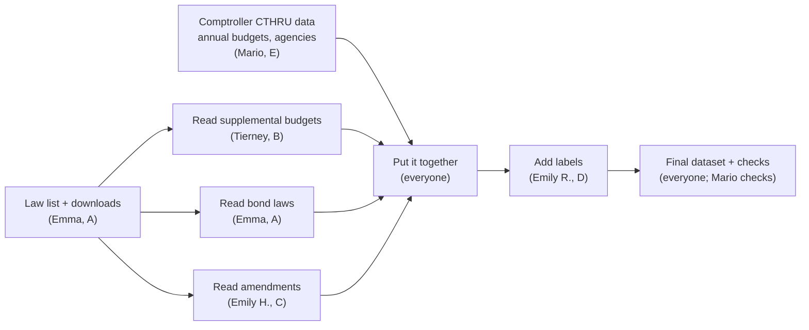

# Project overview (start here)

A plain-language tour of what this project builds, how the program works, who owns which part,
and where things stand. It is deliberately short. For the full detail, see
[`DESIGN.md`](DESIGN.md), which is the source of truth whenever the two disagree.

New to git or Claude Code? Read [`WORKFLOW.md`](WORKFLOW.md) next.

---

## 1. What we're building

We're building a spreadsheet (a CSV file) with **one row for every Massachusetts state
appropriation in a law approved between January 1, 2021 and December 31, 2025**. An appropriation is
money the Legislature legally authorizes the state to spend. Each row says which law did it, which
budget line item, which agency, how many dollars, and which of 18 policy areas it belongs to.
The target format is [`exampledata.csv`](../exampledata.csv).

**One example row, in words (EX-004):** The *FY2023 Supplemental Appropriations Act* (2023 Acts,
ch. 77, signed 12/04/2023) has a Section 178 that changes line item **2330-0100** (Division of
Marine Fisheries) from $9,310,231 to $9,660,231. That is a **Supplemental increase of
$350,000**, and it counts toward **fiscal year 2024** because the item it changes belongs to the
FY2024 budget.

**Just as important: a program that future researchers can re-run every year.** When the 2026
laws are all signed, a future cohort should be able to run one command and work through a short
review checklist to add them. So the program has to be automatic, sturdy, and simple enough for
non-programmers to maintain.

---

## 2. The big picture: two sources, then assembly

The program combines two sources:

- **The Comptroller's CTHRU data**, a clean, official, structured dataset. For every line item in
  every year's annual budget, it gives the final amount (after vetoes), the agency, and history
  back to 2005. **Wherever CTHRU has what we need, we use it.** Structured data is much less
  fragile than reading web pages.
- **The text of the laws** from the Legislature's website. We read it only for what CTHRU doesn't
  have:
  - *which* supplemental budget changed an item, and when;
  - bond (borrowing) laws;
  - sections that amend earlier laws;
  - each item's description.



---

## 3. The moving parts

Each stage is **one Python file** in `src/ma_approps/`. You run them all with
`python -m ma_approps run --stage all`, or one at a time with `--stage cthru` and so on. Stages
that haven't been written yet are skipped with a message.

| # | Stage (file) | Its job, in plain words | Owner |
|---|---|---|---|
| 1 | `laws.py` | Finds each year's spending laws for humans to approve, and downloads their text (slowly and politely, saving a copy) | Emma (A) |
| 2 | `cthru.py` | Downloads the Comptroller's budget data, saves a dated copy, and lists every line item per year with its amount and agency | Mario (E) |
| 3 | `read_items.py` | Reads line items in supplemental budgets, and item descriptions in annual budgets | Tierney (B) |
| 4 | `read_bonds.py` | Reads the items in bond (borrowing) laws, including Chapter 90 road money | Emma (A) |
| 5 | `read_amendments.py` | Reads sections that change earlier items ("strike out $9,310,231, insert $9,660,231") and lump-sum interim budgets | Emily H. (C) |
| 6 | `assemble.py` | Combines everything into one master table, the **ledger**, gives each row its ID, and decides whether it counts toward totals | everyone |
| 7 | `describe.py` | Fills in agency, program purpose, policy area, and "previously funded?" | Emily R. (D) |
| 8 | `export.py` | Applies human corrections and writes the final CSV in exactly the `exampledata.csv` format | everyone |
| — | `validate.py` | Runs the checks: our numbers vs. CTHRU, nothing left unread, IDs unique | Mario (E) |

Two more shared files: `paragraphs.py` turns a law's web-page code into clean paragraphs. Tierney
(B) owns it, and all three law readers use it. `schemas.py` is the single list of every column
name and allowed value, and Mario (E) owns it.

---

## 4. Six ideas you need

**CTHRU first, law text second.** For the annual budgets (about 85% of rows), the amounts come
straight from the Comptroller, already reflecting the governor's vetoes and any overrides. We
compare them with the amounts printed in the law. Where they differ, we record what happened
(vetoed, reduced, overridden) or flag it for a human.
([DESIGN §3.4](DESIGN.md#34-comptroller-cthru-primary-source-for-annual-budgets-check-for-everything-else))

**The ledger: one row per legal action, not one row per item.** Item 2330-0100 can have several
rows: its original amount in the budget, then a supplemental increase. Each action has its own
law, date, and signed dollar amount. The final CSV is a view of this table.
([DESIGN §5](DESIGN.md#5-core-data-model-the-event-ledger))

**Don't count money twice.** Some rows describe money that is already counted somewhere else:
stopgap "interim" budgets (just an advance on the real budget), charges between agencies,
extensions of old money, and transfers. Every ledger row has an `additive` true/false flag, and
totals add up only the `true` rows. Bond money is totaled separately. Federal money is flagged and
left out of the main total for now.
([DESIGN §10](DESIGN.md#10-counting-rules-net-new-appropriation-authority))

**Every row has a permanent ID.** For example, `2023-077-S178-2330-0100-INC-1` means: 2023 ch. 77,
Section 178, item 2330-0100, a supplemental increase, the first one. Running the program again
always produces the same IDs. Never renumber them. ([DESIGN §9.6](DESIGN.md#96-record-id))

**Labels are decided once per line item, then reused every year.** A spreadsheet,
`config/line_item_catalog.csv`, says which policy area each line item number belongs to.
New items get a default from their department (`config/department_policy.csv`), or go to a human
if the department spans several areas. Next year, every known item is labeled automatically. There
is no AI in this step: rules are cheaper, predictable, and need no API key.
([DESIGN §12](DESIGN.md#12-policy-area-classification))

**Automate everything; humans make judgment calls only.** Every routine kind of law is read by
code, not typed in. Human work is limited to things code shouldn't decide: approving which
laws count, labeling genuinely new items, and explaining mismatches with CTHRU. Never edit the
program's generated files by hand. Put labels in the catalog, and one-off fixes in
`review/overrides.csv`. ([DESIGN §14](DESIGN.md#14-human-review-workflow))

---

## 5. Where things live

```
README.md, CLAUDE.md          setup steps; rules Claude follows in this repo
docs/                         OVERVIEW (this), WORKFLOW (git + Claude), DESIGN (full detail)
exampledata.csv               the target format (4 example rows)
policyareas.csv               the 18 allowed policy areas
config/                       files humans edit: the law list, the label spreadsheets, settings
src/ma_approps/               THE PROGRAM: one .py file per stage
tests/                        automatic checks, plus saved copies of sample laws (fixtures)
review/                       one-off human fixes (overrides.csv) and reasoning (research_log.md)
data/raw/                     downloaded laws and CTHRU copies (your computer only, never committed)
data/interim/, data/output/   files the program generates (never edit by hand)
reports/                      check results the program generates (never edit by hand)
```

---

## 6. Tracker

This is the at-a-glance view. Item-by-item detail lives in the
[DESIGN §21 Status Board](DESIGN.md#21-status-board). **When a milestone or workstream changes
state, update this table in the same pull request.** Edit only your own row, so you don't get
merge conflicts.

Status key: ☐ not started · ◐ in progress · ☑ done

### Workstreams

Every workstream has something to start on **now**. Each owner also handles the human review
for their own area.

| WS | Owner | Name: what it covers | Start now with… | Status |
|---|---|---|---|---|
| **A** | **Emma** | **Law list and bond bills:** which laws are in, downloading them, reading bond laws; later the yearly runbook and the 2026 re-run test | Reviewing every row of `config/laws_registry.csv`; saving one bond law and one Chapter 90 bill as samples | ◐ |
| **B** | **Tierney** | **Supplemental budgets:** cleaning law text into paragraphs (used by everyone); reading supplemental items and budget descriptions | `paragraphs.py` on the saved sample laws. Share the paragraph format early, because A and C need it | ☐ |
| **C** | **Emily H.** | **Amendments:** sections that change earlier items, interim budgets, each item's running amount | Writing the expected output rows for the 2023-77, 2021-35 and 2023-15 samples by hand | ◐ |
| **D** | **Emily R.** | **Labels:** agency, purpose, policy area, "previously funded?" | Pulling CTHRU's department list; filling in `department_policy.csv` and seeding the catalog | ☐ |
| **E** | **Mario** | **Annual budgets and checks:** CTHRU data, comparing our numbers with it, the column definitions; leads the **spending-scope discussion** | The CTHRU download and a small saved sample; explaining the 1231-1000 mismatch | ☐ |
| — | **everyone** | **Putting it together:** combining the pieces into the final dataset | Waits on the above (milestone M1) | ☐ |

**Open scope decision (Mario leads, with the group and our State Auditor partner, before M2):**
should the project also cover what the state actually *spent*, not just what laws authorized?
CTHRU has spending data too. See [DESIGN §16](DESIGN.md#16-workstreams-and-ownership) for the
options to discuss.

### Milestones

| Milestone | Done when… | Status |
|---|---|---|
| **M0** Foundations | Column definitions, sample laws and a CTHRU sample are agreed and saved; automatic checks pass | ◐ (skeleton updated to v0.2; sign-off pending) |
| **M1** Vertical slice | The four example rows (EX-001…004) come out of the program correctly from start to finish | ☐ |
| **M2** All annual budgets | Every FY2022–FY2026 budget item has a row and a description; every CTHRU mismatch is explained; spending scope decided | ☐ |
| **M3** Supplementals and interim budgets | All read by code; amendment amounts line up; totals match CTHRU per year | ☐ |
| **M4** Bond bills | All read by code; each law's items add up to its stated borrowing total | ☐ |
| **M5** Labels and release | Every row has a policy area; review cleared; final file published | ☐ |
| **M6** Re-run test | Someone follows the runbook on 2026 laws without changing code, and we list what broke | ☐ |

Open questions waiting on the group or our State Auditor partner are listed in
[DESIGN §19](DESIGN.md#19-open-questions).

---

## 7. Where to go next

- **How to work day to day** (branches, commits, pull requests, working with Claude):
  [`WORKFLOW.md`](WORKFLOW.md)
- **Everyone:** [DESIGN §1–§6](DESIGN.md#1-purpose-scope-non-goals) (goals, sources, data model,
  pipeline)
- **Your workstream's detail:**
  - A: [§4 Seed law registry](DESIGN.md#4-seed-law-registry), [§6 stage notes](DESIGN.md#6-pipeline-architecture), [§11.2 bonds](DESIGN.md#112-item-extraction-state-machine-read_items-read_bonds)
  - B: [§11.1–§11.2 Paragraphs and item reading](DESIGN.md#11-parsing-details-and-known-patterns)
  - C: [§11.3 Amendments](DESIGN.md#113-outside-section-grammar-read_amendments), [§5.5 Amount ledger](DESIGN.md#55-amount-ledger)
  - D: [§8 Column mapping](DESIGN.md#8-mapping-to-the-exampledatacsv-columns), [§12 Labels](DESIGN.md#12-policy-area-classification)
  - E: [§3.4 CTHRU](DESIGN.md#34-comptroller-cthru-primary-source-for-annual-budgets-check-for-everything-else), [§7 File contracts](DESIGN.md#7-file-contracts-schemas), [§13 Validation](DESIGN.md#13-validation-suite), [§16 Spending-scope decision](DESIGN.md#16-workstreams-and-ownership)
