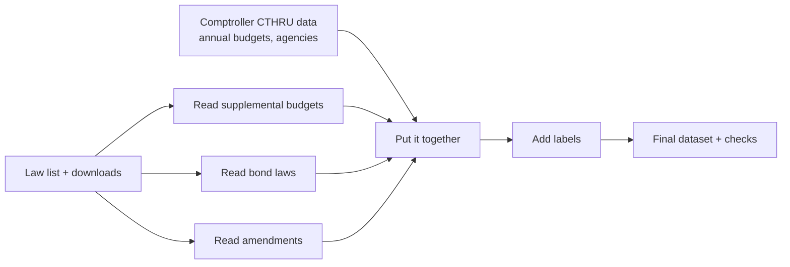

# Project overview (start here)

A plain-language tour of what this project builds, how the program works, and what's left to do
before the final deliverables on 11 December. It is deliberately short. For the full detail, see
[`DESIGN.md`](DESIGN.md), which is the source of truth whenever the two disagree.

New to git or Claude Code? Read [`WORKFLOW.md`](WORKFLOW.md) next.

---

## 1. What we're building

We're building a spreadsheet (a CSV file) with **one row for every Massachusetts state
appropriation in a law approved between January 1, 2021 and December 31, 2025**. An appropriation is
money the Legislature legally authorizes the state to spend. Each row says which law did it, which
budget line item, which agency, how many dollars, and which of 18 policy areas it belongs to.
The target format is [`exampledata.csv`](../exampledata.csv).

**One example row, in words (EX-004):** The *FY2023 Supplemental Appropriations Act* (2023 Acts,
ch. 77, signed 12/04/2023) has a Section 178 that changes line item **2330-0100** (Division of
Marine Fisheries) from $9,310,231 to $9,660,231. That is a **Supplemental increase of
$350,000**, and it counts toward **fiscal year 2024** because the item it changes belongs to the
FY2024 budget.

**Just as important: a program someone else can re-run every year.** Next year an analyst at the
State Auditor's office will add the 2026 laws. They aren't a programmer and won't have Claude
Code: they'll download a copy of this repository and follow the [runbook](RUNBOOK.md). So the
program has to be automatic, sturdy, and need as few steps and commands as possible.

---

## 2. The big picture: two sources, then combining

The program combines two sources:

- **The Comptroller's CTHRU data**, a clean, official, structured dataset. For every line item in
  every year's annual budget, it gives the final amount (after vetoes), the agency, and history
  back to 2005. **Wherever CTHRU has what we need, we use it.** Structured data is much less
  fragile than reading web pages.
- **The text of the laws** from the Legislature's website. We read it only for what CTHRU doesn't
  have:
  - *which* supplemental budget changed an item, and when;
  - bond (borrowing) laws;
  - sections that amend earlier laws;
  - each item's description.



---

## 3. The moving parts

Each stage is **one Python file** in `src/ma_approps/`. You run them all with
`python -m ma_approps run --stage all`, or one at a time with `--stage cthru` and so on.

| # | Stage (file) | Its job, in plain words |
|---|---|---|
| 1 | `laws.py` | Finds each year's spending laws for humans to approve, and downloads their text (slowly and politely, saving a copy) |
| 2 | `cthru.py` | Downloads the Comptroller's budget data, saves a dated copy, and lists every line item per year with its amount and agency |
| 3 | `read_items.py` | Reads line items in supplemental budgets, and item descriptions in annual budgets |
| 4 | `read_bonds.py` | Reads the items in bond (borrowing) laws, including Chapter 90 road money |
| 5 | `read_amendments.py` | Reads sections that change earlier items ("strike out $9,310,231, insert $9,660,231") and lump-sum interim budgets |
| 6 | `combine.py` | Combines everything into one master table, the **funding actions table** (one row per legal action on an item), gives each row its ID, and decides whether it counts toward totals |
| 7 | `label.py` | Fills in agency, program purpose, policy area, and "previously funded?" |
| 8 | `export.py` | Applies human corrections and writes the final CSV in exactly the `exampledata.csv` format |
| — | `validate.py` | Runs the checks: our numbers vs. CTHRU, nothing left unread, IDs unique |
| shared | `paragraphs.py` | Turns a law's web-page code into clean, numbered paragraphs; used by all three law readers (stages 3–5) |
| shared | `schemas.py` | The single list of every column name and allowed value that the stages pass between each other |

---

## 4. Where things live

```
README.md, CLAUDE.md          setup steps; rules Claude follows in this repo
docs/                         OVERVIEW (this), WORKFLOW (git + Claude), DESIGN (full detail),
                              RUNBOOK and CODEBOOK (for the analyst; CODEBOOK still to write)
exampledata.csv               the target format (4 example rows)
policyareas.csv               the 18 allowed policy areas
config/                       files humans edit: the law list, the label spreadsheets, fix files, settings
src/ma_approps/               THE PROGRAM: one .py file per stage
tests/                        automatic checks, plus saved copies of sample laws (samples)
review/                       one-off human fixes (corrections.csv) and reasoning (research_log.md)
data/raw/                     downloaded laws and CTHRU copies (your computer only, never committed)
data/interim/, data/output/   files the program generates (never edit by hand; git ignores them,
                              and the final files go on a GitHub release)
reports/                      check results the program generates (never edit by hand; git ignores
                              them, and the final run's go on the release)
```

---

## 5. Finishing plan

### Deliverables

| Deliverable | For | What it is |
|---|---|---|
| **The dataset** | our partner | The main spreadsheet and the separate bond (capital) spreadsheet, emailed to the partner, and also attached to a GitHub release (a fixed, downloadable version) |
| **The runbook** ([`RUNBOOK.md`](RUNBOOK.md)) | the analyst | Step-by-step instructions for adding a new year of laws, without Claude Code |
| **The codebook** (`CODEBOOK.md`, to write) | the analyst and our partner | Every column, allowed value and counting rule in plain words, plus the known limitations |

### Deadlines

**Until 4 December, checking the data and edge cases come first.** Re-run and documentation work
waits unless it's tiny or helps the checking. After 4 December, the re-run, runbook and codebook
come first.

**Fri 4 Dec: the data is reliable.** The students present simple Excel bar graphs of it that day.
Done when:
- ☐ the random-row review is done and its findings are applied;
- ☐ the review queue is built and its high-priority rows are worked;
- ☐ every open question in [DESIGN §19](DESIGN.md#19-open-questions), plus the 8 borrowing-limit
  differences and issue #36, is fixed or recorded as a known limitation;
- ☐ recurring edge cases found in review are handled in code;
- ☐ the main file is safe to total in Excel, and the copy used for the presentation records which
  run it came from.

**Fri 11 Dec: final.** Done when:
- ☐ the runbook is rewritten for the analyst and followed on the 2026 laws, without Claude Code, by
  someone who didn't write the program;
- ☐ the yearly hand edits are gone;
- ☐ the spreadsheet's ease-of-use fixes are in;
- ☐ the codebook is final;
- ☐ the final files are emailed to the partner and published on a GitHub release.

*Nice to have, not required:* the extended file (the main file plus every column the program keeps
internally), unless the partner asks for it.

### Task list

**Edit only your own row**, so you don't get merge conflicts. **Who's on it** is filled in by
whoever picks a task up, and pushed to `main` straight away (`/start-task` does this), only so
nobody does the same work twice; nobody is assigned areas. When
you finish a task, mark it ☑ and leave a note for the next person.

Status key: ☐ not started · ◐ in progress · ☑ done

#### Check the data

| Task | Why it matters | Due | Who's on it | Status | Notes for the next person |
|---|---|---|---|---|---|
| **Make the main file safe to total in Excel** | The 4 Dec charts add up the dollar column; today that would include money the counting rules leave out | 4 Dec | | ☐ | The main file has no column saying whether a row counts toward totals (`counts_toward_total` is only in `data/interim/funding_actions.csv`), so an Excel total by policy area includes federal grants, interim budgets and other rows the rules leave out. Options: a "Counts toward total?" column in the main file (a format change: DESIGN §7.13, `schemas.py` and a Decision Log entry; simplest for an Excel filter) or a summary sheet the program writes |
| **Random-row review: draw the sample this week** | People catch what no automatic check can: omissions, errors and judgment calls that should change | 4 Dec | Mario | ◐ | **Sample command built (21 Nov):** `python -m ma_approps sample` writes `reports/random_review_sample.csv`: 200 rows (`--size`) of the main file, spread across fiscal years and funding actions, same rows for the same `--seed`. An "Amount source" column says CTHRU or Law text (about 1 in 4 rows are CTHRU; the rest have no second check). Reviewers fill the blank columns on the right (Matches the law?, What is wrong, Reviewer, Date checked); the file isn't read back. **Still to do:** split the rows among reviewers, check them against the laws, and put each finding in `review/corrections.csv`, `config/line_item_catalog.csv` or a new row here. Everyone must use the same copy of the sample (the main file changes when the program re-runs, so share the file, don't redraw). Leave time to apply findings before 4 Dec (Thanksgiving is 26 Nov) |
| **Build the review queue** (`review/review_queue.csv`, DESIGN §7.12) | Lists every row that needs a person, with the reason; the runbook needs it too | 4 Dec | | ☐ | Not built yet: `export` still has it on its to-do list |
| **Federal money: flagged and left out of totals everywhere** (Q1) | The partner decided federal money stays in the data but never counts toward totals; money the program doesn't recognise as federal would inflate every total and chart | 4 Dec | | ☐ | Known gaps: (1) **funds missing from `config/funds.csv`**: as of 11 Nov, 95 `items_raw` rows name 12 funds not in the list (e.g. Education Fund, Highway Fund), and 18 amendment rows do too, among them the federal Coronavirus State Fiscal Recovery Fund (2021-22 §3, $4.9B of ARPA money) and the Inland Fisheries and Game Fund under two names; a fund that isn't listed isn't treated as federal. (2) **Bond items whose federal split the law doesn't state** (2020-383 §34, 2021-15 §6, 2022-176 §48, 2024-139 §4) keep their full amount in the capital total, marked `unknown`. Re-check both on a fresh run; fix, or record as a known limitation |
| **Per-year totals against CTHRU** (Q28) | The yearly totals are what the partner will compare first | 4 Dec | | ◐ | `reports/validation/cthru_mismatches.csv` lists the differences (174 on all laws, 11 Nov): chargeback and fee-revenue items CTHRU doesn't carry, 2026 laws outside the window, and a few unknowns. Three FY2024 increases are explained in `review/research_log.md`. The rest: fix, or record as a known limitation |
| **Annual budgets: 3 CTHRU mismatches and items read as vetoed** (Q29) | An item wrongly read as vetoed shows $0 | 4 Dec | | ☐ | Mismatches: 2022-126 items 2300-0100 and 7008-1116, 2024-140 item 7061-0033. Items read as vetoed to $0: 11, 10, 9, 19 and 12 for FY2022–FY2026; check them against the actual vetoes (FY2025's text doesn't mark vetoes) |
| **The other open data questions:** override figures (Q30), fee-revenue ceilings (Q31), 9C cuts (Q32), the FY2022 §2B year (Q34) | Each one changes some rows' amounts, fiscal year or flags | 4 Dec | | ☐ | Each has a proposed fix in DESIGN §19 |
| **8 borrowing limits that differ from their items** | The bond file's totals depend on them | 4 Dec | | ☐ | `reports/validation/bond_totals.csv`; 39 of 47 limits match. The rule (Q11): the items' total counts and the difference is flagged, so each needs an explanation, not necessarily a fix |
| **FY2025 lists only 12 chargeback accounts** ([issue #36](https://github.com/EmmaWisniewski/capstone-fall26/issues/36)) | Chargeback amounts for FY2025 may be incomplete | 4 Dec | | ☐ | See the issue |
| **Run with a fresh CTHRU download** | Some checks wait on newer CTHRU data | 4 Dec | | ☐ | 2025-9 (the FY2026 budget) shows "not checked" only because the 5 Nov snapshot has no FY2026. The fund rule for 2021-102 §2A also waits on real CTHRU data |
| **Capital file gaps** | Blank cells need either a fix or an explanation in the codebook | 4 Dec | | ☐ | As of 11 Nov (when the capital file had 189 rows; it has 214 now), 6 rows had no printed agency heading and 12 rows under 3 borrowing limits named no paying fund (2024-139 §4–§6: the law names none, see `review/research_log.md`). Re-check on a fresh run |
| **Which checks in DESIGN §13 are built?** | A check that's described but not built gives false confidence | 4 Dec | | ☐ | Known not built: catalog drift (check 11), corrections whose Record ID matches no row (check 9). Two completeness tests from the old milestones also need a home: at least 99% of annual-budget items have a description, and `config/manual_rows.csv` is empty or each row is justified (check 10). List the rest, then build what matters or record it as a known limitation |
| **Vetoed wording** | Decides whether struck wording is worth showing | 4 Dec | | ☐ | Tierney was to ask George about uses for vetoed wording (`read_items`' `wording_vetoed`, DESIGN §11.4). Still open? |

#### Edge cases

| Task | Why it matters | Due | Who's on it | Status | Notes for the next person |
|---|---|---|---|---|---|
| **Recurring problems found in review → handled in code** | A pattern that will come back every year must not need a person every year | 4 Dec | | ☐ | Add a row here for each pattern the random-row review or the open questions turn up. A one-time misprint goes in an existing fix file instead (CLAUDE.md, "Automate what recurs"). Known quirks so far: the runbook's appendix and `review/research_log.md` |

#### An easy spreadsheet

| Task | Why it matters | Due | Who's on it | Status | Notes for the next person |
|---|---|---|---|---|---|
| **Write down what's awkward while making the 4 Dec charts** | The fixes should come from real use, not guesses | 4 Dec | | ☐ | Anyone making the charts: add a line here for each thing that was hard to do in Excel |
| **Fix what's on that list** | The partner and the analyst will work in Excel | 11 Dec | | ☐ | Ideas to weigh: plain words where the file still shows codes; amounts and dates Excel reads as numbers and dates; consistent "Unknown" and "Not classified"; an Excel copy with a frozen header, filters and a short "Read me" tab pointing to the codebook. Any column or value change goes through DESIGN §7.13/§9, `schemas.py` and the Decision Log, within the partner's `exampledata.csv` columns |

#### Re-run and documentation

| Task | Why it matters | Due | Who's on it | Status | Notes for the next person |
|---|---|---|---|---|---|
| **Fewer steps from download to finished file** | The analyst isn't a programmer: every step is an ask | 11 Dec | | ☐ | Includes installation (creating the `.venv`, `pip install`, the macOS hidden-`.venv` fix in the README) |
| **Remove yearly hand edits** | Each one is a chance for the re-run to go wrong | 11 Dec | | ☐ | In `config/settings.toml`: the `[scope]` dates, `discover_years`, and `contact_email` (still Emma's address) |
| **Readable messages and reports** | The analyst has to understand what the program tells them | 11 Dec | | ☐ | The program's messages, `validate`'s output and the report CSVs |
| **Rewrite the runbook for the analyst** | It's a final deliverable, and today it assumes Claude Code | 11 Dec | | ◐ | First draft exists. Remove the **Say:** lines; write step 5 (`cthru`) and step 6's `combine` and `export` parts; explain every flag and review item, and how to edit each fix file (Excel changes `false` and dates when it saves, so the labels part says to use a plain-text editor) |
| **Write the codebook** (`docs/CODEBOOK.md`) | It's a final deliverable: what every column and value means | 11 Dec | | ☐ | Every column of the main and capital files, allowed values, counting rules, flags and known limitations. Starting points: DESIGN §8–§10, `review/research_log.md`, and the plain-language partner page in git history (`docs/plain-language/partner-decisions.md`, deleted 2026-11-18). Written by hand (decided 2026-11-18), plus a test that fails if any column of the main or capital file isn't named in it. Once it's written, trim DESIGN §8–§10's export text so each rule is written once |
| **Re-run test on the 2026 laws** | The only proof someone else can re-run it | 11 Dec | | ☐ | Someone who didn't write the program follows the runbook in the terminal, without Claude Code or code changes, e.g. on 2026-55, 2026-101 and the FY2027 budget; list what broke |
| **The extended file** (DESIGN §7.13) | Nice to have, unless the partner asks for it | 11 Dec | | ☐ | The main file plus every funding-actions column |
| **Publish the final files** | How the partner receives the dataset | 11 Dec | | ☐ | Email the spreadsheet to the partner; attach the main and capital files, plus that run's `reports/law_status.csv` and `reports/validation/` files, to a GitHub release whose notes name the commit they were built from (never commit them; git ignores them anyway). The old snapshot branch `d/dataset-snapshot-2026-11-12` can then be deleted |

Open questions are listed in [DESIGN §19](DESIGN.md#19-open-questions), and decisions in the
[Decision Log](DESIGN.md#20-decision-log).

**Scope decided:** the project covers appropriations (what laws authorized), not what the
state actually *spent*. Our partner set this at the proposal stage
(see the [Decision Log](DESIGN.md#20-decision-log), 2026-11-01).

---

## 6. Where to go next

- **How to work day to day** (branches, commits, pull requests, working with Claude):
  [`WORKFLOW.md`](WORKFLOW.md)
- **What to work on:** the task list above, or type `/start-task` in Claude Code
- **The detail, by topic, in [`DESIGN.md`](DESIGN.md):**
  [§1](DESIGN.md#1-purpose-scope-non-goals) goals and scope ·
  [§3](DESIGN.md#3-sources) sources ·
  [§5](DESIGN.md#5-core-data-model-the-funding-actions-table) the funding actions table ·
  [§6](DESIGN.md#6-pipeline-architecture) the stages ·
  [§7](DESIGN.md#7-file-formats) file formats ·
  [§10](DESIGN.md#10-counting-rules-net-new-appropriation-authority) counting rules ·
  [§11](DESIGN.md#11-parsing-details-and-known-patterns) how laws are read ·
  [§12](DESIGN.md#12-policy-area-classification) policy areas ·
  [§13](DESIGN.md#13-validation-suite) the checks
