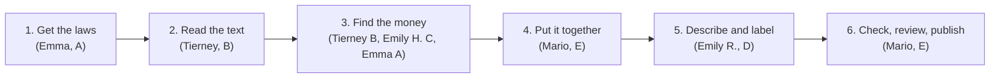

# Project overview (start here)

A plain-language tour of what this project builds, how the program works, who owns which part,
and where things stand. It is deliberately short. For the full detail, see
[`DESIGN.md`](DESIGN.md), which is the source of truth whenever the two disagree.

New to git or Claude Code? Read [`WORKFLOW.md`](WORKFLOW.md) next.

---

## 1. What we're building

We're building a spreadsheet (a CSV file) with **one row for every Massachusetts state
appropriation in a law approved between January 1, 2021 and December 31, 2025**. An appropriation is
money the Legislature legally authorizes the state to spend. Each row says which law did it, which
budget line item, which agency, how many dollars, and which of 18 policy areas it belongs to.
The target format is [`exampledata.csv`](../exampledata.csv).

**One example row, in words (EX-004):** The *FY2023 Supplemental Appropriations Act* (2023 Acts,
ch. 77, signed 12/04/2023) has a Section 178 that changes line item **2330-0100** (Division of
Marine Fisheries) from $9,310,231 to $9,660,231. That is a **Supplemental increase of
$350,000**, and it counts toward **fiscal year 2024** because the item it changes belongs to the
FY2024 budget.

Hand-copying thousands of these rows from the law text would be slow and error-prone. So we're
writing a program that reads the laws and builds the rows, and checks its own work against the
Comptroller's official numbers.

---

## 2. The big picture: an assembly line

The program is a sequence of **stages**. Each stage reads files, does one job, and writes new
files for the next stage. No stage reaches inside another, so five people can work at once,
each on their own stage, using sample laws saved in the repo.



1. **Get the laws.** Find every law that spends money, and download its full text from the
   Legislature's website. Also download the Comptroller's official budget numbers (CTHRU).
2. **Read the text.** Turn each law's web-page code (HTML) into a clean, numbered list of paragraphs.
3. **Find the money.** Spot every line item and dollar amount in the budget sections. Spot every
   later section that *changes* an earlier item ("strike out $9,310,231, insert $9,660,231"). Spot
   every veto and override.
4. **Put it together.** Combine all of that into one master table, the **ledger**, with
   one row per legal action.
5. **Describe and label.** Add the agency name, a short purpose summary, and a policy area.
6. **Check, review, publish.** Compare the totals with the Comptroller's numbers, list anything
   suspicious for a human to look at, apply human corrections, and write the final CSV.

---

## 3. The moving parts

Each stage is **one Python file** in `src/ma_approps/`. You run them all with
`python -m ma_approps run --stage all`, or one at a time with `--stage fetch` and so on. Stages
that haven't been written yet are skipped with a message.

| # | Stage (file) | Its job, in plain words | Reads → writes | Owner |
|---|---|---|---|---|
| 1 | `discover.py` | Scans every law from 2020–2026 for appropriation language and adds candidates to the law list for humans to approve | Legislature website → `config/laws_registry.csv` | Emma (A) |
| 2 | `fetch.py` | Downloads each approved law (slowly and politely) and saves a copy so we never download it twice | law list → `data/raw/` | Emma (A) |
| 3 | `normalize.py` | Cleans the web-page code into numbered paragraphs, keeping strike-throughs and bold, which carry veto meaning | `data/raw/` → `paragraphs/*.jsonl` | Tierney (B) |
| 4 | `extract_items.py` | Finds each line item: its number, agency heading, text, and final dollar amount | paragraphs → `items_raw.csv` | Tierney (B) |
| 5 | `extract_actions.py` | Finds the "outside sections" that amend earlier items (raise, cut, extend, transfer) | paragraphs → `actions_raw.csv` | Emily H. (C) |
| 6 | `vetoes.py` | Works out vetoes and overrides, because the law text alone isn't reliable for these | bill history + CTHRU → `veto_events.csv` | Emma (A) |
| 7 | `assemble.py` | Joins everything into the ledger, gives each row its ID, decides whether it counts toward totals, and tracks each item's running amount | all of the above → `ledger.csv` | Mario (E); running-amount logic by Emily H. (C) |
| 8 | `enrich.py` | Fills in agency/office, program purpose, "previously funded?" and similar columns | ledger → `enrichment.csv` | Emily R. (D) |
| 9 | `classify/` | Picks one of the 18 policy areas: first by agency, then by rules, then by asking Claude for the hard cases | ledger → `classifications.csv` | Emily R. (D) |
| 10 | `validate.py` | Runs the checks: totals vs. CTHRU, nothing left unparsed, IDs unique | everything → `reports/` | Mario (E) |
| 11 | `review.py` | Applies the corrections humans have written down | `review/overrides.csv` → `reviewed.csv` | Mario (E) |
| 12 | `export.py` | Writes the final CSV in exactly the `exampledata.csv` format | reviewed → `data/output/` | Mario (E) |

Two more files hold shared pieces. `schemas.py` is the single list of every column name and
allowed value, and Mario (E) owns it. `cthru.py` loads the Comptroller data, and Emma (A) owns it.

---

## 4. Five ideas you need

**The ledger: one row per legal action, not one row per item.** Item 2330-0100 can have
several rows: its original amount in the budget, a veto, an override, a supplemental increase. Each
action has its own law, date, and signed dollar amount. The final CSV is a view of this table.
([DESIGN §5](DESIGN.md#5-core-data-model-the-event-ledger))

**Don't count money twice.** Some rows describe money that is already counted somewhere
else. Examples are stopgap "interim" budgets, which by law are just an advance on the real
budget, charges between agencies, extensions of old money, and transfers. Every ledger row has an
`additive` true/false flag, and totals add up only the `true` rows. Bond (borrowing) money is
totaled separately. Federal money stays in the data but is flagged and left out of the main total
for now. ([DESIGN §10](DESIGN.md#10-counting-rules-net-new-appropriation-authority))

**Every row has a permanent ID.** For example, `2023-077-S178-2330-0100-INC-1` means: 2023 ch. 77,
Section 178, item 2330-0100, a supplemental increase, the first one. Running the program again
always produces the same IDs, which is what lets human corrections stick to the right row. Never
renumber them. ([DESIGN §9.6](DESIGN.md#96-record-id))

**CTHRU is our answer key.** The Comptroller publishes official enacted amounts per item per
fiscal year. If our numbers don't match, either we have a bug or the law text is misleading. That
happens with vetoes, which the text often fails to show. Every mismatch must be explained or
flagged. ([DESIGN §13](DESIGN.md#13-validation-suite))

**Humans correct the data in one place only.** Generated files get overwritten every time the
program runs, so editing them by hand is pointless and confusing. To fix a policy area or anything
else, add a row to `review/overrides.csv` with the Record ID, and write longer reasoning in
`review/research_log.md`. The program reapplies your corrections on every run.
([DESIGN §14](DESIGN.md#14-human-review-workflow))

---

## 5. Where things live

```
README.md, CLAUDE.md          setup steps; rules Claude follows in this repo
docs/                         OVERVIEW (this), WORKFLOW (git + Claude), DESIGN (full detail)
exampledata.csv               the target format (4 example rows)
policyareas.csv               the 18 allowed policy areas
config/                       files humans edit: the law list, hand-typed rows, fund list, settings
src/ma_approps/               THE PROGRAM: one .py file per stage
tests/                        automatic checks, plus saved copies of 6 sample laws (fixtures)
review/                       human corrections (overrides.csv) and reasoning (research_log.md)
data/raw/                     downloaded laws (on your computer only, never committed)
data/interim/, data/output/   files the program generates (never edit by hand)
reports/                      check results the program generates (never edit by hand)
```

---

## 6. Tracker

This is the at-a-glance view. Item-by-item detail lives in the
[DESIGN §21 Status Board](DESIGN.md#21-status-board). **When a milestone or workstream changes
state, update this table in the same pull request.** Edit only your own row, so you don't get
merge conflicts.

Status key: ☐ not started · ◐ in progress · ☑ done

### Workstreams

| WS | Owner | What it covers | Size | Status | Next step |
|---|---|---|---|---|---|
| **A**: Registry and data access | **Emma** | Finding and downloading laws, CTHRU loader, vetoes and overrides, hand-typed rows (interim budgets, Chapter 90) | Medium | ◐ | Review every row of `config/laws_registry.csv`; decide 2020-316 and 2021-9 (Q7); build `fetch` |
| **B**: Normalizer and item extractor | **Tierney** | Cleaning the law text; finding every line item and amount | Large | ◐ | Build `normalize` on the fixtures so C can start; then `extract_items` |
| **C**: Amendments and running amounts | **Emily H.** | Outside sections that change earlier items; each item's running amount; the struck-figure check | Large | ◐ | Write expected rows for 2023-77 and 2021-35; start `extract_actions` |
| **D**: Enrichment and classification | **Emily R.** | Agency names, purpose summaries, policy areas (crosswalk, rules, Claude), agreement study | Medium–Large | ☐ | Draft the agency → policy-area crosswalk from the CTHRU department list |
| **E**: Contracts, assembly, QA, export | **Mario** | Column definitions, the ledger, checks, human-review step, final CSV, automatic tests | Medium | ◐ | Get group sign-off on the column definitions (M0); start `assemble` |

### Milestones

| Milestone | Done when… | Status |
|---|---|---|
| **M0** Foundations | Skeleton, column definitions and sample laws are agreed by the group; automatic checks pass | ◐ (skeleton merged; sign-off pending) |
| **M1** Vertical slice | The four example rows (EX-001…004) come out of the program correctly from start to finish | ☐ |
| **M2** All annual budgets | The five FY2022–FY2026 budgets match CTHRU for at least 99% of items and dollars | ☐ |
| **M3** Supplementals, interim budgets, vetoes | Every amendment's "struck figure" matches our running amount; supplemental totals match CTHRU | ☐ |
| **M4** Bond bills | Each bond law's items add up to its stated borrowing total | ☐ |
| **M5** Classification, review, release | Every row has a policy area; high-priority review items are cleared; final file published | ☐ |

Open questions waiting on the group or our State Auditor partner are listed in
[DESIGN §19](DESIGN.md#19-open-questions).

---

## 7. Where to go next

- **How to work day to day** (branches, commits, pull requests, working with Claude):
  [`WORKFLOW.md`](WORKFLOW.md)
- **Everyone:** [DESIGN §1–§6](DESIGN.md#1-purpose-scope-non-goals) (scope, sources, data model,
  pipeline)
- **Your workstream's detail:**
  - A: [§3 Sources](DESIGN.md#3-sources), [§4 Seed law registry](DESIGN.md#4-seed-law-registry)
  - B: [§11.1–§11.2 Normalization and item extraction](DESIGN.md#11-parsing-details-and-known-patterns)
  - C: [§11.3 Outside sections](DESIGN.md#113-outside-section-grammar-stage-5), [§5.5 Amount ledger](DESIGN.md#55-amount-ledger)
  - D: [§8 Column mapping](DESIGN.md#8-mapping-to-the-exampledatacsv-columns), [§12 Classification](DESIGN.md#12-policy-area-classification)
  - E: [§7 File contracts](DESIGN.md#7-file-contracts-schemas), [§9 Vocabularies](DESIGN.md#9-controlled-vocabularies), [§13 Validation](DESIGN.md#13-validation-suite)
